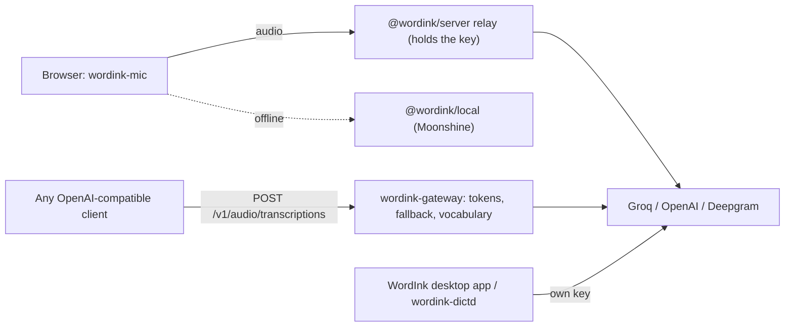

<p align="center">
  <picture>
    <source media="(prefers-color-scheme: dark)" srcset="assets/brand/lockup-dark.svg">
    
  </picture>
</p>

# WordInk

**Open-source dictation: hold a hotkey, speak, get finished text in the app you are using.**

WordInk is one desktop app plus the pieces developers need to put dictation in their own products. It is MIT licensed, has no WordInk servers and sends no telemetry.

[](LICENSE)

## What you can use

| Product | For | State |
|---|---|---|
| **WordInk desktop app** (`apps/desktop`) | Anyone who wants system-wide dictation on Linux, Windows, and macOS on Apple silicon | 1.0. Install with one command below. Built on [Hex](https://github.com/kitlangton/Hex) (MIT). Groq, OpenRouter or a local model (Parakeet v3). See [ROADMAP.md](ROADMAP.md). |
| **`wordink-dictd`** (`sdks/python`) | The interim dictation daemon for Linux, Windows and macOS | Works today (Groq Whisper, then clean-up, then typed into the focused window). Kept until the desktop app reaches parity on each OS. See [examples](examples/). |
| **Web SDK** (`packages/*`) | Developers adding a `<wordink-mic>` button to a web app | Merged and documented. Not published to npm yet. |
| **Gateway** (`packages/server`) | Anyone who wants an OpenAI-compatible transcription endpoint with provider fallback and per-device tokens | Merged and documented. Not published to npm yet. |
| **iOS app** (`apps/ios`, `sdks/ios`) | Hold-to-talk on iPhone through a gateway | In progress; built from source. |

The web SDK, the gateway and the iOS app are separate products from the desktop app. They share the transcription protocol and a clean-up contract, not code.

**Docs and live demo: <https://duketopceo.github.io/WordInk/>**

## Install the desktop app

WordInk runs on Linux (x86_64 or aarch64), macOS 15+ on Apple silicon, and 64-bit Windows.

**Linux**

```sh
curl -fsSL https://github.com/duketopceo/WordInk/releases/latest/download/install.sh | sh
```

Needs glibc 2.39 or newer (Ubuntu 24.04, Debian 13, Fedora 40, Arch and newer) and OpenSSL 3. The installer checks the release's ed25519 signature, starts WordInk as a user service, and keeps it updated from signed releases.

**macOS**

```sh
curl -fsSL https://github.com/duketopceo/WordInk/releases/latest/download/install-macos.sh | sh
```

Installs `WordInk.app` into `~/Applications` and starts it at login. WordInk for macOS is not notarized yet: macOS asks you to allow microphone and accessibility access, and updates are shown in the app as a download link.

**Windows (PowerShell)**

```powershell
irm https://github.com/duketopceo/WordInk/releases/latest/download/install.ps1 | iex
```

Installs per user (no admin) and starts at login. WordInk for Windows is not code-signed yet, so SmartScreen may warn the first time you open it from Explorer (More info › Run anyway).

**Uninstall**

- Linux: `curl -fsSL https://github.com/duketopceo/WordInk/releases/latest/download/install.sh | sh -s -- uninstall` (add `--purge` to delete settings, history and models)
- macOS: `curl -fsSL https://github.com/duketopceo/WordInk/releases/latest/download/install-macos.sh | sh -s -- uninstall`
- Windows: `& ([scriptblock]::Create((irm https://github.com/duketopceo/WordInk/releases/latest/download/install.ps1))) -Uninstall`

**Release candidates** install the same way with `WORDINK_INSTALL_BASE=https://github.com/duketopceo/WordInk/releases/download/desktop-v1.0.0-rc.N` set before the command.

## Web SDK quickstart

The packages are not on npm yet, so the CDN URL below becomes valid after the first release. Plain HTML, no build step:

```html
<textarea id="message"></textarea>
<wordink-mic for="message" endpoint="/api/wordink"></wordink-mic>

<script
  type="module"
  src="https://cdn.jsdelivr.net/npm/@wordink/web@VERSION/dist/wordink-web.cdn.js"
  integrity="sha384-…"
  crossorigin="anonymous"
></script>
```

The [HTML quickstart](https://duketopceo.github.io/WordInk/quickstart-html.html) has the pinned version and its integrity hash. `endpoint` is your [`@wordink/server`](packages/server) relay, which holds the provider key.

React:

```tsx
import { WordInkMic } from "@wordink/react";

<textarea id="message" />
<WordInkMic htmlFor="message" endpoint="/api/wordink" />
```

- **Drop-in:** one element or one React hook, inserted at the cursor with native undo.
- **Bring your own key:** Groq (default), OpenAI or Deepgram through your own small relay (`@wordink/server`), so long-lived keys never reach the browser. Or use a local model (`@wordink/local`) that works offline.
- **No WordInk servers, no telemetry.** MIT licensed.

| Package | |
|---|---|
| [`@wordink/web`](packages/web) | The `<wordink-mic>` element (ES module and single-file CDN build) |
| [`@wordink/react`](packages/react) | `useDictation` and `<WordInkMic>` |
| [`@wordink/core`](packages/core) | The engine: Rust core as WebAssembly plus a TypeScript browser host |
| [`@wordink/local`](packages/local) | Offline speech recognition in the browser (Moonshine) |
| [`@wordink/server`](packages/server) | Fail-closed credential relay for Cloudflare Workers and Node |

## How it works



This diagram covers the web SDK and the gateway. The desktop app and `wordink-dictd` call providers directly with the user's own key. The Rust core (`crates/wordink-core`) does no I/O: it takes events and emits effects, and a host (the TypeScript browser host today) performs the I/O. The core compiles to WebAssembly at about 35 KB gzip (budget 150 KB). The gateway is a second, separate trust boundary: browsers authenticate to the relay with cookies and an Origin check, devices authenticate to the gateway with revocable bearer tokens.


The docs demo in its idle state (static capture; a recording of dictation is still to do). The live demo is at the docs link above.

## Repository layout

| Path | What |
|---|---|
| `apps/desktop` | The WordInk desktop app, based on Hex (arrives in a pull request; not on `master` yet) |
| `sdks/python` | `wordink-dictd` (the interim desktop daemon for Linux, Windows and macOS), the `wordink` CLI and the `wordink-mcp` server |
| `crates/wordink-core`, `crates/wordink-wasm` | Rust sans-I/O dictation core and its WebAssembly bindings (used by the web SDK) |
| `packages/*` | Web SDK and gateway: `@wordink/core`, `web`, `react`, `local`, `server` |
| `apps/ios`, `sdks/ios` | The iOS app and its Swift SDK |
| `apps/docs` | The docs site and live demo (GitHub Pages) |
| `examples/*` | Install scripts for `wordink-dictd` (Linux, Windows, macOS), a gateway systemd service, and web examples |
| `docs/` | Decisions, research, solutions, and `docs/archive/` (superseded plans) |
| `assets/brand/` | Logo, wordmark and glyph proposals |
| `tests/fixtures/` | Cross-platform contract fixtures shared by the TypeScript, Python and Swift tests |

## Develop

```bash
cargo test --workspace                       # Rust core
pnpm install && pnpm typecheck && pnpm test  # TypeScript packages
cd sdks/python && uv run pytest              # wordink-dictd and the Python SDK
pnpm --filter @wordink/docs dev               # docs site on localhost (offers a dev-key field)
```

## Releases and docs

Changesets drives releases: add one with `pnpm changeset`, and `.github/workflows/release.yml` opens a version PR, then publishes to npm on merge through npm trusted publishing (OIDC, with provenance; no npm token is stored). The one-time npm setup is described at the top of that workflow. `.github/workflows/docs.yml` deploys `apps/docs` to GitHub Pages; it needs Settings > Pages > Source set to "GitHub Actions" once.

## Python, dictd and agents

`sdks/python` provides `wordink-dictd` (the interim desktop daemon), a `wordink` CLI (`transcribe`, `dictate`) and a `wordink-mcp` MCP server (`transcribe`, `list_models`) over the gateway. See [sdks/python/README.md](sdks/python/README.md).

## Contributing

Work on a branch, one PR per roadmap unit; `master` requires a PR and one review and is squash-only. Add a changeset (`pnpm changeset`) for any change to a published package. Read [AGENTS.md](AGENTS.md) for the architecture invariants (no I/O in the core, keys never in the browser, no telemetry).

## License

MIT, see [LICENSE](LICENSE). The copyright line for Parth Jain stays because the project's early history includes code from his MIT-licensed [groq_flow](https://github.com/ParthJain18/groq_flow); the original app has since been removed from the tree.
