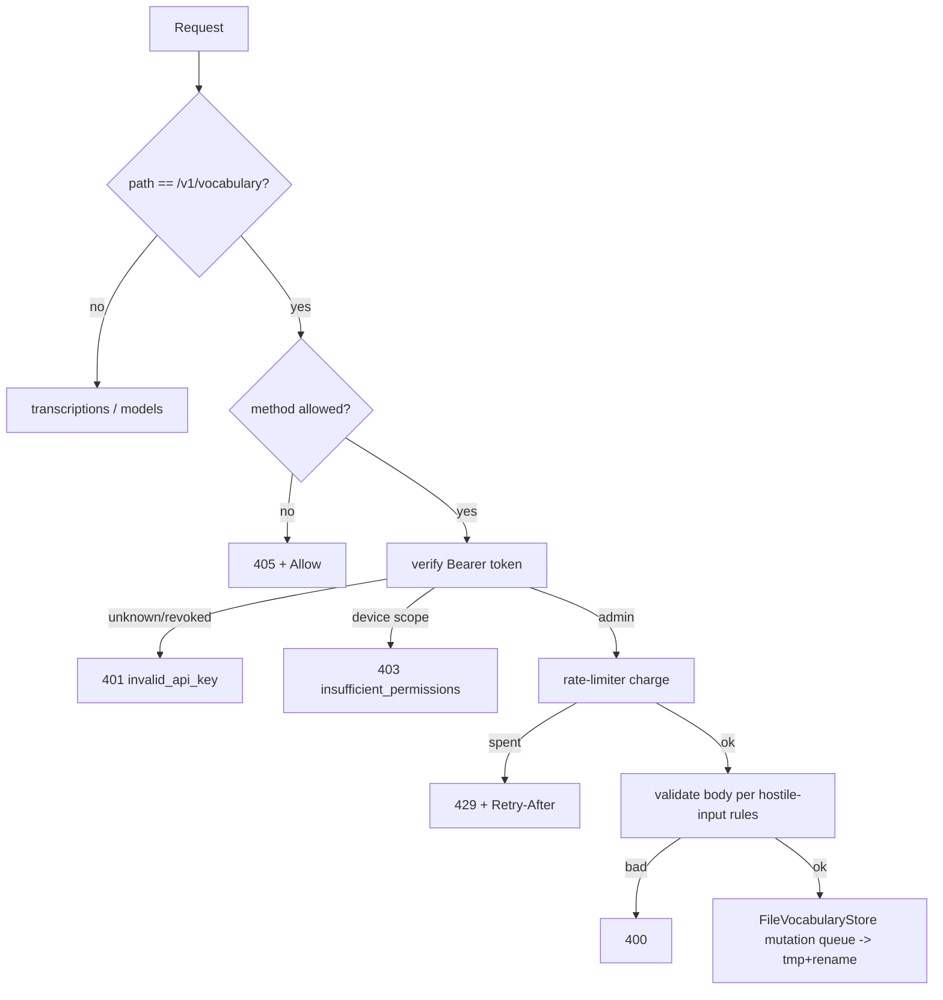
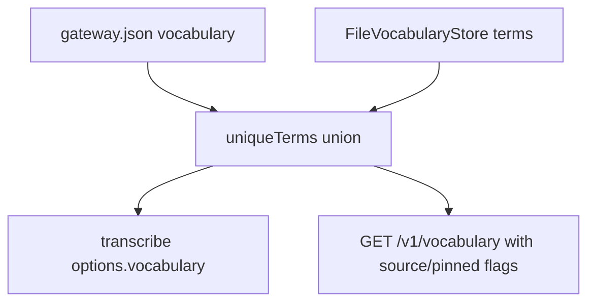

# feat: Runtime vocabulary API + agent correction loop

## Summary

Give the gateway's shared vocabulary a runtime mutation surface — `GET/POST/DELETE /v1/vocabulary` behind admin-scoped device tokens, persisted to a state-dir file — then expose it through `wordink vocab` and `wordink-mcp` so an agent can run the correction loop: dictate → transcript mishears "kurultai" → `vocab_add` → re-dictate → fixed, with no restart and no `gateway.json` edits.

## Problem Frame

The gateway merges an operator vocabulary into every transcription (KTD6), but it is a static `vocabulary` array in `gateway.json` — deduped once at router construction (`gateway/router.ts`) and changeable only by hand-editing config and restarting the service. That makes vocabulary correction the exact wrong shape for its best consumer: agents, who discover the miss (misheard repo names like `kurultai`, `wisp`) inside a transcript and should fix it in seconds. Origin: `docs/brainstorms/2026-10-10---desktop-surfaces-requirements.md` (rung 2 agent surface; F1, A2, AE1, AE3).

This plan covers the vocabulary loop only. The Omarchy bar plugin (rung 1 — different repo, QML) and the human control surface (rung 2 remainder, Phase 6) are separate plans.

---

## Requirements

**Auth and scoping**

- R1. `TokenRecord`/`TokenInfo` carry `scope: "device" | "admin"`; records lacking the field resolve to `"device"` (fail closed). Admin is a superset — an admin token transcribes and lists models.
- R2. `wordink-gateway tokens create --admin <label>` mints admin tokens; `tokens list` shows scope. Flag parsing is real — `--admin` never lands inside the label (today `tokens create --admin laptop` would mint a token literally labeled `"--admin laptop"`).
- R3. All three vocabulary endpoints require a live admin token: absent/unknown/revoked → 401 `invalid_api_key`; valid device-scope → 403 `insufficient_permissions`. The admin check precedes the rate-limiter charge so rejected calls never burn transcription budget; accepted calls (GET included, matching the models precedent) share the caller's per-token bucket.

**API surface**

- R4. `GET /v1/vocabulary` returns the effective list in the OpenAI list shape: `{object:"list", data:[{term, source:"config"|"runtime", pinned, runtimeOverride?, effective:{prompt,keyterm}, addedBy?, addedByTokenId?, addedAt?}]}` plus `prompt_chars` and `keyterm_count` capacity fields.
- R5. `POST /v1/vocabulary` accepts `{"terms": ["…", …]}` — required, ≥1 item and ≤200 items per request (`too_many_terms` → 400), all trimmed non-empty strings without control characters, each ≤200 chars. All matching — dupes, config-pinned checks, runtime case-variant checks — is case-folded like `uniqueTerms`. Outcomes per term: `added`; `already_present` (exact dupe); `updated` (case-variant of a stored runtime term — respells it); `pinned` (matches a config term — no runtime record stored); `config_shadowed` (case-variant of a config term — stores a runtime spelling override that wins the union's casing while presence stays config-owned). Optional `"remove": ["term",…]` performs deletions in the same call (proxy-safe fallback for KTD13). Optional `"dryRun": true` reports resolution plus post-change capacity without persisting. Atomic: a request that would exceed the runtime cap fails wholly — nothing partially persists.
- R6. `DELETE /v1/vocabulary` accepts `{"term": "…"}` — case-folded match against runtime records; missing → 404 `term_not_found`; config-pinned with no runtime record → 409 `term_pinned` (edit `gateway.json`); a runtime spelling-override on a config term is removable — deleting it reverts to the config spelling (200); success echoes the stored spelling removed.
- R7. Runtime records cap at 200 — beyond it POST → 409 `vocabulary_full` (whole request fails, nothing written). Every vocabulary response carries capacity metadata: `prompt_chars` = the packed head `mergePrompt` actually emits against the 800-char budget (first-fit-break order, not a raw length sum), `keyterm_count` vs the 50-keyterm Deepgram slice, and per-term `effective` keyed by merge mechanism (`{prompt: bool, keyterm: bool}`) — a term past one budget but inside the other reports that split, so stored-but-inert is never silent.
- R8. Mutations take effect on the next transcription request. The handler resolves the effective vocabulary once per `transcribe()` call and passes it through `TranscribeOptions.vocabulary` — every provider attempt in a fallback chain sees the same term set. All vocab bodies route through `readCapped` with `VOCAB_MAX_BODY_BYTES = 64 * 1024` → 413 in the OpenAI shape.

**Persistence**

- R9. Runtime terms persist in `$XDG_STATE_HOME/wordink/vocabulary.json` (sibling of the token file): `{version:1, terms:[{term, addedBy, addedByTokenId, addedAt, removedBy?, removedByTokenId?, removedAt?}]}` — delete tombstones keep attribution on the destructive half, and `addedByTokenId` (the token's unique id, not just its free-text label) makes provenance unambiguous across agents. Atomic tmp+rename, mode 0600, mtime-keyed read cache so other processes' writes show up on the next call, and an in-process mutation queue so HTTP writers serialize (the token store's "writers are CLI invocations" assumption does not hold for agents in loops). Union order: config terms first (config order), then runtime in insertion order — the `mergePrompt` "operator terms first" precedent.
- R10. Store failure is tri-state: `GET` and mutations answer 500 `server_error` (fail closed); the transcription accessor degrades to config-only plus warn-once — a corrupt `vocabulary.json` must never take dictation down; `check` reports file health.
- R11. `wordink-gateway check` and `serve` startup warn when no live **admin-scope** token exists specifically — a device-only install would otherwise 403 opaquely on every vocab call.

**Agent surfaces**

- R12. `wordink vocab list|add|remove` in `sdks/python`. Vocab calls resolve `--token` > `WORDINK_ADMIN_TOKEN` > `WORDINK_DEVICE_TOKEN` (a device token earns a clean 403, not a mystery); dictation resolves `--token` > `WORDINK_DEVICE_TOKEN` > `WORDINK_ADMIN_TOKEN` (admin works as the superset credential but stays off daily driver paths); the `wordink-mcp` env gate accepts either variable being set.
- R13. `wordink-mcp` gains `vocab_list`, `vocab_add`, `vocab_remove` returning JSON strings — a deliberate break from the bare-`str` precedent of `transcribe`, because agents act on fields.
- R14. MCP tool descriptions steer agents: `transcribe(file, prompt="…")` for one-off corrections (local, reversible — the prompt parameter already exists), `vocab_add` for recurring terms (global, shared across devices); `pinned`/`config_shadowed` outcomes mean "respell okay, delete needs the operator in `gateway.json`". All descriptions and the docs page state plainly: never add secrets, passwords, or other sensitive dictated content as terms — terms are sent verbatim to providers on every call.

**Docs and ops**

- R15. `apps/docs/pages/desktop.md` gains the vocabulary section + error-code table; `CONCEPTS.md` gains "admin token" and "runtime vocabulary"; changesets for `@wordink/server`.

---

## Key Technical Decisions

- **KTD10 — Live vocabulary via per-request resolution, not router rebuild.** The handler resolves `config ∪ store` per request and passes it through `transcribe()` options. `createRouter`'s closure (cooldowns) is untouched; the router stays pure. The alternative — rebuilding the router on mutation — drops provider cooldown state and adds a race surface.
- **KTD11 — `scope` on token records; admin ⊃ device.** One token type with a scope field, not a second credential kind. Version-1 file records without `scope` resolve to `"device"` — fail closed, matching the store's existing posture. Alternatives rejected: loopback-only vocab routes (dies the day the gateway binds remote or rides an SSH tunnel — the VM integration already does) and a separate `WORDINK_ADMIN_TOKEN` env secret (second credential system, no per-agent revocation).
- **KTD12 — `vocabulary.json` in `$XDG_STATE_HOME`, records not strings.** `{term, addedBy, addedByTokenId, addedAt, removedBy?…}` — label plus the token's unique id, since labels are free text and non-unique; tombstones attribute deletes. `gateway.json` stays operator-owned and read-only at runtime; config terms are `source:"config", pinned:true`.
- **KTD13 — DELETE takes a JSON body on the collection path.** `DELETE /v1/vocabulary {"term":…}` — the dispatch stays exact-match, and the percent-encoding/parameterized-route bug class (`%2F`, terms containing `/`, empty segments, `/v1/vocabularyevil` prefix collisions) never exists. Priced tradeoff: RFC 9110 gives DELETE bodies no defined semantics and a stripping proxy could turn `vocab_remove` into a bare 400 — so `POST` also accepts `"remove": […]` as a proxy-safe fallback (R5), and the docs table names the symptom.
- **KTD14 — Capacity metadata in every response, defined truthfully.** `prompt_chars` is the packed head `mergePrompt` actually emits (first-fit-break over the union in order — config terms first, runtime by insertion), `keyterm_count` the first-50 slice `keyterms` produces, and per-term `effective` is keyed by merge mechanism: `{prompt, keyterm}` — a term inside the 800-char prompt but past the keyterm cap reports `{prompt:true, keyterm:false}`. Stored-but-inert is the correction loop's worst failure mode (200 OK that does nothing); the response must always be agent-truthful.
- **KTD15 — Case-variant adds update spelling; config ownership splits presence from spelling.** Runtime-vs-runtime case-variant → respell, outcome `updated`. Runtime-vs-config case-variant → `config_shadowed`: a runtime record stores the corrected spelling and wins the union's casing, while the term's *presence* stays config-pinned (undeletable). Without this split the correction loop provably fails on every config-seeded term — all 53 of today's terms. Chosen over "refuse + escalate" because the record is additive and reversible (delete the runtime record → config spelling returns).

---

## High-Level Technical Design

Request path (mutations; the read path shares auth, skips the queue):

Effective vocabulary, resolved once per `transcribe()` call:

Union semantics (matching is always case-folded; union emits config terms first, then runtime terms by insertion order):

| Term state | `source` | `pinned` | Effective spelling | DELETE result |
|---|---|---|---|---|
| In `gateway.json` only | `config` | `true` | config spelling | 409 `term_pinned` |
| In `vocabulary.json` only | `runtime` | `false` | runtime spelling | 200, removed + tombstone |
| In both, same case (dup) | `config` | `true` | config spelling | 409 `term_pinned` — config owns presence |
| Config term + runtime case-variant (respell) | `config` | `true`, `runtimeOverride:true` | **runtime spelling** | 200, override removed → config spelling returns |

---

## Scope Boundaries

- The Omarchy bar plugin (origin rung 1) is out — different repo (`omarchy-plugins` monorepo), QML stack, its own plan.
- The human control surface (rung 2 remainder) is Phase 6 — this plan ships the API it will sit on.
- No `GET /v1/status` or usage/quota endpoints — the bar's liveness probe is `GET /v1/models`.
- No `wordink-gateway vocab` offline CLI subcommand — the file is hand-editable; the API is the product surface.
- No audit log file — `addedBy`/`addedAt` on records is the v1 audit surface.
- No per-device or per-context vocabulary scoping — v1 is operator-global (origin open question, deferred).

### Deferred to Follow-Up Work

- `GET /v1/tokens` admin-read for the Phase 6 control surface (token metadata, never values).
- Token `mint`/`revoke` and provider config mutation stay human-gated forever — never agent surfaces (mint plaintext flows through agent context; provider keys resolve from env at serve time so runtime mutation cannot work).
- Agent-writable health/cooldown read (`coolUntil` introspection) for Phase 6.

---

## Implementation Units

### U1. Token scopes

**Goal:** `wdk_` tokens gain a `scope` field; the CLI can mint, list, and verify admin tokens.

**Requirements:** R1, R2.

**Dependencies:** none.

**Files:**
- `packages/server/src/gateway/tokens.ts` — `TokenInfo`/`TokenRecord` gain `scope?: "device" | "admin"`; export the scope type.
- `packages/server/src/gateway/file-tokens.ts` — `create(label, scope?)`; `verify` returns scope (missing field → `"device"`); `list` surfaces scope.
- `packages/server/src/bin/wordink-gateway.ts` — `tokens create [--admin] <label>` with real flag parsing; `tokens list` prints scope; USAGE text.
- `packages/server/test/gateway/tokens.test.ts` (or adjacent file-tokens test file) — scope coverage.

**Approach:** Treat absent `scope` on stored records as `"device"` — version-1 files need no migration. Keep `verify` constant-time: scope is read after the token match, not during the loop.

**Patterns to follow:** `file-tokens.ts` `mutate()` for writes; the `openaiError` shape is not involved here (CLI-only surface).

**Test scenarios:**
- `tokens create laptop` → record has `scope:"device"`; `tokens create --admin agent` → `scope:"admin"`.
- `tokens create --admin` alone → usage error, no token minted; `tokens create --admin my laptop` → label `"my laptop"`, scope admin (flag consumed, not folded into label).
- `verify` on a legacy record lacking `scope` → `TokenInfo.scope === "device"`.
- `tokens list` prints scope for admin and device rows.

**Verification:** `pnpm test` for the server package covers new cases; `wordink-gateway tokens create --admin x` + `tokens list` show it end-to-end.

### U2. Vocabulary store

**Goal:** A `VocabularyStore` interface (Workers-safe) plus `FileVocabularyStore` (Node-only) holding runtime terms with provenance.

**Requirements:** R9, R10 (store half), R7 (caps constants).

**Dependencies:** none (parallel with U1).

**Files:**
- `packages/server/src/gateway/vocabulary-store.ts` — interface `list()`, `add(terms, addedBy)`, `remove(term)` + record type `{term, addedBy, addedAt}` + `MAX_TERM_CHARS = 200`, `MAX_TERMS = 200` + term-validation helpers (trim, control-char/empty rejection) shared by the route layer.
- `packages/server/src/gateway/file-vocabulary.ts` — Node impl; default path `$XDG_STATE_HOME/wordink/vocabulary.json`.
- `packages/server/test/gateway/vocabulary-store.test.ts` — new.

**Approach:** Mirror `FileTokenStore`: atomic tmp+rename at 0600, `(ino:mtime:size)`-keyed cache, unreadable file distinguishes "missing" (empty) from "corrupt" (fail closed for mutations). Add a per-store promise queue around `mutate()` — HTTP writers (agents in loops) break the token store's "rare CLI writers" assumption; the stat-recheck retry stays as the cross-process guard. `remove` matches case-folded and returns the stored spelling or null.

**Patterns to follow:** `file-tokens.ts` wholesale — same file contract, same warn-once latches. `docs/solutions/best-practices/operator-config-is-hostile-input.md` for validate-shape-not-truthiness.

**Test scenarios:**
- Add → persists to file; a second store instance on the same path sees it next `list()` (cache invalidation via stat key).
- Corrupt file: `list()` reports unreadable (distinct from empty); `add` throws rather than overwriting.
- Concurrent `add`/`remove` calls serialize — N parallel mutations all land, none throw "changed while writing".
- `remove("kurultai")` removes stored `"Kurultai"` and echoes it; removing an absent term → null.
- Term validation: whitespace-only, control-char, >200-char, non-string inputs rejected.
- Cap: 201st runtime term rejected.

**Verification:** unit tests green; file contents inspectable on disk.

### U3. Gateway routes + live vocabulary wiring

**Goal:** The three endpoints live in the gateway handler; transcriptions resolve vocabulary per request.

**Requirements:** R3, R4, R5, R6, R7, R8, R10, R11.

**Dependencies:** U1 (scope), U2 (store).

**Files:**
- `packages/server/src/index.ts` — dispatch allowlist gains `/v1/vocabulary` (exact match — KTD13 keeps it parameter-free).
- `packages/server/src/gateway/index.ts` — route the vocab path before the "else = transcriptions" fall-through; admin gate; endpoint logic; per-request vocabulary resolution into `router.transcribe`.
- `packages/server/src/gateway/router.ts` — `GatewayRouter.transcribe` currently signs `Omit<TranscribeOptions,"vocabulary">` and `attempt` force-injects the construction-time set (router.ts:31, :84): widen the signature to accept per-call `vocabulary` (per-call wins when present) and keep the static construction-time dedup as the fallback for direct `createRouter` callers.
- `packages/server/src/node.ts` — re-export `FileVocabularyStore` + `defaultVocabularyPath` beside `FileTokenStore`/`defaultTokenPath` so embedders' `vocabularyStore` opt-in is reachable via `@wordink/server/node`.
- `packages/server/src/bin/wordink-gateway.ts` — construct `FileVocabularyStore`, pass to gateway config; `check`/`serve` admin-token warning + vocab-file health line.
- `packages/server/test/gateway/vocabulary-api.test.ts` — new.

**Approach:** Order inside the handler: method-allowed check → verify → scope check → limiter → body validation → store op → response. The transcription path catches store-read failures and falls back to config terms with a warn-once log — the accessor is the only consumer that degrades. `GatewayConfig` gains an optional `vocabularyStore`; absent → vocab routes 404 (embedders opt in; `wordink-gateway serve` always wires it).

**Patterns to follow:** `authorizeDevice` gate shape; `modelsList` list-shape precedent; `openaiError` codes (`insufficient_permissions`, `term_not_found`, `term_pinned`, `vocabulary_full` are new codes inside existing `type` values).

**Test scenarios:**
- Covers AE1: POST `{"terms":["kurultai"]}` as admin → next transcribe call's provider request carries the term in the merged prompt (spy adapter); no restart.
- Unauthed/device-token on all three → 401/403 respectively; 403 does not consume rate budget (device token still transcribes after N denied vocab calls).
- GET shape: `source`/`pinned`/`effective` correct for config-only, runtime-only, both; a term past the keyterm slice but inside the prompt budget reports `{prompt:true, keyterm:false}`.
- Case-variant runtime: stored `"kurultai"`, POST `{"terms":["Kurultai"]}` → `outcome:"updated"`, stored spelling now `"Kurultai"`.
- Case-variant vs config: config holds `"Kurultai"`, POST `{"terms":["kurultai"]}` → `outcome:"pinned"`, nothing stored; POST `{"terms":["KURULTAI"]}` → `config_shadowed` stores the override and the union emits the runtime spelling; DELETE removes the override and the config spelling returns.
- DELETE `{"term":"Kurultai"}` → removed + echoed; DELETE config-only term → 409 `term_pinned`; DELETE absent → 404 `term_not_found`. POST `{"remove":["X"]}` deletes without DELETE (proxy-safe path).
- Malformed bodies: array body, `{"terms":[]}`, non-string item, >200-char term, control chars, >200-item terms array → 400. Body over `VOCAB_MAX_BODY_BYTES` → 413. `dryRun:true` → reported + post-change capacity, file untouched.
- Cap: POST pushing past 200 runtime records → 409 `vocabulary_full`, nothing persisted (atomic).
- Store-unreadable: GET → 500; transcribe still succeeds using config terms only.
- Method checks: PUT/PATCH → 405 + `Allow`.
- Dispatch: `GET /v1/vocabularyevil` → not routed (404 or transcriptions-405 as existing behavior dictates); models path unaffected.

**Verification:** handler-level tests green; live check — mint admin token, `curl POST /v1/vocabulary`, `wordink transcribe` picks up the term.

### U4. Python vocab surfaces

**Goal:** `wordink vocab` and `wordink-mcp` tools expose the API to scripts and agents.

**Requirements:** R12, R13, R14.

**Dependencies:** U3 (endpoint contract).

**Files:**
- `sdks/python/src/wordink/client.py` — `vocab_list() / vocab_add(terms, dry_run=) / vocab_remove(term)` returning parsed JSON; admin-token resolution; fix stale `token new` docstring.
- `sdks/python/src/wordink/cli.py` — `vocab list|add|remove` group.
- `sdks/python/src/wordink/mcp_server.py` — three tools, explicit `name=` (the `_tool` naming lesson), JSON string returns, tool descriptions encoding the prompt-first/vocab-for-recurring policy (R14).
- `sdks/python/README.md` — vocab commands + `WORDINK_ADMIN_TOKEN`; fix the stale `token new` reference.
- `sdks/python/tests/` — vocab client + CLI tests.

**Approach:** Per R12's two chains — vocab calls resolve `--token` > `WORDINK_ADMIN_TOKEN` > `WORDINK_DEVICE_TOKEN`; dictation resolves `--token` > `WORDINK_DEVICE_TOKEN` > `WORDINK_ADMIN_TOKEN`, and the `wordink-mcp` startup gate accepts either variable being set so an admin-token-only host still starts. Errors: pass through the gateway's error JSON (agents read `code`).

**Test scenarios:**
- `vocab add kurultai` happy path prints the API response fields; `--dry-run` flag maps to `dryRun`.
- Device-token vocab call → surfaces 403 `insufficient_permissions` with the gateway's message, nonzero exit.
- `WORDINK_ADMIN_TOKEN` beats `WORDINK_DEVICE_TOKEN` for vocab; `transcribe` prefers device but falls back to admin when only it is set; `wordink-mcp` boots with only `WORDINK_ADMIN_TOKEN`.
- MCP `vocab_add` returns parseable JSON containing `term` and `outcome`; `vocab_remove` echoes removed spelling.

**Verification:** `uv run pytest` green; live handshake against the running gateway (admin token in omaseal as `wordink/admin`).

### U5. Docs, concepts, changesets

**Goal:** The operator and the docs reader can discover and understand the surface.

**Requirements:** R11 (docs half), R15.

**Dependencies:** U3 (final endpoint/error vocabulary).

**Files:**
- `apps/docs/pages/desktop.md` — vocabulary section: what it is, the correction loop, endpoint + error-code table, `tokens create --admin` bootstrap.
- `CONCEPTS.md` — "admin token" + "runtime vocabulary" entries in the existing glossary shape.
- `packages/server/README.md` — vocab endpoints + vocabulary.json in the file-layout story.
- `examples/gateway-systemd/` — if it documents config, note runtime vocab lives elsewhere.
- `.changeset/` — `@wordink/server` minor; `wordink` (sdks/python has no changeset flow — note PyPI-deferred as before).

**Approach:** The docs table is the contract mirror — every `code` value the API emits gets a row.

**Test scenarios:** `Test expectation: none — docs/`metadata; verify by docs build (`pnpm build` in `apps/docs`) and link check.

**Verification:** docs build green; `wordink-gateway check` output shown in docs matches reality.

---

## Open Questions

- **GET visibility for device tokens** — settled as admin-only now; additive widening later if a device-side need appears. Flagged because vocabulary is operator PII (names, codenames) once tokens leave the loopback box — revisit before any Phase 7 multi-tenant work.
- **`transcribe` response echoing `vocabulary_count`** (int only, no terms) — cheap observability for agents; include in U3 only if it stays provider-agnostic under R7 (it does — counts never identify the serving provider). Implementer call.
- **Whether MCP structured tool results exist in the installed `mcp` SDK version** — check at implementation; if supported, prefer structured errors over JSON-in-strings for vocab tools.

---

## Risks & Dependencies

| Risk | Mitigation |
|---|---|
| Agent vocab-writes pollute every device's transcriptions (shared blast radius) | `addedBy`+`addedByTokenId` provenance with delete tombstones; hard term/length/count caps; `dryRun`; MCP descriptions steer one-off corrections to `transcribe(prompt=…)` |
| Agent bulk-seeding starves its own bucket — vocab calls share the caller's 60/min transcription limiter | Documented behavior (shared per-token bucket); agents should use multi-term POSTs |
| `vocabulary.json` is the first runtime-written file — new failure class | `FileTokenStore` contract copied wholesale + in-process mutation queue; transcription path degrades to config-only |
| Hand-edit of `vocabulary.json` racing an HTTP mutation | Stat-recheck throws "changed while writing" after one retry → 500; agents must tolerate a retry |
| `--admin` flag landing in labels today (latent CLI bug) | Fixed in U1 as part of flag parsing |
| Vocab terms are operator PII readable by any admin token holder | Admin-only surface; `vocabulary.json` mode 0600 |
| Stale `token new` references in `sdks/python` docs | Fixed in U4 while touching the files |

---

## Sources

- Origin: `docs/brainstorms/2026-10-10---desktop-surfaces-requirements.md` — F1 loop, A2, R2.x, AE1/AE3.
- `packages/server/src/gateway/{index,router,vocabulary,tokens,file-tokens}.ts` — dispatch order, static-vocab point, merge budgets, store precedent.
- `packages/server/src/{index.ts,node.ts,bin/wordink-gateway.ts}` — allowlist dispatch, config load, CLI surface.
- `docs/solutions/best-practices/operator-config-is-hostile-input.md` — runtime-write rules applied to `vocabulary.json`.
- `docs/solutions/best-practices/read-the-target-apps-openai-compatible-engine-first.md` — contract pinning precedent.
- Live config: `~/.config/wordink/gateway.json` (53-term vocabulary today); token store `~/.local/state/wordink/gateway-tokens.json`.
