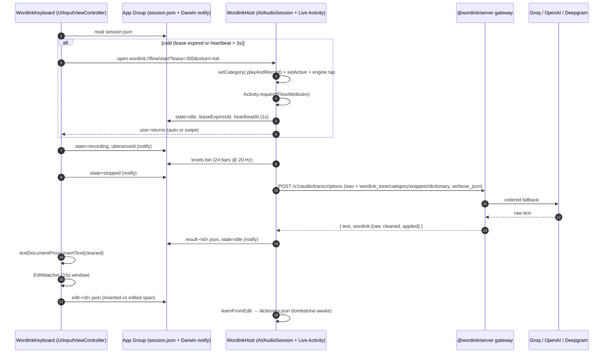

# Wispr Flow + Wispr Flow for iOS Teardown and WordInk iOS Keyboard - Plan

## Goal Capsule

- **Objective:** Rebuild the parts of Wispr Flow that matter on iPhone (AI cleanup with backtracking, per-app tone, a dictionary that learns from your corrections, snippets, whisper mode, and a voice keyboard that works in any text field) on top of WordInk's existing open-source gateway. Do it without copying Wispr's code or binaries.
- **Means:** (a) Extend `packages/server/src/gateway/flow.ts` so it handles every Auto-edit behavior Wispr documents, with tone, snippets and dictionary set per request. (b) Add a thin Swift package `sdks/ios/WordInkIOS` plus an iOS host app and a `UIInputViewController` keyboard extension that use the documented iOS "Flow Session" pattern: the keyboard opens the host app, the host app starts a background `AVAudioSession` and a Live Activity, and later dictations stay inside the keyboard (D1-D8, W1-W7).
- **Product authority:** Luke (duketopceo). This plan owns the Flow-parity gateway features and the iOS client. Android, desktop overlays and a WordInk-branded macOS app are not in scope.
- **Authority order:** Counterarguments + Product Contract, then Key Technical Decisions (D1-D8), then the Approach text in each unit.
- **Stop conditions:**
  - Stop if a unit needs a Wispr Flow binary, IPA, private API, or unpublished endpoint. This plan only uses public docs and permissively or GPL-licensed open source as references.
  - Stop if any part of the design needs the keyboard extension to capture audio itself. Apple does not allow it (see C1).
  - Stop if a change would alter current `/v1/audio/transcriptions` responses for clients that send no new Flow fields (Voxtype and TypeWhisper must stay byte-identical).
  - Do not copy GPLv3 TypeWhisper iOS code into MIT WordInk. Re-implement the *pattern* only.
- **Execution profile:** W1 and W2 run first, server side, and parallel to each other. W3 comes next. W4 and W5 run in parallel after W3. W6 and W7 come last.
- **Coordination note:** A separate subagent is changing `packages/server/src/gateway/flow.ts`, `gateway/index.ts` and `test/gateway/flow.test.ts`. The diff is uncommitted (`git status`: `M gateway/index.ts`, `?? gateway/flow.ts`, `?? test/gateway/flow.test.ts`). W1 and W2 below are written as **deltas against that in-tree baseline**. They do not restart it.

---

## 1. Provenance and Boundaries

Each claim carries one provenance label and one confidence level.

| Label | Meaning |
| --- | --- |
| **documentation-based** | Wispr Flow's own help center (`docs.wisprflow.ai`), marketing site (`wisprflow.ai`), App Store listing, or Apple developer documentation. |
| **source-assisted** | Read from public open-source repositories: `Baranets/typewhisper-ios` (GPLv3 mirror of TypeWhisper iOS) and `argmaxinc/WhisperKit` (MIT). |
| **in-tree** | Read from `/home/user/workspace/re/WordInk` (MIT), read-only. |
| **third-party** | Press coverage (TechCrunch, 9to5Mac, MacStories, KeyboardKit docs). Corroborating only. |

Confidence: **high** = stated directly by a first-party source or seen in code. **moderate** = inferred from several consistent sources, or community-measured. **low** = plausible inference that has not been verified.

**Explicit non-actions:**
- **No commercial Wispr Flow IPA, macOS `.app`, Windows binary, or Android APK was downloaded, decrypted, decompiled, or disassembled.** No network traffic from Wispr Flow was intercepted. Every Wispr claim below comes from Wispr's public documentation and press, not from the binary.
- No Reddit sources were used.
- No code from GPLv3 TypeWhisper iOS goes into WordInk. Only architecture patterns, which are not copyrightable, are carried over, and they are described in prose.
- No files under `/home/user/workspace/re/WordInk` were changed by this plan's author.

---

## 2. Strongest Counterarguments First

**C1. Apple's keyboard sandbox means no third-party keyboard can match native dictation's zero-jump cold start.** *(documentation-based, high)*
Apple's App Extension Programming Guide says: "Custom keyboards, like all app extensions in iOS 8.0, have no access to the device microphone, so dictation input is not possible" ([Apple App Extension Programming Guide](https://developer.apple.com/library/archive/documentation/General/Conceptual/ExtensibilityPG/CustomKeyboard.html)). Apple's current Full Access page still lists "No access to microphone and speaker" ([Apple: Configuring open access](https://developer.apple.com/documentation/uikit/configuring-open-access-for-a-custom-keyboard)). Wispr's own setup guide shows the cost. The user taps **Start**, the main app opens, and the user then taps **OK** to return automatically or swipes right across the bottom edge ([Wispr: Set up the Flow keyboard](https://docs.wisprflow.ai/articles/7453988911-set-up-the-flow-keyboard-on-iphone)). Keyboards also "can't show iOS permission dialogs, so the prompt has to come from the main app" (same source). Product Hunt reviewers call the popup "a bit annoying" while accepting that it is an iOS limitation ([Product Hunt](https://www.producthunt.com/products/wisprflow)).
**Implication:** WordInk cannot beat Wispr on cold start. The best possible result is *parity*: one app jump per session lease, then warm in-place dictation. Success is measured by how often a warm session is already running (W3 lease), not by removing the jump.

**C2. The background audio lease is fragile, and iOS can kill it.** *(documentation-based, high)*
Wispr documents that the orange mic indicator stays on while the session is warm. Auto-stop runs only when the app is in the background, the session is idle and the keyboard is inactive. On a low-memory warning, Flow cancels dictation and discards the audio ([Wispr: orange dot](https://docs.wisprflow.ai/articles/3634682593-why-the-orange-dot-or-mic-indicator-stays-on-after-dictating-ios)). iOS 26.4 changed the return-to-app flow and the host-app context ([Wispr: Adapting to iOS 26.4](https://docs.wisprflow.ai/articles/6269634092-adapting-to-ios-26-4)). Any design must treat "session dead" as a normal state and recover with a single cold-start handoff. A watchdog with heartbeat staleness is required (D4).

**C3. Porting the Rust `wordink-core` (or a WASM build of it) into the keyboard extension is the wrong approach.** *(documentation-based + in-tree, moderate)*
- Apple says only that a keyboard process "has a limit on the amount of memory it may use" and that "the memory limits vary from model to model" ([Apple: Creating a custom keyboard](https://developer.apple.com/documentation/uikit/creating-a-custom-keyboard)). Developers measure the cap at roughly 48 MB ([SpeakUp iOS](https://getspeakup.app/ios/), [React Native docs (CN)](https://reactnative.cn/docs/app-extensions)) and up to about 60-70 MB ([KeyboardKit](https://docs.keyboardkit.com/documentation/keyboardkit/developer-memory-management/)). The figure is undocumented and varies by device, so the confidence here is **moderate**.
- The keyboard **cannot capture audio** (C1), so `wordink-core`'s main job inside the keyboard (VAD, resample, PCM16; `session.rs`, `audio.rs`) would have no input. Audio lives in the host app.
- `wordink-core` is sans-I/O and built for the browser and WASM (`crates/wordink-core/src/lib.rs`). Shipping a WASM runtime (JavaScriptCore or wasm3) in the keyboard adds memory and startup cost for no gain. A native `staticlib` with a Swift bridge would work in the *host app*, but the VAD it provides (`SPEECH_RMS_THRESHOLD = 0.01`, `MIN_SPEECH_MS = 300`) is about 40 lines of Swift on top of `AVAudioEngine`.
- Flow cleanup already runs in TypeScript in the gateway (`gateway/flow.ts`). Running it again on the device would fork the logic.
**Implication:** D1 picks a thin Swift keyboard plus the existing gateway. The Rust core stays the browser and WASM engine. A Swift port of the VAD constants comes with a parity test against `session.rs` fixtures (W3).

**C4. Wispr's "AI" edits are LLM-driven, and deterministic regex will lag behind.** *(documentation-based, moderate)*
Wispr's Medium cleanup "rewords phrases for clarity" ([Wispr: Auto Cleanup control](https://docs.wisprflow.ai/articles/4283510616-auto-cleanup-control-how-much-flow-edits-your-dictation-beta)). That is a model, not rules. WordInk's `flow.ts` is deterministic, which is safer, testable and runs on Workers. It will miss phrasing that Wispr's model catches. D3 keeps deterministic `light` as the default and makes `medium` an opt-in LLM pass through `buildFlowCleanupPrompt`.

**C5. On iOS 26.4+ the per-app tone signal is unreliable.** *(documentation-based, high)*
Wispr adapted to iOS 26.4 limits on host-app context and added a keyboard-level style switcher plus an account-wide default ([Wispr: Adapting to iOS 26.4](https://docs.wisprflow.ai/articles/6269634092-adapting-to-ios-26-4)). Any bundle-ID-based mapper must fall back to `UITextDocumentProxy` traits (`keyboardType`, `textContentType`, `returnKeyType`) and to a manual chip (D6).

**C6. Full Access is a trust tax.** *(documentation-based, high)*
Apple warns that with Full Access users "know their keystrokes are available to the keyboard developer". It also tells developers not to store "keystroke or voice data beyond the time needed to provide text back to the user" ([Apple: Configuring open access](https://developer.apple.com/documentation/uikit/configuring-open-access-for-a-custom-keyboard)). WordInk needs Full Access for the App Group and the network, so D7 makes the gateway self-hostable and adds no logging of transcripts by default.

---

## 3. Research Findings

### 3.1 Wispr Flow for iOS: keyboard and session mechanics

| # | Finding | Provenance | Confidence |
| --- | --- | --- | --- |
| F1 | iOS app launched June 3, 2025, as an app that "doubles as a keyboard". It learns names automatically, supports whispering, and claims to work on poor networks ([TechCrunch](https://techcrunch.com/2025/06/03/wispr-flow-releases-ios-app-in-a-bid-to-make-dictation-feel-effortless/)). | third-party | high |
| F2 | Setup: open the app once (the keyboard appears in Settings only after first launch). Then Settings → General → Keyboard → Keyboards → Add → Wispr Flow → **Allow Full Access** ([Wispr setup](https://docs.wisprflow.ai/articles/7453988911-set-up-the-flow-keyboard-on-iphone), [App Store](https://apps.apple.com/us/app/wispr-flow-ai-voice-keyboard/id6497229487)). | documentation-based | high |
| F3 | Mic permission must be requested by the main app. Keyboards cannot show permission dialogs ([Wispr setup](https://docs.wisprflow.ai/articles/7453988911-set-up-the-flow-keyboard-on-iphone)). | documentation-based | high |
| F4 | "Flow Sessions" are windows of mic access. Tapping **Start Flow** opens the app, starts the session, and "hops you back". After that the keyboard mic records in place ([9to5Mac](https://9to5mac.com/2025/06/30/wispr-flow-is-an-ai-that-transcribes-what-you-say-right-from-the-iphone-keyboard/)). | third-party + documentation-based | high |
| F5 | Background persistence uses a Live Activity in the Dynamic Island and on the Lock Screen ([MacStories](https://www.macstories.net/stories/macstories-selects-2025-recognizing-the-best-apps-of-the-year/)). | third-party | high |
| F6 | Lease settings ("Disable Flow after"): Immediately / 5 min (default) / 15 min / 1 hour / Never. The countdown runs only when the app is backgrounded, the session is idle and the keyboard is inactive. One dictation is capped at 5 min. On a low-memory warning Flow cancels and discards the audio ([Wispr orange dot](https://docs.wisprflow.ai/articles/3634682593-why-the-orange-dot-or-mic-indicator-stays-on-after-dictating-ios)). | documentation-based | high |
| F7 | Other triggers: Action Button, Back Tap, a Control Center "Toggle Flow" control, Siri Shortcuts (App Intents) ([Wispr shortcuts](https://docs.wisprflow.ai/articles/1986921789-how-to-set-up-flow-shortcuts-for-iphone)). | documentation-based | high |
| F8 | iOS 26.4: automatic return to the source app can be blocked, so the user swipes back. Host-app context is reduced, and a style switcher was added to the keyboard ([Wispr iOS 26.4](https://docs.wisprflow.ai/articles/6269634092-adapting-to-ios-26-4)). | documentation-based | high |
| F9 | The keyboard hands off to the system keyboard in number, phone, decimal, email-address and numbers-and-punctuation fields. Secure (password) fields always use the system keyboard. Custom text engines (for example some banking apps) do not support third-party keyboards ([Wispr setup](https://docs.wisprflow.ai/articles/7453988911-set-up-the-flow-keyboard-on-iphone), [Product Scout](https://product.ferryman.app/en/articles/2026-08-27-wispr-flow-voice-keyboard/)). | documentation-based + third-party | high (secure fields) / moderate (exact keyboard-type list) |
| F10 | The URL scheme name, App Group ID, and IPC encoding of Wispr's iOS app are **unknown**. The binary was not inspected. | — | n/a (unknown by design) |

### 3.2 Apple platform constraints

| # | Finding | Provenance | Confidence |
| --- | --- | --- | --- |
| A1 | Keyboards have no microphone access ([Apple App Extension Guide](https://developer.apple.com/library/archive/documentation/General/Conceptual/ExtensibilityPG/CustomKeyboard.html), [Apple open access](https://developer.apple.com/documentation/uikit/configuring-open-access-for-a-custom-keyboard)). | documentation-based | high |
| A2 | `RequestsOpenAccess = true` is required for network access and for writing to a shared group container. Check it at runtime with `hasFullAccess` ([Apple: Creating a custom keyboard](https://developer.apple.com/documentation/uikit/creating-a-custom-keyboard), [Apple: UIInputViewController](https://developer.apple.com/documentation/uikit/uiinputviewcontroller)). | documentation-based | high |
| A3 | The keyboard process has a memory limit that varies by device. Dismissing the keyboard does not necessarily end the process ([Apple: Creating a custom keyboard](https://developer.apple.com/documentation/uikit/creating-a-custom-keyboard)). Community measurements put it at about 48 MB ([SpeakUp](https://getspeakup.app/ios/)) or 60-70 MB ([KeyboardKit](https://docs.keyboardkit.com/documentation/keyboardkit/developer-memory-management/)). | documentation-based + third-party | high (limit exists) / moderate (number) |
| A4 | The keyboard reaches the text field only through `textDocumentProxy`: selected text, insert or delete, cursor moves, surrounding context ([Apple: Creating a custom keyboard](https://developer.apple.com/documentation/uikit/creating-a-custom-keyboard)). | documentation-based | high |
| A5 | Background mic capture needs `UIBackgroundModes: audio` and an active `AVAudioSession` started from the foreground ([Apple: AVAudioSession](https://developer.apple.com/documentation/avfaudio/avaudiosession)). | documentation-based | high |

### 3.3 Wispr Flow core mechanics (all platforms)

| # | Mechanic | Documented behavior | Provenance | Confidence |
| --- | --- | --- | --- | --- |
| M1 | **Auto Cleanup levels** | `None` (raw), `Light` (default: removes fillers, fixes grammar, punctuation and capitalization), `Medium` (rewords for clarity) ([Wispr Auto Cleanup](https://docs.wisprflow.ai/articles/4283510616-auto-cleanup-control-how-much-flow-edits-your-dictation-beta)). | documentation-based | high |
| M2 | **Backtrack** | Corrections are triggered by "actually", "scratch that", "never mind", "no", or by restating. Example: "Let's do coffee at 2 actually 3" → "Let's do coffee at 3." Non-correction uses ("I actually enjoyed…") are left alone ([Wispr Smart Formatting & Backtrack](https://docs.wisprflow.ai/articles/5373093536-how-do-i-use-smart-formatting-and-backtrack)). | documentation-based | high |
| M3 | **Spoken lists and punctuation** | "one… two…" / "first… second…" become lists. Spoken "period", "comma", "question mark", "new line", "new paragraph" and similar become punctuation (same source; [Android smart formatting](https://docs.wisprflow.ai/articles/6568835559-why-wispr-flow-sometimes-removes-or-changes-words-on-android-smart-formatting)). | documentation-based | high |
| M4 | **Flow Styles (context and tone)** | Categories: Personal (iMessage, WhatsApp…), Work (Slack, Teams…), Email (Mail, Gmail, Outlook…), Other (Docs, Notion, IDEs). Tones: `Formal.`, `Casual`, `very casual` (Personal only), `Excited!` (not Personal). Casual removes trailing periods on short messages ([Wispr Flow Styles](https://docs.wisprflow.ai/articles/2368263928-how-to-setup-flow-styles)). | documentation-based | high |
| M5 | **Dictionary** | Vocabulary words plus `misspelling → replacement` rules (≤ 60 chars; iOS 59 after trim). Matching is case-insensitive and whole-word, longest match wins, the target's capitalization is kept, possessives are corrected (`John's` → `Bob's`), and `n't` is never changed (`Don → Dawn` leaves `don't` alone) ([Wispr Dictionary](https://docs.wisprflow.ai/articles/4052411709-teach-flow-your-words-with-the-dictionary)). | documentation-based | high |
| M6 | **Auto-learn** | Edits made right after insertion are compared with the inserted text and added to the dictionary. Noise is filtered: paths, URLs, emails, code symbols, hashes and IDs, numbers, dates, markdown, emoji, common words, and words the user previously deleted (same source). | documentation-based | high (behavior) / low (exact diff algorithm) |
| M7 | **Snippets** | Trigger ≤ 60 chars, expansion ≤ 4,000 chars. Case-insensitive. Works standalone (trailing punctuation ignored) or mid-sentence (the trigger must not touch letters, digits or `_`). Possessives expand, `n't` does not, and the longest match wins ([Wispr Snippets](https://docs.wisprflow.ai/articles/5784437944-create-and-use-snippets)). | documentation-based | high |
| M8 | **Whispering** | Whispered speech works for quiet environments ([Wispr mic guide](https://docs.wisprflow.ai/articles/9192039587-using-wispr-flow-discreetly-microphone-guide), [Wispr whispering workflow](https://wisprflow.ai/workflow/whispering-in-an-open-office)). The DSP method (gain, compression, VAD threshold) is **not documented**. | documentation-based | high (feature) / low (method) |
| M9 | **Command mode** | Speak an instruction to rewrite selected text or text-box context ("make this more concise") ([Wispr Command mode](https://docs.wisprflow.ai/articles/4816967992-how-to-use-command-mode)). Support differs by platform ([Wispr compatibility matrix](https://docs.wisprflow.ai/articles/6842235104-wispr-flow-platform-compatibility-matrix)). | documentation-based | high (desktop) / moderate (iOS scope) |

### 3.4 Open-source comparison points

| # | Component | What it shows | Provenance | Confidence |
| --- | --- | --- | --- | --- |
| O1 | **TypeWhisper iOS** `TypeWhisper/Services/FlowSessionManager.swift` | The host app sets `AVAudioSession` `.playAndRecord`, mode `.measurement`, options `[.defaultToSpeaker, .allowBluetoothHFP, .mixWithOthers]`. An `AVAudioEngine` tap (4096 frames) is converted to 16 kHz mono Float32. It writes 24-bar levels and a 1.0 s `flowHeartbeat` to App Group `UserDefaults`, and polls `keyboardRecordingState` every 100 ms (`idle → recording → stopped → processing → idle`, plus `aborted`) ([repo](https://github.com/Baranets/typewhisper-ios)). | source-assisted (GPLv3) | high |
| O2 | **TypeWhisper iOS** `TypeWhisperKeyboard/Services/KeyboardAudioService.swift` | The keyboard counts the session as warm when `flowSessionExpires > now` and `now − flowHeartbeat ≤ 3.0 s`. Otherwise it shows "Start Flow", which opens `typewhisper://startflow?duration=300` ([repo](https://github.com/Baranets/typewhisper-ios)). | source-assisted | high |
| O3 | **TypeWhisper iOS** `TypeWhisperKeyboard/KeyboardViewController.swift` | Writes the Full Access status to an App Group JSON file only when access is *confirmed* (`hasFullAccess` is known to return stale `false` values). On `viewWillDisappear` it moves `recording` → `aborted`. It sets the keyboard height to 260 pt on iPhone and 340 pt on iPad. It also activates its own `AVAudioSession` (`.voiceChat`), presumably for playback and haptics coexistence; capture still happens in the host app ([KeyboardViewController.swift](https://raw.githubusercontent.com/Baranets/typewhisper-ios/main/TypeWhisperKeyboard/KeyboardViewController.swift)). | source-assisted | high (code) / low (why the keyboard sets a session) |
| O4 | **TypeWhisper iOS docs** | Describes the dictation and keyboard UX ([TypeWhisper docs](https://www.typewhisper.com/en/docs/ios/dictation-and-keyboard/)). | documentation-based | high |
| O5 | **WhisperKit (Argmax, MIT)** | Whisper on Core ML and the Apple Neural Engine, from the `tiny` model up to `large-v3-turbo` ([GitHub](https://github.com/argmaxinc/WhisperKit), [docs](https://argmaxinc-whisperkit.mintlify.app/introduction), [blog](https://www.argmaxinc.com/blog/whisperkit)). Even the tiny Whisper models are reported far above keyboard limits at runtime (about 273 MB for whisper.cpp tiny per [OpenSuperWhisper #135](https://github.com/Starmel/OpenSuperWhisper/issues/135)), so it **must run in the host app**. | source-assisted + third-party | high (host-only) / moderate (exact RAM) |
| O6 | **WordInk gateway** (`packages/server/src/gateway/`) | `index.ts`: `POST /v1/audio/transcriptions`, `GET /v1/models`, Bearer `wdk_…` tokens, 60 req/min per token, 25 MB cap, and `config.flow` applied **gateway-wide**. `router.ts`: ordered fallback across Groq → OpenAI → Deepgram with cooldowns. `vocabulary.ts`: 800-char prompt merge and a 50-keyterm cap. `multipart.ts`: only `file/model/prompt/language/response_format/temperature` are parsed. | in-tree | high |
| O7 | **WordInk `flow.ts`** (in progress, uncommitted) | `stripFillers`, `resolveCourseCorrections` (markers: `no wait`, `wait no`, `actually no`, `scratch that`, `I mean`, `or rather`), `formatSpokenLists`, `expandSnippets` (longest-first, Unicode word boundary), `applyTonePreset` (`casual\|work\|email\|code\|verbatim`), `buildFlowCleanupPrompt` (with Command mode), and `learnVocabularyFromEdit` (LCS diff, 40% rewrite guard, ≤ 3-token spans). | in-tree | high |
| O8 | **WordInk `wordink-core`** (`crates/wordink-core/src/session.rs`) | Sans-I/O `Session` state machine, `SPEECH_RMS_THRESHOLD = 0.01`, `MIN_SPEECH_MS = 300`, `MAX_UTTERANCE_MS = 60_000`. | in-tree | high |

### 3.5 Gap map: Wispr behavior vs the current WordInk in-tree baseline

| Wispr behavior | WordInk today | Gap → Unit |
| --- | --- | --- |
| Backtrack on bare "no" / "actually" ("meet at 2 no 3pm" → "meet at 3 PM") | Only multi-word markers. A bare `no` or `actually` is not matched, and "pm" is not normalized to "PM" | W1 |
| Non-correction "actually" is preserved | Nothing to preserve yet (bare `actually` is not handled) | W1 (guard needed when added) |
| Spoken punctuation ("period", "new paragraph") | Missing | W1 |
| Cleanup levels None / Light / Medium | `verbatim` only. Medium (LLM) prompt exists but is not wired | W1 |
| Per-request tone (keyboard-selected) | `config.flow` applies gateway-wide. `multipart.ts` drops unknown fields | W1 |
| 4 Wispr tones × 4 categories | 5 WordInk presets (`casual/work/email/code/verbatim`). No `very casual` and no `excited` | W1 (map, D5) |
| Snippet: standalone with trailing period, possessive expands, `n't` blocked, `_` boundary | Unicode boundary only. No `_` boundary, no possessive or `n't` rules, no size caps | W1 |
| Dictionary replacement rules (possessive, `n't`, keep target case) | Vocabulary only biases ASR prompts. No post-ASR replacement pass | W2 |
| Auto-learn noise filters (URL, email, path, number, hash, emoji, previously deleted) | Stopwords plus a 40% guard only | W2 |
| Undo AI edit (raw transcript kept) | The response returns only the cleaned `text` | W1 (`verbose_json.wordink.raw`) |
| iOS keyboard, warm session, Live Activity | None (`sdks/` has only `python`) | W3-W5 |
| Whisper boost | None | W4 |
| On-device fallback | None | W6 |

---

## 4. Product Contract

### Summary

WordInk for iOS is a voice keyboard. It works in any standard text field, gives Wispr-style cleanup, and is backed by a gateway the user can run themselves. The keyboard is a thin UI. The host app owns the mic, the Live Activity, and the optional on-device model. The gateway owns transcription and cleanup.

### Actors

- A1. **iOS user:** dictates in any app through the WordInk keyboard.
- A2. **Host app (`WordInkHost`):** owns `AVAudioSession`, the Live Activity, the mic permission, and the gateway token in the Keychain.
- A3. **Keyboard extension (`WordInkKeyboard`):** the UI, `textDocumentProxy` insertion, and watching edits after insertion.
- A4. **Gateway operator:** runs `@wordink/server` and issues device tokens.

### Requirements

**Cleanup (gateway)**
- R1. Requests may carry the optional multipart fields `wordink_cleanup` (`none|light|medium`), `wordink_tone`, `wordink_category`, `wordink_snippets` (JSON), and `wordink_dictionary` (JSON). If none is present, the response is byte-identical to today's.
- R2. Backtrack resolves bare `no`, `actually`, `never mind` and restatements when they are followed by a replacement of the same type (time, number, name, place). It leaves non-correction uses alone.
- R3. Spoken punctuation and paragraph commands are converted at `light` and above.
- R4. `verbose_json` responses include `wordink: { raw, cleaned, tone, applied: [...] }` so the client can offer "Undo AI edit".
- R5. Snippet and dictionary matching follows M5 and M7: case-insensitive, whole-word including `_`, longest wins, possessive yes, `n't` no, target case kept, caps 60 / 4,000 chars.

**Learning**
- R6. A pure function `learnFromEdit(raw, inserted, edited, existing, tombstones)` returns `{ addTerms, addRules }` after applying the M6 noise filters, and never re-adds a tombstoned entry.

**iOS**
- R7. Cold start: when no warm session exists, the mic tap opens `wordink://flow/start?lease=<s>&return=<token>`. The host activates audio and starts the Live Activity, and the user returns to the source app (automatically where iOS allows, otherwise by swiping).
- R8. Warm: when the lease is valid and the heartbeat is no older than 3 s, the mic tap starts recording without leaving the current app.
- R9. Lease options are Immediately / 5 min (default) / 15 min / 1 h / Never. The countdown runs only when the host is backgrounded, idle, and the keyboard is inactive. One utterance is capped at 5 min.
- R10. The tone chip is chosen in order: an explicit user pick, then the bundle mapping (when available), then trait heuristics, then the account default.
- R11. In secure, number-pad, phone-pad, decimal-pad and email-address fields the keyboard hands off with `advanceToNextInputMode()`. In other fields it never captures typed text beyond the post-insertion watch window.
- R12. Without Full Access, the keyboard shows a single explanation screen and makes no network or App Group calls.
- R13. If the gateway cannot be reached, the host transcribes on device (WhisperKit, or Apple Speech) when the user has opted in.

### Acceptance Examples

- AE1. A tone of `casual` with the dictation "um meet at 2 no 3pm" inserts `meet at 3 PM` (R2, R1).
- AE2. "I actually enjoyed the movie period" inserts `I actually enjoyed the movie.` (R2, R3).
- AE3. The user dictates "ask stephen about word ink" and edits it within 10 s to "ask Stefan about WordInk". The dictionary gains `stephen→Stefan` and `word ink→WordInk`. Editing in `https://x.io` adds nothing (R6).
- AE4. With a cold session, the mic tap opens the host, the Live Activity appears, and the user is back in Messages. The next tap records in place (R7, R8).
- AE5. With the gateway unreachable and on-device enabled, the transcript is still inserted, labelled "on-device" (R13).
- AE6. A Voxtype request with no `wordink_*` fields gets exactly today's response (R1).

### Scope Boundaries

- **In:** iPhone keyboard, host app, Live Activity, App Intents trigger, gateway Flow parity, learned dictionary, on-device fallback, simulator harness.
- **Deferred:** iPad layout polish, Apple Watch, Android keyboard, cloud sync of dictionary across devices, Medium LLM cleanup on by default, full cross-app Command mode.
- **Outside identity:** a hosted WordInk SaaS that stores transcripts, and any re-implementation of Wispr branding, wording, or assets.

---

## 5. Planning Contract: Key Technical Decisions

- **D1. Thin Swift keyboard plus the existing gateway. No Rust or WASM in the extension.** The keyboard links only `WordInkIOS` (Swift, no ML, no audio capture) and stays under a self-imposed **20 MB** resident budget. This leaves headroom under the roughly 48 MB community-measured cap (C3, A3). `wordink-core` stays in browsers. The Swift VAD constants mirror `session.rs`, and a parity test enforces the match. *(Confidence that this is right: high.)*
- **D2. The host app owns all audio. Use the documented "Flow Session" lease.** The host keeps one `AVAudioSession` (`.playAndRecord`, `.measurement`, `[.mixWithOthers, .allowBluetoothHFP, .defaultToSpeaker]`), one `AVAudioEngine` tap, `UIBackgroundModes=audio`, and a Live Activity for the whole lease (F4-F6, O1). The 16 kHz mono PCM16 WAV from each utterance is uploaded by the **host** to the gateway, so the keyboard never sends audio. *(high)*
- **D3. Cleanup is deterministic by default and LLM only when asked.** `light` is the default and is fully deterministic in `flow.ts`. `medium` calls an operator-configured OpenRouter or Groq chat model with `buildFlowCleanupPrompt`. If that call fails, the `light` result is returned. `none` = `verbatim`. The raw transcript is always returned in `verbose_json.wordink.raw` (R4). *(high)*
- **D4. App Group IPC is a small, versioned state file plus Darwin notifications. Do not poll UserDefaults at 100 ms.** Shared container `group.io.wordink.shared`: `session.json` (`v`, `state`, `leaseExpiresAt`, `heartbeatAt`, `utteranceId`), `levels.bin` (24 floats in a ring), and `result-<utteranceId>.json`. Changes are signaled with `CFNotificationCenterGetDarwinNotifyCenter` names `io.wordink.flow.*`, with a 250 ms poll as a fallback. Warm means `leaseExpiresAt > now && now − heartbeatAt ≤ 3 s` (O2). Full Access status is written only when confirmed true (O3). *(moderate: Darwin notifications from a keyboard extension need on-device validation in W7.)*
- **D5. Map tones to WordInk presets instead of cloning Wispr's tones.** `Personal → casual` (with a new `casual_lower` variant for "very casual"), `Work → work`, `Email → email`, `Other → work`, IDE/code → `code`. A new `excited` preset is added only in W1 and only for Work, Email and Other. Category names are WordInk's own, and Wispr's style names and copy are not reused. *(high)*
- **D6. Tone mapper precedence: user pick > bundle map > traits > default.** The bundle ID, where it can be read at all, is treated as a hint and never a requirement (C5). Trait heuristics: `.emailAddress` / `.URL` → hand off. `returnKeyType == .send` with no bundle → Personal. `textContentType == .emailAddress`-adjacent fields or a subject-like context → Email. *(moderate: iOS 26.4 behavior has to be confirmed on device.)*
- **D7. Privacy posture.** Device token in the host Keychain, shared through the App Group access group. No logging of transcripts on the gateway (current `GATEWAY_LOG_PREFIX` logs carry error names only). Audio files are deleted after the result is read. The edit watcher keeps only the inserted span plus ±200 chars, for at most 15 s, in memory (C6). *(high)*
- **D8. On-device fallback runs only in the host and only when the user opts in.** WhisperKit `base` or `small` (the user picks the download), with `SFSpeechRecognizer` (`requiresOnDeviceRecognition = true`) as a zero-download fallback. Local output passes through a Swift port of `light` cleanup **only for the subset that has test parity** (fillers, spoken punctuation, snippets). Anything else is labelled as uncleaned. *(moderate)*

---

## 6. High-Level Technical Design



**Session state machine (W3, shared by host and keyboard):**

```
            start(url)                record()            stop()
  cold ───────────────▶ warm.idle ───────────▶ recording ─────────▶ processing
   ▲                     ▲   │                    │                     │
   │ lease expiry /      │   │ keyboard gone      │ 5-min cap /         │ result | error
   │ low memory /        │   ▼                    ▼ viewWillDisappear   ▼
   │ interruption ───────┴─ warm.idle ◀────────── aborted ◀──────── warm.idle
```

---

## 7. Implementation Units

### W1. Gateway Flow parity: cleanup levels, backtracking, spoken punctuation, tone presets, snippets, per-request options

- **Goal:** Close the gaps in §3.5 that belong to `flow.ts` and `multipart.ts`, and allow Flow options per request.
- **Files (WordInk):** `packages/server/src/gateway/flow.ts`, `gateway/multipart.ts`, `gateway/index.ts`, `test/gateway/flow.test.ts`, `test/gateway/flow-parity.test.ts` (new).
- **Approach:**
  1. `multipart.ts`: parse optional `wordink_cleanup`, `wordink_tone`, `wordink_category`, `wordink_snippets` (JSON object, ≤ 200 entries, trigger ≤ 60, expansion ≤ 4,000), and `wordink_dictionary` (`{terms: string[], rules: {from,to}[]}`, `from`/`to` ≤ 60). Invalid JSON is dropped silently, which keeps OpenAI-shape compatibility.
  2. `index.ts`: compute `effective = merge(config.flow, requestFlow)`. When neither exists, skip Flow (AE6). When `responseFormat === "verbose_json"`, add `wordink: { raw, cleaned, tone, cleanup, applied }`. Request dictionary `terms` are merged into the router's `vocabulary` for this request only, through the existing `mergePrompt` and keyterms caps.
  3. `flow.ts` backtracking: add the bare-marker pattern `\b(no|actually|never mind)\b`. It fires only when the token after the marker has the same **slot type** as a token in the 4 tokens before it. Slot types: time (`\d{1,2}(:\d\d)?\s?(am|pm)?`), number or number word, capitalized name, or a known day or month. Otherwise the text passes through unchanged ("I actually enjoyed"). Normalize `(\d)\s?(am|pm)` → `$1 AM/PM` in `work`, `email` and `casual`. Use a guard loop of at most 8.
  4. Spoken punctuation: an ordered table (`new paragraph`→`\n\n`, `new line|next line|line break`→`\n`, `period|full stop`→`.`, `comma`, `question mark`, `exclamation point|mark`, `colon`, `semicolon`). It applies only when the word is a standalone token at the end of a clause, and is skipped in `code` tone.
  5. Cleanup levels: `none` → verbatim, `light` → the current pipeline plus steps 3-4, `medium` → `light` followed by an optional `config.flowLlm` hook (`(prompt, text) => Promise<string>`) with a 4 s timeout that falls back to the `light` result.
  6. Tones: add `excited` (sentence-final `.` → `!` on at most the last sentence, never inside lists or code) and `casual_lower` (the current `casual`). Change `casual` to keep sentence case and remove only the trailing period when there are 2 sentences or fewer (this matches M4). Use the D5 category→tone default table.
  7. Snippets: the boundary class becomes `[^\p{L}\p{N}_]`. Standalone match ignores trailing `[.!?]`. Possessive `trigger's` → `expansion's`. Skip matches followed by `n't`. Apply caps.
- **Tests (changed-input, table-driven):** AE1, AE2, `"Let's do coffee at 2 actually 3"` → `"Let's do coffee at 3."`, `"no I don't think so"` unchanged, `"send it to bob no alice"` → `"send it to alice"`, `"my_calendly"` not expanded, `"my calendly's link"` possessive, AE6 byte-identity with a snapshot of current output, `verbose_json.wordink.raw` exactly equal to the provider text.
- **Verification:** `pnpm --filter @wordink/server test`, `tsc --noEmit`, and the existing gateway tests stay green.
- **Confidence:** high (behavior), moderate (slot-type heuristic recall).

### W2. Auto-learned dictionary diff engine plus replacement pass

- **Goal:** Match M5 and M6. Learn from edits made after insertion, with noise filters and tombstones, and apply dictionary rules after ASR.
- **Files:** `packages/server/src/gateway/dictionary.ts` (new, pure), `gateway/flow.ts` (call `applyDictionary` before snippets), `test/gateway/dictionary.test.ts`. Also export it from `src/index.ts` so the Swift port and fixtures can share the cases.
- **Approach:**
  1. `applyDictionary(text, rules)`: sort by `from.length` descending. Match with `(?<![\p{L}\p{N}_])from(?:'s)?(?![\p{L}\p{N}_]|n't)` case-insensitively. Emit `to` with its saved case, keep the matched `'s`, never touch `n't`.
  2. `learnFromEdit({ inserted, edited, existing, tombstones })`: reuse the LCS from `learnVocabularyFromEdit`, then filter candidates. Reject if any of these match: URL `/^[a-z]+:\/\/|\.[a-z]{2,}(\/|$)/i`, email, path (`/` or `\` plus an extension), `^[\d.,:/-]+$`, a hex or ID run of 8 or more characters, markdown tokens (`` ` ``, `*`, `#`, `[`), emoji (`\p{Extended_Pictographic}`), the top-2k English list (bundled ~12 KB), a tombstoned entry, or Levenshtein distance > 0.6 × length (a rewrite, not a respelling). Return `{ addTerms, addRules }`. Single-token respellings become rules. New capitalized tokens or tokens with symbols become terms.
  3. Tombstones: deleting an entry in the UI writes it to `tombstones` so it is never learned again (M6).
- **Tests:** AE3; URL, email, path, number, emoji and hash cases add nothing; a tombstoned `stephen→Stefan` is not re-added; `Don→Dawn` leaves `don't`; `John→Bob` gives `Bob's`; the longest of overlapping rules wins.
- **Confidence:** high (rules) / low (fidelity to Wispr's unpublished algorithm).

### W3. `sdks/ios` Swift package `WordInkIOS`

- **Goal:** Shared, testable logic for the host and the keyboard, with no UIKit dependency in the core targets.
- **Layout:** `sdks/ios/Package.swift` (iOS 17+, Swift 6, strict concurrency), with targets:
  - `WordInkShared`: `AppGroupStore` (atomic JSON read and write with a versioned `SessionState`), `DarwinNotifier`, constants (`group.io.wordink.shared`, `wordink://` routes).
  - `WordInkSession`: `FlowSessionMachine`, a pure reducer `reduce(state, event, now) -> (state, [Effect])`. Events: `startURL(lease)`, `heartbeat`, `record`, `stop`, `result`, `error`, `keyboardDisappeared`, `lowMemory`, `interruption(began/ended)`, `leaseTick`, `utteranceCap`. Effects: `activateAudio`, `deactivateAudio`, `startLiveActivity`, `updateLiveActivity`, `endLiveActivity`, `upload(id)`, `discardAudio`.
  - `WordInkColdStart`: builds and parses `wordink://flow/start?lease=&return=&v=1`. The return token is an opaque nonce stored in `session.json`, so it holds no host-app data.
  - `WordInkTone`: `ToneMapper.resolve(userPick:, bundleID:, traits:, default:)` with the D6 precedence and a bundled `tone-map.json` (com.apple.MobileSMS→personal, com.tinyspeck.chatlyio→work, com.apple.mobilemail→email, com.microsoft.VSCode-like→code, …).
  - `WordInkEdit`: `EditWatcher` takes snapshots of `documentContextBeforeInput`/`AfterInput` at insertion and again at `textDidChange` for up to 15 s or until the keyboard is dismissed. It extracts the edited version of the inserted span by anchor matching and emits `EditSample(inserted, edited)`. It never emits text outside ±200 chars.
  - `WordInkVAD`: Swift RMS VAD with the `session.rs` constants, plus whisper-mode parameters.
  - `WordInkClient`: a `URLSession` multipart client for the gateway (`verbose_json`, `wordink_*` fields), with the token read from a shared Keychain access group.
- **Tests (`swift test`, runs on macOS):** a reducer table over every event × state (including lease expiry while recording, which must cap and not drop audio), 3.0 s / 3.01 s heartbeat boundaries, URL round-trip and rejection of unknown versions, tone precedence, EditWatcher fixtures (append, mid-span edit, cursor jump away, field cleared), VAD parity against `session.rs` fixture vectors exported as JSON from a `cargo test` helper.
- **Confidence:** high.

### W4. iOS host app: `AVAudioSession`, Live Activity, triggers, whisper mode

- **Files:** `apps/ios/WordInkHost/` (XcodeGen `project.yml`, SwiftUI), `apps/ios/WordInkWidgets/` (ActivityKit and the Control widget).
- **Approach:**
  1. Info.plist: `UIBackgroundModes = [audio]`, `NSMicrophoneUsageDescription`, `NSSupportsLiveActivities = YES`, URL scheme `wordink`. Entitlements: App Group and Keychain access group.
  2. On `wordink://flow/start`: request mic permission (first run only), configure the session (D2), install an engine tap that converts to 16 kHz mono through `AVAudioConverter`, start `Activity<FlowAttributes>` (`idle` / `recording(startedAt)`), write the 1 s heartbeat, and then show the "Swipe back to continue" view. If the source app cannot be reopened automatically, it stays as a fallback card (F8).
  3. Recording: buffer only while `state == recording`, enforce the 5-min cap, then write the WAV to a temp file in the shared container and upload with `WordInkClient`. On `AVAudioSession.interruptionNotification`, `mediaServicesWereReset`, or `didReceiveMemoryWarning`, emit the matching reducer events (discard on low memory, F6).
  4. Lease: the countdown runs only when backgrounded, idle and the keyboard is inactive (keyboard heartbeat older than 2 s). Settings offer Immediately / 5 / 15 / 60 min / Never.
  5. Whisper mode: a pre-VAD software gain (+12 dB max, soft-knee limiter at −1 dBFS), VAD threshold lowered from 0.01 to 0.003, and the `MIN_SPEECH_MS` floor kept. This is a toggle in the host and a chip in the keyboard. *(low confidence that it matches Wispr's method, since M8 is undocumented.)*
  6. App Intents: `StartFlowSessionIntent` and `ToggleDictationIntent`, exposed to Shortcuts, the Action Button and the Control Center control (F7).
  7. Host dictionary screen: list, add and delete (delete writes a tombstone). It applies `EditSample`s through a Swift port of W2's `learnFromEdit` that is checked against shared JSON fixtures, or posts to an optional `POST /v1/wordink/learn` gateway route (decided in W2 review; Swift port is the default to avoid a new route).
- **Confidence:** high (APIs) / moderate (iOS 26.x auto-return behavior).

### W5. `UIInputViewController` keyboard UI

- **Files:** `apps/ios/WordInkKeyboard/` (SwiftUI inside `UIHostingController`).
- **Approach:**
  1. Info.plist: `RequestsOpenAccess = YES`, `PrimaryLanguage = en-US`, `IsASCIICapable = NO`, `PrefersRightToLeft = NO`.
  2. Layout: a mic button, a 24-bar level meter (from `levels.bin`), a tone chip (from `ToneMapper` with a manual override), a whisper chip, a globe key when `needsInputModeSwitchKey`, backspace, return, and space. A 260 pt / 340 pt height constraint at `.defaultHigh` priority (O3).
  3. Without Full Access: a single explanation card with a link to Settings. No App Group or network calls (R12).
  4. Field exclusion: on `textWillChange`/`viewWillAppear`, if `textDocumentProxy.keyboardType ∈ {.numberPad, .phonePad, .decimalPad, .asciiCapableNumberPad, .emailAddress, .numbersAndPunctuation}` → `advanceToNextInputMode()` (R11, F9). Secure fields never reach third-party keyboards.
  5. Mic tap: `warm` → write `recording` and notify. `cold` → open the cold-start URL through the responder-chain `openURL` pattern used by keyboard extensions. If iOS blocks it, show a "Open WordInk to start" deep-link card instead.
  6. On result: `insertText(cleaned)`, then start the EditWatcher. A long press on the inserted-text toast offers "Use original", which replaces the span with `raw` (R4).
  7. `viewWillDisappear`: `recording` → `aborted` (O3). Memory: no images beyond SF Symbols, no ML, and a resident-memory sample written to the App Group in debug builds for W7 to assert.
  8. Command mode (scoped): if `selectedText` is not empty when the mic starts, send it as `wordink_selected` and insert the rewritten text (requires `medium` and the LLM hook). Otherwise the feature is hidden. *(moderate: `selectedText` availability varies by host app.)*
- **Confidence:** high (layout, Full Access) / moderate (cold-start `openURL` from an extension on iOS 26.x).

### W6. On-device fallback: WhisperKit plus Apple Speech (host app only)

- **Files:** `apps/ios/WordInkHost/OnDevice/`, `sdks/ios` target `WordInkLocal` (depends on `WhisperKit` via SPM, MIT).
- **Approach:** `TranscriptionEngine` protocol with `GatewayEngine`, `WhisperKitEngine` (lazy model download of `openai_whisper-base` or `small`, kept on disk, loaded on demand and unloaded after 60 s idle), and `AppleSpeechEngine` (`SFSpeechURLRecognitionRequest`, `requiresOnDeviceRecognition`). Policy: gateway first. On network error or a 5xx after the gateway deadline, try local, but only if the user opted in. Results get a `source: "on-device"` badge. Light cleanup runs through the Swift port subset (D8).
- **Never** linked into `WordInkKeyboard`. A CI check fails if `WordInkKeyboard`'s link map contains `WhisperKit` or `CoreML`.
- **Tests:** engine selection table (online, offline with opt-in, offline without opt-in) and an AE5 simulation with a stubbed network.
- **Confidence:** high (host-only) / moderate (latency on older devices).

### W7. Simulator and contract harness

- **Files:** `sdks/ios/Tests/`, `apps/ios/UITests/`, `scripts/ios-harness.sh`, `packages/server/test/gateway/ios-contract.test.ts`.
- **Approach:**
  1. **Contract fixtures:** `fixtures/flow-parity.json` (input, options, expected) generated from the W1 and W2 tests and used by **both** Vitest and `swift test` for the Swift cleanup and learn ports. Any drift fails CI.
  2. **Simulator UI test:** `xcrun simctl` boots an iPhone 16 / iOS 26 simulator, installs host and keyboard, and enables the keyboard through a test-only launch argument plus `defaults write` for keyboard preferences. Where that is blocked, keyboard UI is tested in a host-embedded `KeyboardPreviewController` that uses a fake `UITextDocumentProxy`. The test drives cold → warm → record → result → insert → edit → learn against a local `wordink-gateway` with a stub provider that returns fixed transcripts. Audio input is a bundled WAV fed through an `AudioSource` protocol, because the Simulator mic is not reliable.
  3. **Memory gate:** a debug build records `phys_footprint` of the keyboard. The test asserts < 20 MB (D1).
  4. **On-device checklist (manual, gated):** Darwin notify delivery, auto-return on iOS 26.4+, Live Activity across lock, low-memory discard, interruptions (incoming call, Siri).
- **Confidence:** moderate. Simulator keyboard enablement is the riskiest automation step, so the fake-proxy path is the guaranteed fallback.

---

## 8. Verification Contract

| Requirement | Check | Unit |
| --- | --- | --- |
| R1 / AE6 | Snapshot byte-identity for requests without `wordink_*` fields | W1 |
| R2-R5 / AE1-AE2 | `flow-parity.test.ts` table plus shared fixtures | W1, W7 |
| R6 / AE3 | `dictionary.test.ts` noise and tombstone tables plus Swift fixture parity | W2, W7 |
| R7-R9 / AE4 | Reducer tests plus simulator cold → warm flow | W3, W4, W7 |
| R10 | `ToneMapper` precedence table | W3 |
| R11-R12 | Keyboard-type exclusion and no-Full-Access tests on the fake proxy | W5, W7 |
| R13 / AE5 | Engine-selection table plus offline simulation | W6 |
| D1 memory | `phys_footprint` < 20 MB plus link-map check | W5, W6, W7 |

## 9. Definition of Done

- All W1-W2 server tests pass, with existing gateway tests unchanged and green. `tsc --noEmit` is clean.
- `swift test` passes for every `WordInkIOS` target, and shared fixtures pass in both languages.
- The simulator harness completes AE4 end to end against a local gateway.
- The manual on-device checklist (W7.4) is signed off on one physical iPhone running iOS 26.x.
- Docs: `docs/ios.md` (setup, Full Access rationale, privacy posture, lease settings) and a README row for `sdks/ios`.
- No GPLv3 source is vendored. `LICENSE` stays MIT, and the WhisperKit MIT notice is included.

## 10. Risks

| Risk | Likelihood | Mitigation |
| --- | --- | --- |
| Apple tightens the background-audio or Live Activity policy for keyboard-companion apps (App Review) | moderate | Session is user-initiated only, the indicator is always visible, the lease defaults to 5 min, and there is a clear privacy explanation. Wispr ships the same pattern in the App Store ([App Store](https://apps.apple.com/us/app/wispr-flow-ai-voice-keyboard/id6497229487)). |
| `openURL` from a keyboard extension is blocked in a future iOS | moderate | Deep-link card plus App Intent and Control Center trigger as the cold-start paths (F7). |
| The bare-`no` backtrack produces false positives | moderate | The slot-type guard, `verbose_json.raw` for undo, and a per-user toggle. |
| Darwin notifications are unreliable across extension suspension | low-moderate | 250 ms fallback poll plus heartbeat staleness (D4). |
| The keyboard memory cap is lower on old devices | moderate | 20 MB self-budget, no ML in the keyboard, memory gate in CI. |
| Learned dictionary gets polluted | moderate | Noise filters, tombstones, Levenshtein rewrite guard, user-visible list. |
| A coordination conflict with the subagent editing `flow.ts` | high (near term) | W1 and W2 land only after that diff merges, and are rebased as additive changes. |

## 11. Open Questions (non-blocking)

- Q1. Is `/v1/wordink/learn` on the gateway worth adding for multi-device dictionary sync, or should the Swift port stay the default? (W4.7)
- Q2. Is `excited` worth shipping, given it is a Wispr-specific flavor? (D5)
- Q3. Can the host read the bundle ID reliably on iOS 26.4+? Validate on device, with the mapper already degrading safely (C5).

---

## Sources

- Wispr Flow: AI Voice Keyboard, App Store: https://apps.apple.com/us/app/wispr-flow-ai-voice-keyboard/id6497229487
- Wispr: Set up the Flow keyboard on iPhone: https://docs.wisprflow.ai/articles/7453988911-set-up-the-flow-keyboard-on-iphone
- Wispr: Setup guide: https://docs.wisprflow.ai/articles/3152211871-setup-guide
- Wispr: iOS post-onboarding: https://docs.wisprflow.ai/articles/7523910584-try-flow-in-your-apps-ios-post-onboarding-experience
- Wispr: Orange dot / mic indicator (iOS): https://docs.wisprflow.ai/articles/3634682593-why-the-orange-dot-or-mic-indicator-stays-on-after-dictating-ios
- Wispr: Adapting to iOS 26.4: https://docs.wisprflow.ai/articles/6269634092-adapting-to-ios-26-4
- Wispr: Flow shortcuts for iPhone: https://docs.wisprflow.ai/articles/1986921789-how-to-set-up-flow-shortcuts-for-iphone
- Wispr: Smart Formatting and Backtrack: https://docs.wisprflow.ai/articles/5373093536-how-do-i-use-smart-formatting-and-backtrack
- Wispr: Auto Cleanup control: https://docs.wisprflow.ai/articles/4283510616-auto-cleanup-control-how-much-flow-edits-your-dictation-beta
- Wispr: Android smart formatting: https://docs.wisprflow.ai/articles/6568835559-why-wispr-flow-sometimes-removes-or-changes-words-on-android-smart-formatting
- Wispr: Flow Styles: https://docs.wisprflow.ai/articles/2368263928-how-to-setup-flow-styles
- Wispr: Dictionary: https://docs.wisprflow.ai/articles/4052411709-teach-flow-your-words-with-the-dictionary
- Wispr: Snippets: https://docs.wisprflow.ai/articles/5784437944-create-and-use-snippets
- Wispr: Discreet use / microphone guide: https://docs.wisprflow.ai/articles/9192039587-using-wispr-flow-discreetly-microphone-guide
- Wispr: Whispering in an open office: https://wisprflow.ai/workflow/whispering-in-an-open-office
- Wispr: Command mode: https://docs.wisprflow.ai/articles/4816967992-how-to-use-command-mode
- Wispr: Platform compatibility matrix: https://docs.wisprflow.ai/articles/6842235104-wispr-flow-platform-compatibility-matrix
- Apple: App Extension Programming Guide, Custom Keyboard: https://developer.apple.com/library/archive/documentation/General/Conceptual/ExtensibilityPG/CustomKeyboard.html
- Apple: Creating a custom keyboard: https://developer.apple.com/documentation/uikit/creating-a-custom-keyboard
- Apple: Configuring open access for a custom keyboard: https://developer.apple.com/documentation/uikit/configuring-open-access-for-a-custom-keyboard
- Apple: UIInputViewController: https://developer.apple.com/documentation/uikit/uiinputviewcontroller
- Apple: AVAudioSession: https://developer.apple.com/documentation/avfaudio/avaudiosession
- TechCrunch (iOS launch): https://techcrunch.com/2025/06/03/wispr-flow-releases-ios-app-in-a-bid-to-make-dictation-feel-effortless/
- 9to5Mac (Flow Sessions): https://9to5mac.com/2025/06/30/wispr-flow-is-an-ai-that-transcribes-what-you-say-right-from-the-iphone-keyboard/
- MacStories Selects 2025 (Live Activity): https://www.macstories.net/stories/macstories-selects-2025-recognizing-the-best-apps-of-the-year/
- Product Hunt (Wispr Flow for iOS): https://www.producthunt.com/products/wisprflow
- AI Product Scout (field exclusions): https://product.ferryman.app/en/articles/2026-08-27-wispr-flow-voice-keyboard/
- KeyboardKit memory management: https://docs.keyboardkit.com/documentation/keyboardkit/developer-memory-management/
- SpeakUp iOS (48 MB cap): https://getspeakup.app/ios/
- React Native app extensions (48 MB keyboard): https://reactnative.cn/docs/app-extensions
- OpenSuperWhisper issue #135 (keyboard RAM vs whisper tiny): https://github.com/Starmel/OpenSuperWhisper/issues/135
- TypeWhisper iOS (GPLv3): https://github.com/Baranets/typewhisper-ios
- TypeWhisper KeyboardViewController.swift: https://raw.githubusercontent.com/Baranets/typewhisper-ios/main/TypeWhisperKeyboard/KeyboardViewController.swift
- TypeWhisper iOS docs: https://www.typewhisper.com/en/docs/ios/dictation-and-keyboard/
- WhisperKit (Argmax): https://github.com/argmaxinc/WhisperKit
- WhisperKit docs: https://argmaxinc-whisperkit.mintlify.app/introduction
- Argmax WhisperKit blog: https://www.argmaxinc.com/blog/whisperkit
- In-tree (read-only): `/home/user/workspace/re/WordInk/packages/server/src/gateway/{index,flow,multipart,providers,router,vocabulary,tokens,file-tokens}.ts`, `/home/user/workspace/re/WordInk/packages/server/test/gateway/flow.test.ts`, `/home/user/workspace/re/WordInk/crates/wordink-core/src/{lib,session,audio}.rs`
