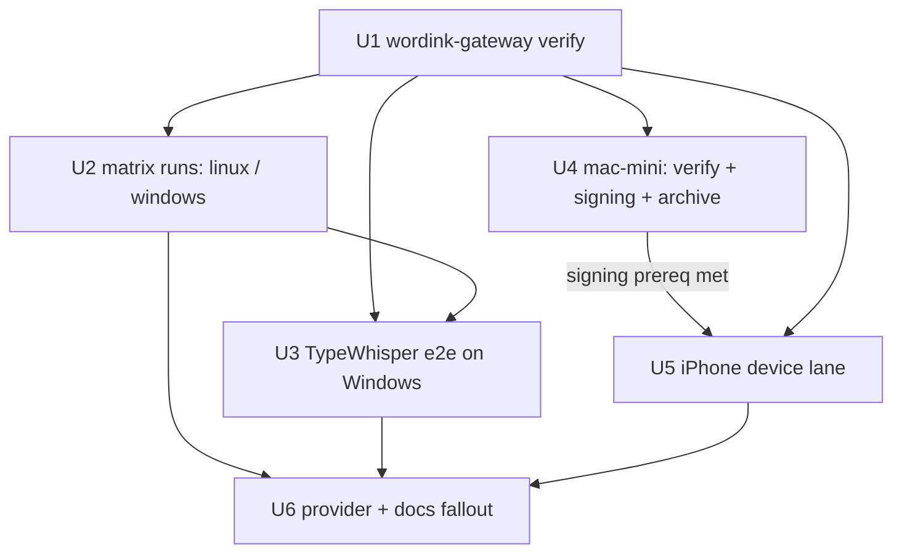

# Cross-Platform Verification - Plan

## Goal Capsule

- **Objective:** Every WordInk surface that claims to work is proven working on real hardware — the gateway on Linux, macOS, and Windows, a real dictation client end-to-end on Windows, and WordInkRemote on a physical iPhone — with failures filed as issues and docs corrected, so "verified" in the project sitrep means a human observed it, not that CI compiled it.
- **Means:** One repo-side `wordink-gateway verify` command (executable form of `apps/docs/pages/verify.md`) run per OS (KTD1, KTD5), plus ordered per-box lanes executed against the operator's private runbook (KD1).
- **Authority:** Product Contract governs product behavior; KTDs govern mechanism; units cite both.
- **Execution profile:** Mixed — one code unit (U1) lands via PR on `master`; the OS/device lanes run on operator hardware per the private runbook and produce evidence, not diffs.
- **Stop conditions:** a lane needs hardware access, Apple signing material, or provider keys the operator has not supplied — record the blocker and stop that lane, not the plan.
- **Who ships:** the agent ships U1 and U6; the operator (or an agent on each box) executes U2–U5.

---

## Product Contract

### Summary

WordInk's verification claim currently rests on CI gates and one developer machine. This phase turns "tested" into "observed working" across the OS matrix the project claims to support: a repeatable repo-side verify command proves the gateway's mechanics on any box (with or without provider keys), ordered lanes execute it on each target, TypeWhisper on Windows closes the client e2e gap the landscape work left open, and WordInkRemote on a physical iPhone proves the iOS lane that simulator tests cannot. The landscape doc gains the Google AI Edge Eloquent entry it predates.

### Problem Frame

CI proves the code compiles and unit/e2e suites pass on GitHub runners. It does not prove the gateway runs on Windows paths, that TypeWhisper's current plugin still speaks the contract (live-verified once, on Windows 11 ARM), that the iOS app survives real signing, keychain, mic, and Shortcuts on hardware, or that provider keys other than Groq's work at all. The one documented live verification per surface is now months stale or never happened. Before npm publishing exposes the project to strangers, each claim needs one honest run.

### Key Decisions

- **KD1. Repo artifacts stay generic; machine topology stays private** (session-settled: user-directed — chosen over committing the per-box runbook: the repo is public; machine names, tailnet hosts, and Apple IDs live in the operator's private `~/wordink-hammer-runbook.md`, never in committed files). Governs R5.
- **KD2. iOS device lane covers WordInkRemote only** (session-settled: user-approved — chosen over verifying both iOS apps on device: the operator's stated product is the thin Groq-LPU companion; WordInkApp keeps its simulator gate). Governs R4.
- **KD3. The verify tool ships inside `wordink-gateway` as a subcommand** (session-settled: user-approved — chosen over a repo-local script: `wordink-gateway verify` runs anywhere the CLI is installed, including after the eventual npm publish). Governs R1.

### Requirements

**Verification tooling**

- R1. `wordink-gateway verify` proves the gateway's mechanics on any host with Node 20+ and no provider keys — config loads, `serve` binds, a minted device token authenticates, `/v1/models` and a multipart transcription round-trip against a loopback fake provider — and reports each check as pass/fail with the cause. With `--live`, it additionally POSTs the repo's `hello-world.wav` through each provider entry that resolves a real key. (KD3)
- R2. Verification never mutates real operator state: the tool always sandboxes `XDG_STATE_HOME` to a temp dir and mints tokens only there — never into an existing store. `--live` may read the operator's real `gateway.json` (default path or `--config <path>`) for provider entries, read-only; when a pre-existing token store is found, token-lifecycle checks report `SKIP` rather than mint.

**Hardware lanes**

- R3. The verify command runs to a recorded pass on at least one fresh Linux box, the Windows VM, and the macOS mini — each run exercising `check`, `serve`, token lifecycle, and both model and transcription endpoints.
- R4. WordInkRemote installs on a physical iPhone and completes the onboarding checklist: gateway URL + device token validated against `/v1/models`, hold-to-talk dictation lands on the clipboard, the `Dictate` shortcut opens the app into recording, the `Transcribe Audio` shortcut transcribes a file headlessly, and a revoked-token retry fails then succeeds after rotation. (KD2)
- R5. TypeWhisper on Windows completes a real dictation through the gateway — OpenAI Compatible engine, base URL without `/v1`, `wdk_` device token, model from `/v1/models` discovery — recorded per TypeWhisper/plugin version. (KD1)

**Providers and docs**

- R6. Groq is verified end-to-end from at least two distinct hosts. OpenAI and Deepgram get the same check only where a key exists; otherwise the plan records them deferred, not passed.
- R7. Findings land where they belong: doc bugs fixed (`install -Dm755` fails on macOS too), the landscape doc gains Edge Eloquent, discovered product bugs get GitHub issues with reproduction, and results outside the repo stay in the private runbook log. (KD1)

### Scope Boundaries

**Deferred for later**

- WordInkApp and WordInkKeyboard on a physical device — sim-verified only this phase (KD2).
- Live OpenAI/Deepgram transcription checks — gated on keys that may not exist on any box (R6).
- Retiring `legacy/`, cleanup presets, stronger local engine, TypeWhisper-on-macOS and browser handcheck — real items, other phases.

**Outside this product's identity**

- New product features, a standalone WordInk desktop app, npm publishing mechanics (operator account setup — tracked as a gate, not a unit).

### Success Criteria

- A reader of the private runbook log can name, per OS and per surface, what was observed working, on which date, and on which build — nothing relies on memory.
- `wordink-gateway verify` exits non-zero on every planted failure in its test suite, and a contributor with no provider keys sees a full offline pass.
- Every "unverified" cell in the operator's status matrix either moved to verified or holds an open issue.

---

## Planning Contract

### Key Technical Decisions

- KTD1. **`verify` is a `wordink-gateway` subcommand with an offline-first design.** It runs the full mechanics check against a loopback fake provider (`{"provider":"groq","keyEnv":"X","url":"http://127.0.0.1:<port>"}` — the config's own `url` override accepts http on loopback) so the check needs no secrets; `--live` opts into one real transcription per resolved provider entry. `packages/server/test/gateway/cli.test.ts` is the reference implementation for temp-XDG sandboxing, serve-spawn detection (`/listening on/`), and the fake-provider technique. (session-settled: user-approved — chosen over repo-local script: ships with the CLI and survives npm publish.)
- KTD2. **Hermetic state via `XDG_*` temp dirs, on every OS including Windows.** `wordink-gateway` resolves config/state only through `XDG_CONFIG_HOME`/`XDG_STATE_HOME`/`homedir()`; setting the XDG pair to temp dirs makes runs identical on all three OSes and can never touch a live `gateway-tokens.json`. Windows has no POSIX secret-store wrapper — `keyEnv` vars are injected directly per process.
- KTD3. **Device reachability prefers `tailscale serve` over `allowInsecureRemote`.** The app accepts http on LAN/tailnet ranges and https anywhere; `tailscale serve --bg 8941` on the gateway host yields a TLS endpoint the phone trusts without weakening the gateway config. `allowInsecureRemote` + plain http is the fallback for same-LAN runs only. (apps/ios/README.md, Shared/GatewayConfig.swift URL policy.)
- KTD4. **Sim gates stay in CI; the mini stages signing and produces the device-signed archive.** The CI ios job already runs on `macos-15` runners — real Apple Silicon — so the mini lane does not replay sim tests; it does what CI cannot: stage the operator's Apple ID/team and App Store Connect API key and produce a `xcodebuild archive -allowProvisioningUpdates` for device (testflight.sh pattern). WordInkRemote + WordInkWidgets need **no registered App Group** — the keychain-access-group is auto-provisioned and `StartDictationIntent` runs in-process (`group.io.wordink.shared` belongs to the deferred WordInkApp/Keyboard pair). Ordering mini-first keeps code work unblocked while credentials are staged.
- KTD5. **Assertions fuzzy-match transcript content.** The `hello-world.wav` result varies by provider/model ("Hello, world" vs "Hello, world."); assert case-insensitive `hello`+`world`, never an exact string — the same lesson the e2e flake taught. (docs/solutions/test-failures/chromium-fake-mic-loops-from-launch.md.)

### High-Level Technical Design



```mermaid
flowchart LR
  subgraph verify[wordink-gateway verify]
    A[load config in temp XDG sandbox] --> B[spawn serve, wait for /listening on/]
    B --> C[mint device + admin tokens]
    C --> D[GET /v1/models + POST transcription]
    D --> E{vocab round-trip}
  end
  D -.->|offline: loopback fake provider| F[stub HTTP 200 {"text":…}]
  D -.->|--live: real provider entry| G[hello-world.wav → real API, fuzzy match]
```

### Assumptions

- At least one box besides this machine can run the lanes (cluster/VM/mini as described), each with Node 20+/pnpm provisioned; lanes stop individually if unreachable.
- The Windows VM has TypeWhisper installed and a working audio capture path (mic passthrough, or a virtual audio device fed `hello-world.wav` as the dictated phrase).
- Apple signing prerequisites (Apple ID in Xcode on the mini, App Store Connect API key `.p8`, a Developer Program membership adequate for device provisioning) are operator-staged before U5; `DEVELOPMENT_TEAM` is overridden if not `6BP7W45U55`.
- A Groq key is confirmed on this machine only; R6's second-host leg is deferred until a second host carries the key — never claimed early.
- Lane boxes are single-operator machines; on any shared box, injected keyEnv vars and minted tokens are purged at lane end.

### Sources

- `docs/solutions/ios-ci-github-actions.md` — sim-only signing recipe; device deploy needs real provisioning (KTD4).
- `docs/solutions/best-practices/read-the-target-apps-openai-compatible-engine-first.md` — TypeWhisper contract facts; base-URL `/v1` omission is the top failure (R5).
- `docs/solutions/best-practices/operator-config-is-hostile-input.md` — assertable fail-closed checks for the verify tool (U1 test scenarios).
- `docs/solutions/test-failures/chromium-fake-mic-loops-from-launch.md` — fuzzy transcript assertions; mechanism note: `fakeMicFromClip` now substitutes the AudioWorklet, not the learning's older BufferSource stub (KTD5).
- `packages/server/test/gateway/cli.test.ts` — reference implementation for the verify recipe.
- Planning dossiers from this session were scratch artifacts; all key facts are folded inline above.

---

## Implementation Units

### U1. `wordink-gateway verify` subcommand

**Goal:** A single command proves gateway mechanics on any OS — offline always, `--live` when keys exist.

**Requirements:** R1, R2, R6 (offline half), KTD1, KTD2, KTD5

**Dependencies:** none

**Files:**
- `packages/server/src/bin/wordink-gateway.ts` — register `verify [--live] [--config <path>]` in USAGE and dispatch
- `packages/server/src/bin/verify.ts` — the command implementation (new)
- `packages/server/fixtures/hello-world.wav` — speech fixture copied from `packages/local/test/fixtures/` and added to the package `files` list, resolved relative to the package root so `--live` works on an npm-installed CLI (KD3's survive-publish rationale requires it)
- `packages/server/test/gateway/verify.test.ts` — unit suite
- `.github/workflows/ci.yml` — new matrix job running `wordink-gateway verify` (offline only) on `ubuntu-latest`, `windows-latest`, `macos-15` per commit — durable coverage so the OS claims do not go stale the day after the private lanes run
- `apps/docs/pages/verify.md` — replace the manual recipe with the command, keep the per-OS table, the failure reading, and the "serving other machines" TLS/`allowInsecureRemote` cleartext warning
- `apps/docs/pages/desktop.md` — fix the `install -Dm755` invocation for macOS/BSD
- `.changeset/` — new changeset (`@wordink/server` minor)

**Approach:**
1. Reuse the cli.test.ts techniques: temp-dir `XDG_CONFIG_HOME`/`XDG_STATE_HOME` environment, write a minimal `gateway.json` whose provider entry points `url` at an ephemeral loopback stub (`node:http` server answering `{"text":"ok"}`) **on a probed free loopback port** (the `freePort()` pattern — never the 8941 default, so `verify` passes on a host already running a live gateway), spawn `serve`, wait for `wordink-gateway: listening on` on stdout with a bounded timeout.
2. Checks, each reported `PASS`/`FAIL` + cause: config resolves; `check` exits 0; `serve` binds; `tokens create` mints a `wdk_` token (regex-extracted); `/v1/models` 200 with the provider's model id; `/v1/audio/transcriptions` multipart round-trip returns `{"text": …}` from the fake provider; admin token mints and POSTs one term to `/v1/vocabulary` with a following GET reporting it effective (the write path — `FileVocabularyStore` mkdir/tmp+rename/fsync — is the POSIX-flavored persistence the Windows lane exists to catch) while a device token gets 403; device token revoke yields 401 on the next request.
3. `--live` mode: resolves provider entries from the operator's real `gateway.json` (default resolution path, or `--config <path>` — erroring clearly when absent), then for **each** entry that resolves a real key spawns an isolated single-provider `serve` (still against the temp state sandbox) and POSTs the bundled `hello-world.wav`, asserting fuzzy `hello`+`world` (KTD5). Per-entry isolation is required because the fallback chain always prefers the first healthy provider; the built-in offline fake never counts as live provider evidence (an operator-configured loopback `url` entry *is* treated as a real entry — that is how the test suite exercises the live path without keys). Without `--live` and without keys the run is complete and green — that is the offline contract.
4. State discipline (R2): `XDG_STATE_HOME` is always a temp dir — tokens mint only there, never into an existing store. When a pre-existing `gateway-tokens.json` is detected in the resolved state dir, token-lifecycle checks report `SKIP`. A pre-seeded store file must be byte-identical after a verify run.
5. Exit code: 0 when every attempted check passed; non-zero with a one-line failure summary. PASS/FAIL lines and failure summaries never contain token or provider-key material.

**Execution note:** This is mostly spawn-and-assert orchestration; prefer runtime smoke verification in the unit tests over mocking the bin — cli.test.ts already proves the pattern works under vitest.

**Patterns to follow:** `packages/server/test/gateway/cli.test.ts` (sandbox env, spawn detection, token regex, loopback fake, `freePort()`); `packages/server/test/gateway/fakes.ts` (`makeUpstream` for stub bodies); USAGE/dispatch style already in `wordink-gateway.ts`.

**Test scenarios:**
- Happy path: config + fake provider → `verify` exits 0 and prints all PASS lines including models, transcription, vocab write+read round-trip, admin/device scope split, and revoke→401 — all landed inside the temp XDG sandbox.
- `--live` with no real keys: skipped check reports `SKIP`, exit 0.
- `--live` with a loopback fake configured as the "real" provider: transcription asserted, PASS.
- `--live` with two configured provider entries where only entry 1 is healthy: entry 2's isolated run still executes and reports independently — no fallback masking.
- Missing config file: `verify` fails fast naming the expected path per-OS (XDG or `%USERPROFILE%`-derived).
- Fake provider returns 500: transcription check FAILs with the upstream status, exit non-zero.
- Occupied 8941: a listener already bound on the default port does not affect the run.
- Pre-seeded `gateway-tokens.json` in the state dir: byte-identical after the run; token checks report `SKIP`.
- Output hygiene: stdout+stderr contain no `wdk_` value and no env key content.
- Rate-limit safety: the full check issues well under 60 requests so the shared per-token limiter never trips.
- Windows parity: unit test forces `XDG_*` sandboxing; no POSIX-only calls (`install`, signal handlers) in the code path.

**Verification:** `pnpm --filter @wordink/server test` green; `wordink-gateway verify` run manually on this machine exits 0 offline and passes `--live` against Groq.

### U2. OS matrix runs (Linux cluster, Windows VM)

**Goal:** The verify command exits 0 on at least one fresh Linux box and the Windows VM — each run recorded in the private runbook log.

**Requirements:** R2, R3 (Linux and Windows legs), R5 (gateway half), R6 (Groq half), KD1

**Dependencies:** U1

**Files:**
- `~/wordink-hammer-runbook.md` (private — the per-box commands and results log; not committed)

**Approach:**
1. Per box: clone or copy the repo, `pnpm --filter @wordink/server build`, run `wordink-gateway verify` offline first (proves mechanics independent of key plumbing), then `--live` with a Groq key in the environment.
2. On Windows run via `node packages/server/dist/bin/wordink-gateway.js` in PowerShell with `XDG_CONFIG_HOME`/`XDG_STATE_HOME` set to a temp dir — never the POSIX wrapper, `install`, or `curl` alias (use `curl.exe`).
3. Credential handling: provider keys are injected per-session from the operator's secret store, never written into the runbook, recorded command lines, or committed files; the log records `keyEnv` variable names, token ids/labels, and pass/fail — never values.
4. Record per box: date, OS/arch, Node version, offline pass/fail, live pass/fail, anomalies → issues.

**Test expectation: none — this is the verification itself; its evidence is the runbook log.** `verify` already covers revoke→401 in its sandbox; the extra negative check here is on the *durable* lane gateway (U3's serve): `tokens revoke` that box's minted id and confirm the next request 401s.

**Verification:** each box's runbook entry shows offline PASS and Groq live PASS, or an open issue with the observed failure.

### U3. TypeWhisper end-to-end on Windows

**Goal:** A real dictation on the Windows VM reaches text through the gateway — the client-integration claim becomes live-verified at a recorded version.

**Requirements:** R5, KD1

**Dependencies:** U1 (verify green on the same box), U2 (Windows gateway lane done)

**Files:**
- `~/wordink-hammer-runbook.md` (private log entry)
- Any resulting issue/doc fix discovered during the run

**Approach:**
1. Provision a durable gateway first — the verify run's serve and tokens die with its temp sandbox: write a real `gateway.json` on the Windows VM, start `wordink-gateway serve` with a provider key in the environment, and `tokens create` a durable `wdk_` device token for the TypeWhisper profile.
2. In TypeWhisper Settings add the bundled **OpenAI Compatible** engine: base URL `http://127.0.0.1:8941` with **no `/v1` suffix** (it appends `/v1/audio/transcriptions` itself — the top documented failure), API key = `wdk_` device token, model picked from `/v1/models` discovery.
3. Keep transport on Auto/batch — never `gpt-live-transcribe`/`gpt-realtime-whisper` names and never Translate mode (unsupported; gateway has no translations route).
4. Dictate a phrase (mic passthrough, or play `hello-world.wav` through a virtual audio device if the VM has no mic), confirm text lands; record TypeWhisper + plugin versions and pass/fail.

**Test expectation: none — live client verification; the contract is already covered by gateway tests.**

**Verification:** observed transcription through TypeWhisper's own UI/pipeline, or an issue filed with plugin version and request shape.

### U4. mac-mini lane — gateway verify, signing staging, device archive

**Goal:** The macOS verify run lands (R3's macOS cell) and the mini stages everything the device lane needs that CI cannot provide — operator signing material and a device-signed archive.

**Requirements:** R3 (macOS leg), R4 (staging half), KTD4

**Dependencies:** U1

**Files:**
- `~/wordink-hammer-runbook.md` (private log entry)

**Approach:**
1. `ssh mini`: clone, run the gateway verify lane — offline then `--live` (covers R3's macOS cell).
2. Stage device prerequisites: operator's Apple ID signed into Xcode, App Store Connect API key (`.p8`) for `testflight.sh` staged per the operator's own key-handling, `DEVELOPMENT_TEAM` overridden if not `6BP7W45U55`. No App Group registration — WordInkRemote + WordInkWidgets use only the auto-provisioned keychain-access-group (KTD4).
3. Produce a device-signed build: `xcodegen --spec apps/ios/project.yml` → `xcodebuild -scheme WordInkRemote archive -allowProvisioningUpdates` — the step CI's sim-only signing cannot perform.
4. Confirm the iPhone runs iOS ≥ 18 — WordInkWidgets is embedded in WordInkRemote with an 18.0 deployment floor, so it ships in every install.

**Test expectation: none — xcodebuild IS the verification.**

**Verification:** gateway verify PASS on the mini, a signed `WordInkRemote` archive exists, and U5's prerequisites checklist has no open item.

### U5. iPhone device lane — WordInkRemote

**Goal:** WordInkRemote on a physical iPhone completes the onboarding-and-dictation checklist against a reachable gateway.

**Requirements:** R4, KD2, KTD3

**Dependencies:** U4 (prerequisites staged), U1

**Files:**
- `~/wordink-hammer-runbook.md` (private log entry)
- Any resulting issue filed with device/OS/app-version reproduction

**Approach:**
1. Make the gateway reachable: `tailscale serve --bg 8941` on the gateway host → `https://<host>.<tailnet>.ts.net` (KTD3 — requires the iPhone on the tailnet), or `allowInsecureRemote` + LAN http for same-LAN runs only — noting the fallback crosses tokens and audio in cleartext.
2. Install via `apps/ios/scripts/testflight.sh` (ASC API key + team) or a direct Xcode run with the operator's team overriding `DEVELOPMENT_TEAM`/`PRODUCT_BUNDLE_IDENTIFIER` build settings.
3. Checklist (from the remote-mic plan's manual list): onboarding URL + device token validates (`/v1/models`, 10 s timeout); hold-to-talk → transcription lands on clipboard; `Dictate` shortcut opens the app into recording; a composed Shortcuts flow (Record Audio → `Transcribe Audio` → Copy) transcribes a file headlessly; revoke the token → next request rejected → mint a new one → succeeds.
4. A plain **device** token is required — admin is unnecessary for onboarding (the app only calls `/v1/models` + `/v1/audio/transcriptions`).
5. Lane teardown: restore the gateway's prior reachability — `tailscale serve reset`/`--bg … off`, or remove `allowInsecureRemote` and the non-loopback `host` so the gateway returns to loopback-only — recorded in the runbook, unless the operator explicitly keeps the exposure.

**Test expectation: none — on-device checklist IS the test.**

**Verification:** checklist fully observed on hardware, or each failure filed with reproduction; WordInkApp device testing explicitly out (KD2).

### U6. Provider checks and docs fallout

**Goal:** Groq verified from two+ hosts; OpenAI/Deepgram verified or honestly deferred; every finding lands in its durable home.

**Requirements:** R6, R7, KD1

**Dependencies:** U2, U3, U5

**Files:**
- `docs/research/2026-10-10-landscape.md` — Edge Eloquent entry
- `apps/docs/pages/desktop.md` / `verify.md` — fixes discovered during lanes (e.g., BSD `install` note — may already land in U1)
- `~/wordink-hammer-runbook.md` — final results log
- GitHub issues for each unfixed failure

**Approach:**
1. `wordink-gateway verify --live` covers Groq wherever a key exists; OpenAI/Deepgram get one real transcription each only where a key is present — absent keys are recorded deferred, never claimed.
2. Landscape doc: Edge Eloquent (Google, April 2026 — free, unlimited, on-device Gemma ASR + polish, iOS-only, keyboard announced, desktop evaluated) as the new closest iOS competitor; note WordInk's counter-position (BYO provider, own gateway, SDK embedding).
3. Sweep the runbook log: every anomaly → an issue with reproduction, or a doc fix PR if it's a docs bug.

**Verification:** provider table records each provider as verified-from-host(s) or deferred-with-reason; issues exist for every unresolved failure.

---

## Verification Contract

| Lane | Command / check | Gate |
|---|---|---|
| U1 code | `pnpm --filter @wordink/server build && pnpm --filter @wordink/server test` | green incl. new `verify.test.ts` |
| U1 lint | `pnpm typecheck` | clean |
| Per-OS | `wordink-gateway verify` (offline) then `wordink-gateway verify --live` | exit 0 both, or issue filed |
| Windows client | TypeWhisper real dictation → text | observed text, versions recorded |
| macOS | gateway verify on mini + signed `WordInkRemote` archive | verify PASS + archive produced |
| Device | onboarding → dictate → shortcuts → revoke/rotate checklist | all observed on hardware |
| Teardown | gateway restored to prior reachability state | loopback-only or operator-kept, recorded |
| Docs | `pnpm --filter @wordink/docs build` after any page edits | renders clean |

## Definition of Done

- `wordink-gateway verify` exists, is documented on the verify page, passes its suite, and exits 0 on a keyless host.
- The private runbook log holds a dated entry per executed lane; every "unverified" status cell is either verified or has an open issue.
- At least one lane beyond this machine passed: a run where every new lane blocked into filed issues is not done — the phase stays open on the blockers.
- No committed file names a private machine, host, tailnet address, team ID that isn't already public, or credential material; the runbook records `keyEnv` names, token ids/labels, and pass/fail — never values; no abandoned-attempt code remains in the diff.
- After the device lane, the gateway's reachability is restored to its prior state (loopback-only, or `tailscale serve` taken down) unless the operator explicitly keeps the exposure — recorded either way.
- OpenAI/Deepgram are either verified from a host or recorded as deferred-on-keys — never silently claimed.

## Risks and dependencies

- **Two-host Groq coverage may not materialize** — a key is confirmed only on this machine; if no second lane host carries one, R6's Groq leg records deferred rather than passed.
- **LAN-trust variance on the U5 fallback** — the `allowInsecureRemote` path assumes the operator's LAN is trustworthy (no shared Wi-Fi segments or untrusted devices); if not, only the `tailscale serve` path is acceptable.
- **Verified-cell decay is undefined** — the runbook records dates and builds, but nothing decides when a verified claim goes stale (surface-affecting code changes vs. elapsed time). A runbook convention or later phase owns this.
- **`verify` output becomes public contract at publish** — PASS/FAIL format and exit codes are stable API once npm-published; note this when the npm-publish phase lands.
- **Apple membership level unknown** — device provisioning beyond Personal-Team limits (and the `.p8` ASC key) requires a paid Developer Program account; the lane stops at that gate if absent (see open questions).

## Deferred / Open Questions

- Is the operator's Apple account a paid Developer Program membership? Device provisioning and the ASC `.p8` depend on it.
- Is the target iPhone enrolled on the tailnet? If not, U5 falls back to `allowInsecureRemote` + same-LAN http — and whether that cleartext exposure is acceptable at all is the operator's call (the alternative is tailnet enrollment first).
- Are the lane boxes provisioned and reachable (Node 20+/pnpm each; TypeWhisper + an audio capture path on the Windows VM)?
- What invalidates a "verified" status cell — a time window, re-verification on changes to the verified surface, or verified-as-of-build permanently?

## Review — 2026-10-19

Five reviewers (coherence, feasibility, scope-guardian, security-lens, adversarial); cross-model pass skipped — host serving family not attestable under the route contract, no user opt-in. 24 raw findings deduplicated to 20; all applied under the granted edit authority, none skipped.

| Finding | Reviewers | Applied |
|---|---|---|
| LAN cleartext fallback lacked teardown → U5 step 5, VC row, DoD item | security | yes |
| Real-config mode undefined → R2 + U1: state always sandboxed, `--config` read-only, pre-existing store → SKIP | security, adversarial | yes |
| No credential-handling rule → U2 step 3 + DoD (names/ids only, never values) | security | yes |
| Verify output not barred from echoing tokens → U1 step 5 + hygiene test | security | yes |
| verify.md rewrite could drop cleartext warning → retained in U1 files | security | yes |
| Vocab write path unproven → POST + GET-effective round-trip in U1 | scope-guardian | yes |
| mac-mini double-owned by U2/U4 → U4 sole owner; U2 = Linux+Windows | scope-guardian, coherence | yes |
| `hello-world.wav` unreachable on npm-installed CLI → bundled into `@wordink/server` files | adversarial, feasibility | yes |
| Spawned serve could collide on :8941 → `freePort()` probe | adversarial | yes |
| No durable OS coverage → CI matrix job (ubuntu/windows/macOS, offline) in U1 | adversarial | yes |
| App Group prereq misattributed to WordInkRemote → removed (belongs to deferred App/Keyboard pair) | adversarial, feasibility, coherence | yes |
| U4 sim replay duplicated CI macos-15 → rescoped to verify + signing + device archive | adversarial | yes |
| Windows VM audio/TypeWhisper prereqs unstated → Assumptions + U3 | adversarial | yes |
| `Dictate` intent misnamed for file transcription → `Transcribe Audio` named; `Dictate` opens app | adversarial, feasibility | yes |
| U3 had no running gateway → durable serve+token provisioning step | coherence | yes |
| Mermaid dropped U2→U3, U1→U5 edges → fixed | coherence | yes |
| Means citation misattributed KTD1/KTD5 vs KD1 → split per clause | coherence | yes |
| Widget-scope conditional unresolved → iOS ≥18 check unconditional | coherence | yes |
| DoD degenerate all-blocked path → at-least-one-lane-beyond-this-machine clause | adversarial (residual) | yes |

Residual risks and open questions are carried in the two sections above.
