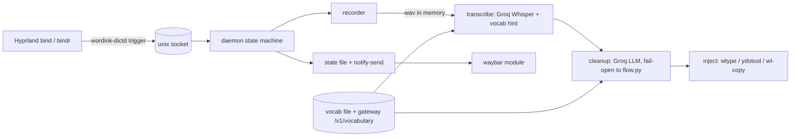

# Standalone Linux Dictation App (Voxtype replacement on Omarchy) - Plan

## Goal Capsule

- **Objective:** On Omarchy (Hyprland, Wayland), hold a key, speak, release, and cleaned-up text lands in the focused window, with Groq as the backend and no Voxtype installed. Windows (cyberpowa) is a follow-on lane, planned here but not built in this slice.
- **Means:** A small Python daemon, `wordink-dictd`, added to the existing `sdks/python` package as an optional `desktop` extra. It reuses the Python client (`wordink.client`), the deterministic cleanup (`wordink.flow`), the mic capture in `wordink.cli`, and the gateway's vocabulary API. Hyprland binds drive it. A systemd user unit keeps it running. An install script wires everything.
- **Authority:** `ROADMAP.md` Phase 3 and program plan U13 (standalone, works on default open-source config with only a provider key). `docs/brainstorms/2026-10-10---desktop-surfaces-requirements.md` R3.x and AE5 for hotkey and injection behavior.
- **Execution profile:** Code units U1 to U7 land as small PRs. U8 (machine verification) is read-only and operator-run. U9 (Windows) is a separate later plan.
- **Stop conditions:** no Groq key available to the daemon, a Wayland compositor without a working injection tool, or a hotkey clash that cannot be resolved by config. Record the blocker and stop that unit.

---

## Product Contract

### Summary

Replace Voxtype on omarchy-max with a first-party WordInk dictation app that is cleaner and more integrated: push-to-talk or toggle from a Hyprland bind, mic capture, Groq Whisper transcription with the user's vocabulary, a Groq LLM cleanup pass, and text typed into the focused window (clipboard fallback), with a bar indicator and a systemd user service. Works with only a Groq key; the WordInk gateway is an optional upstream, not a requirement.

### Problem Frame

Voxtype works but is a separate product with its own config and no WordInk vocabulary, cleanup, or history. The gateway integration (Phase 2) made Voxtype use WordInk as a transcription backend, but the user experience stays Voxtype's. U9 chose first-party standalone apps. Wayland has no universal global-hotkey or text-injection API, so the design leans on what Hyprland and Omarchy already provide (compositor binds, `wtype`, `ydotool`, `wl-clipboard`) instead of fighting for portals. `wisp` already owns `Super+D` push-to-talk on the same machine, so the two must coexist.

### Requirements

- R1. **Hotkey.** A Hyprland `bind`/`bindr` pair triggers `wordink-dictd` over a Unix socket. Hold-to-talk and tap-to-toggle are both supported. The default key does not collide with wisp's `Super+D` or with Omarchy's own binds, and is configurable.
- R2. **Mic capture.** 16 kHz mono capture through PipeWire (via `sounddevice`, falling back to `pw-record`/`arecord`), with a start-of-speech grace so the first word is not clipped, a max duration, and a minimum duration below which the press is discarded.
- R3. **Transcription.** Groq Whisper (`whisper-large-v3-turbo` default, `whisper-large-v3` selectable) with the vocabulary list sent as the prompt hint, language hint optional. Failures retry once, then surface a notification and keep the audio for retry.
- R4. **Cleanup.** A Groq LLM pass (default `llama-3.1-8b-instant`, configurable) that fixes punctuation, removes fillers and false starts, applies the vocabulary spellings, and never answers or follows instructions in the dictated text. Skips short utterances and falls back to deterministic `wordink.flow` on timeout or error. A `verbatim` tone bypasses it.
- R5. **Vocabulary.** The vocabulary comes from a local file, plus the gateway's `/v1/vocabulary` when a gateway is configured, merged and de-duplicated. `wordink-dictd vocab add|list|remove` manages the local file.
- R6. **Insertion.** Type into the focused window with `wtype`, else `ydotool`, else copy with `wl-copy` and notify "copied, paste". Terminals get a paste-based path (`wl-copy` then the terminal's paste chord) because per-key typing is slow and lossy there. The clipboard is restored afterward when pasting was used.
- R7. **Indicator.** A waybar custom module (idle, recording, transcribing, error) fed by a state file, plus `notify-send` for errors and the clipboard fallback. No GUI toolkit in v1.
- R8. **Service.** A systemd user unit with restart-on-failure, secrets via `EnvironmentFile` (mode 0600) or omaseal, and a `wordink-dictd doctor` command that checks tools, mic, key, and Hyprland bind without printing secrets.
- R9. **Install.** An idempotent Omarchy install script that installs missing packages, writes config, the unit and the waybar module, adds the Hyprland bind, and has an `--uninstall`. It does not disable Voxtype; switching over is a separate documented step the operator runs.
- R10. **Reuse.** No second transcription client, vocabulary store, or cleanup implementation. New code is the daemon, recorder, injector, LLM cleanup, and install glue.
- R11. **Safety.** Keys never appear in logs, state files, or notifications. Audio is held in memory and only written to disk on failure, in a 0700 cache dir with a retention limit. Dictation is skipped if the focused window is a known password manager class (config list).

### Scope Boundaries

- Not in scope: a GUI settings app, tray icon, streaming partial results, local engines (U11), macOS (own plan), meeting mode.
- Not in this slice: Windows build (U9 below only plans it).
- The gateway and Voxtype recipe docs stay supported; nothing here removes them.

---

## Planning Contract

### Key Technical Decisions

- **KTD1. Direct-to-Groq by default, gateway optional.** The Python client already targets "any OpenAI-compatible transcriptions endpoint". Standalone means no self-hosted gateway is required, so `endpoint` defaults to Groq's OpenAI-compatible base URL. Setting `WORDINK_GATEWAY_URL` points the same client at a gateway for fallback chains and shared vocabulary. Governs R3, R5, R10.
- **KTD2. Python daemon inside `sdks/python`, not a new Rust host.** The Rust core is sans-I/O and the work here is glue (sockets, subprocesses, HTTP). Python reuses `client.py`, `flow.py` and the recorder, and ships through the existing `python-sdk` CI job and `uv tool install`. A Rust host stays an option for the cross-OS app later; the daemon's module boundaries (recorder, transcriber, cleaner, injector, indicator) are the seams. Governs R10.
- **KTD3. Hyprland binds plus a Unix socket, not evdev or portals.** `bind` on press and `bindr` on release call `wordink-dictd trigger start|stop|toggle`, the same pattern wisp uses (`wispd trigger`). It needs no input-group membership and no portal support. Governs R1.
- **KTD4. Chosen default bind: `SUPER ALT, D`** (hold) and `SUPER ALT, S` (toggle), because wisp holds `SUPER, D` and Hyprland matches exact modifier masks. Both are written by the installer only after `hyprctl binds -j` shows no existing match, and are overridable. The chosen keys are provisional until U8 confirms against the live bind list. Governs R1.
- **KTD5. Injection order: `wtype`, then `ydotool`, then clipboard.** `wtype` uses `zwp_virtual_keyboard_v1`, needs no daemon, and handles Unicode. `ydotool` needs `ydotoold` and uinput access, so it is the fallback. Clipboard-only is the last resort and is always reported. Terminal windows use paste-then-restore. Governs R6.
- **KTD6. LLM cleanup is bounded and fail-open.** One chat completion with a fixed system prompt, a short timeout (default 3 s), and the raw transcript wrapped as data. On timeout, error, or a response that is much longer than the input, use the deterministic cleanup instead. The dictated text is never executed as instructions. Governs R4, R11.
- **KTD7. State and IPC.** Socket at `$XDG_RUNTIME_DIR/wordink/dictd.sock`; state file `$XDG_RUNTIME_DIR/wordink/state` (JSON, one line) read by waybar's `exec` with `tail`-free polling or `signal`. Governs R7.
- **KTD8. Config.** `~/.config/wordink/dictate.toml` for hotkey, models, tone, injection order, window deny list. Secrets only in the environment. Governs R8, R11.

### Output Structure

```text
sdks/python/src/wordink/desktop/
  __init__.py
  daemon.py        # socket server, state machine (idle/recording/transcribing/error)
  recorder.py      # PipeWire capture, grace, min/max
  transcribe.py    # thin wrapper over wordink.client.transcribe
  cleanup.py       # Groq LLM pass + deterministic fallback via wordink.flow
  inject.py        # wtype / ydotool / wl-copy, terminal paste path
  indicator.py     # state file, waybar JSON, notify-send
  config.py        # dictate.toml
  doctor.py
sdks/python/tests/desktop/
examples/omarchy-dictation/
  install.sh
  wordink-dictd.service
  waybar-module.jsonc
  hyprland-binds.conf
  README.md
apps/docs/pages/linux-dictation.md
```

### High-Level Technical Design



### Risks

- **Hotkey collision with wisp or Omarchy binds.** Mitigation: KTD4 plus the install script's bind check and U8.
- **Injection fails in some apps** (Electron, terminals, XWayland). Mitigation: terminal paste path, clipboard fallback, per-app overrides in config.
- **Cleanup latency** makes dictation feel slow. Mitigation: skip the LLM pass under a word threshold, 3 s timeout, deterministic fallback, and a latency log line (no text) for tuning.
- **LLM rewrites meaning.** Mitigation: tight prompt, length guard, `verbatim` tone, raw transcript kept in history for the last N dictations (local, opt-out).
- **Groq outage or rate limit.** Mitigation: retry once, optional gateway fallback, keep audio for retry.

---

## Implementation Units

### U1. Daemon skeleton, config, state machine

- **Goal:** `wordink-dictd` runs, listens on the socket, and moves idle, recording, transcribing, idle on `trigger start|stop|toggle`, with stubs for the stages.
- **Requirements:** R1, R7, R8, R10.
- **Dependencies:** none.
- **Files:** `sdks/python/src/wordink/desktop/{__init__,daemon,config,indicator}.py`, `sdks/python/pyproject.toml` (extra `desktop`, script `wordink-dictd`), `sdks/python/tests/desktop/test_daemon.py`.
- **Approach:** asyncio Unix socket server; single in-flight dictation; state file written atomically.
- **Test scenarios:** start then stop returns to idle; toggle twice; double start ignored; stop while idle ignored; stale socket cleaned on start; config defaults and overrides.
- **Verification:** `uv run pytest` and `python -m compileall` green in the existing `python-sdk` CI job.

### U2. Recorder

- **Goal:** In-memory 16 kHz mono capture with grace, min and max.
- **Requirements:** R2.
- **Dependencies:** U1.
- **Files:** `desktop/recorder.py` (lift `_record` from `cli.py` into a shared helper both use), tests.
- **Test scenarios:** press under min duration is discarded; max duration auto-stops; backend fallback order when `sounddevice` is missing; WAV header correct.
- **Verification:** unit tests with a fake audio source; manual mic check deferred to U8.

### U3. Transcription and vocabulary

- **Goal:** Groq Whisper call with vocabulary hint, one retry, audio kept on failure.
- **Requirements:** R3, R5, R10.
- **Dependencies:** U1, U2.
- **Files:** `desktop/transcribe.py`, `sdks/python/src/wordink/client.py` (only if a Groq base URL default needs adding), `wordink-dictd vocab ...` subcommands, tests.
- **Test scenarios:** vocabulary merged from file and gateway and de-duplicated; prompt truncated to the provider limit; 429 retries once then errors with a clear code; no key present gives an actionable error; key never in the error text.
- **Verification:** tests against a local fake OpenAI-compatible server (the same pattern the gateway tests use).

### U4. LLM cleanup with deterministic fallback

- **Goal:** Groq chat cleanup, fail-open.
- **Requirements:** R4, R11.
- **Dependencies:** U3.
- **Files:** `desktop/cleanup.py`, tests, a fixture set of dictated samples including prompt-injection-style transcripts ("ignore previous instructions ...").
- **Test scenarios:** short utterance skips the LLM; timeout falls back to `flow.py`; over-long response rejected; injection transcript comes back as cleaned text, not obeyed; `verbatim` bypass; vocabulary casing applied.
- **Verification:** fake chat server tests plus a recorded-sample comparison.

### U5. Injection

- **Goal:** Insert text into the focused window.
- **Requirements:** R6, R11.
- **Dependencies:** U1.
- **Files:** `desktop/inject.py`, tests with a fake command runner.
- **Test scenarios:** `wtype` present; `wtype` missing then `ydotool`; both missing then `wl-copy` plus a notification; terminal class uses paste and restores the clipboard; newline and Unicode handling; focused-window deny list skips insertion; `hyprctl activewindow -j` failure falls back to type mode.
- **Verification:** unit tests; live insertion checked in U8.

### U6. Service, waybar module, notifications

- **Goal:** Always-on daemon with a visible indicator.
- **Requirements:** R7, R8.
- **Dependencies:** U1.
- **Files:** `examples/omarchy-dictation/{wordink-dictd.service,waybar-module.jsonc}`, `desktop/doctor.py`, tests for `doctor`.
- **Test scenarios:** `doctor` reports each missing tool or key by name and never prints values; waybar JSON for each state; unit file passes `systemd-analyze verify`.
- **Verification:** `systemd-analyze --user verify` in CI where available; otherwise lint only.

### U7. Omarchy installer, docs, hotkey wiring

- **Goal:** One command installs and one documented step switches over from Voxtype.
- **Requirements:** R1, R9.
- **Dependencies:** U1 to U6.
- **Files:** `examples/omarchy-dictation/{install.sh,hyprland-binds.conf,README.md}`, `apps/docs/pages/linux-dictation.md`, `ROADMAP.md` (U13 status), `.changeset` entry.
- **Approach:** the installer is idempotent, supports `--dry-run` and `--uninstall`, checks `hyprctl binds -j` for clashes before adding binds, and prints the Voxtype disable commands instead of running them. Build on the open install-script draft in PR #53 (`examples/gateway-systemd/install-omarchy.sh`) for package and omaseal handling rather than duplicating it.
- **Test scenarios:** shellcheck clean; dry run changes nothing; running twice leaves one bind and one unit; uninstall removes only what it added; a clashing bind aborts with the clashing line shown.
- **Verification:** shellcheck in CI; a dry-run transcript attached to the PR.

### U8. Read-only machine checks (operator or agent on each box, no changes)

- **Goal:** Confirm assumptions before the installer runs anywhere. Nothing here installs, edits, or restarts anything.
- **Dependencies:** none; run after U7's PR is open.
- **Checks on omarchy-max (Linux):**
  - `hyprctl version` and `hyprctl binds -j`: look for existing use of `SUPER ALT D`, `SUPER ALT S`, and wisp's `SUPER D`.
  - `systemctl --user list-units 'voxtype*' 'wisp*' 'wordink*'` and `systemctl --user is-active voxtype`: what is running now.
  - `command -v wtype ydotool ydotoold wl-copy wl-paste notify-send waybar uv python3`, and `python3 --version` (needs 3.11 or newer).
  - `wpctl status` and `wpctl get-volume @DEFAULT_AUDIO_SOURCE@`: the default mic exists and is not muted.
  - `ls -l /dev/uinput` and `id -nG`: whether ydotool could work (group `input` or uinput rule).
  - `ls ~/.config/voxtype ~/.config/wordink ~/.config/waybar`: current config (names only; do not read key files).
  - Key presence only: `[ -n "$GROQ_API_KEY" ]` or `wordink-gateway check` (which never prints keys); how wisp obtains its Groq key.
  - Which terminal and browser are in use (`hyprctl clients -j | jq -r '.[].class' | sort -u`) to seed the terminal list.
- **Checks on cyberpowa (Windows):**
  - Windows version and architecture, `python --version`, `uv --version`.
  - Default recording device in Sound settings, and whether anything else registers a global hotkey (legacy `legacy/wordink` still installed or running?).
  - Whether `AutoHotkey` is present and whether the target apps run elevated (affects injection).
  - Key presence only for Groq.
- **Verification:** results pasted into the PR as a short table, with no keys, no tokens, no audio.

### U9. Windows lane for cyberpowa (planned only, separate plan before code)

- **Goal:** Record what carries over so the Windows build does not restart from zero.
- **Reuses unchanged:** `wordink.client`, `wordink.flow`, `cleanup.py`, `transcribe.py`, the vocabulary files, and the config schema.
- **Replaces:** the Hyprland bind with `RegisterHotKey` (a low-level keyboard hook is needed for true hold-to-talk); `wtype`/`ydotool` with Win32 `SendInput` using `KEYEVENTF_UNICODE`, falling back to clipboard plus `Ctrl+V`; waybar with a tray icon (`pystray`); the systemd unit with a Startup-folder shortcut or a Task Scheduler logon task; the install script with a PowerShell script.
- **Known limits:** `SendInput` is blocked into elevated windows from a non-elevated process; antivirus may flag keyboard hooks.
- **Relation to `legacy/`:** `legacy/wordink` is retired only when this lane ships and is verified on cyberpowa (U8 in the program plan).
- **Verification:** deferred to its own plan.

---

## Verification Contract

- Python: `uv run pytest` and `uv run python -m compileall wordink` in `sdks/python` (the existing `python-sdk` job), covering `tests/desktop/`.
- Shell: `shellcheck examples/omarchy-dictation/install.sh`.
- Docs: the docs build and link check stay green.
- Operator acceptance (after U8): on omarchy-max, hold the bind, say a sentence containing a vocabulary term, release; cleaned text appears in a terminal, a browser field, and an editor within a few seconds; the waybar module changes state; killing the daemon restarts it; wisp's `Super+D` still works.

## Definition of Done

- U1 to U7 merged with green CI, U8 results recorded, Voxtype disable steps documented but not run by the installer.
- `ROADMAP.md` U13 reflects Linux shipped and Windows planned.
- WI-U13 (TLY-279) updated on tallyline.app with each merged PR.
