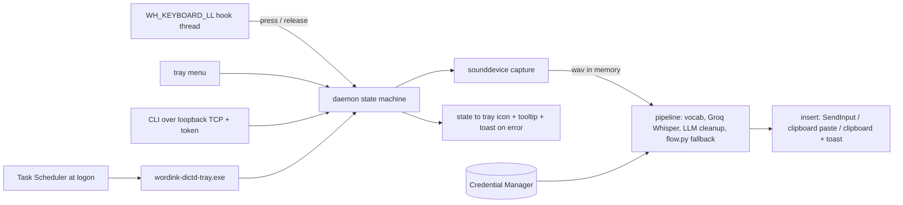

# Windows Dictation App (cyberpowa, Windows 11) - Plan

## Goal Capsule

- **Objective:** On cyberpowa (Windows 11, Python 3.11, uv), hold a global hotkey, speak, release, and Groq-transcribed, cleaned-up text is typed into the focused window. A tray icon shows state, a Task Scheduler logon task keeps it running, and it replaces the legacy `legacy/wordink` tray app, with a one-command way back to the legacy app until the replacement is proven.
- **Means:** The same `wordink.desktop` package that already ships on Linux (`sdks/python`). The pipeline stays as is: vocabulary, Groq Whisper transcription, bounded Groq LLM cleanup with the `flow.py` fallback, the state machine, config validation. Only the platform edges change: mic capture, hotkey, text insertion, tray and notifications, IPC, autostart, secrets, and install. Those edges move behind small interfaces on Linux first, then get Windows implementations.
- **Authority:** `ROADMAP.md` Phase 3 and program plan U13 (standalone app on each OS, works on default open-source config with only a provider key). `docs/plans/2026-10-28-0005-feat-standalone-linux-dictation-app-plan.md` (units U1 to U7 shipped; its U9 asked for this plan).
- **Execution profile:** Code units W1 to W8 land as small PRs. W9 (CI) rides with them. W10 is operator-run on cyberpowa and produces evidence, not diffs. Nothing in this plan changes cyberpowa until the operator runs the installer.
- **Stop conditions:** a target app that runs elevated and rejects injected input (record, fall back to clipboard), antivirus quarantining the keyboard hook (record, stop that unit), or the hotkey clashing with something the operator wants to keep (change the key, not the design).
- **Who ships:** the agent ships W1 to W9. The operator (or an agent on cyberpowa) runs W10.

---

## Product Contract

### Summary

A Windows build of the dictation daemon that matches the Linux one in behavior: hold-to-talk and tap-to-toggle, vocabulary hint, LLM cleanup that fails open, insertion into whatever has focus, a visible state indicator, and an always-on service. Same Groq backend and the same cleanup code. It installs with one PowerShell script that supports a dry run, an uninstall, and a rollback to the legacy app.

### Problem Frame

Today cyberpowa runs `legacy/wordink`: about 2,000 lines of Windows-only Python (`keyboard` library hotkey, default `Pause`; `pyaudio`; clipboard paste through `pyperclip` and `pyautogui`; `pystray`; a Startup-folder shortcut named "Groq Flow.lnk"). It works, but it is a separate codebase from the Linux daemon, has no shared vocabulary or cleanup pipeline, and `legacy/` can only be retired once a Windows replacement ships (program plan U8, U13). The Linux work already isolated the platform-independent pipeline, so most of the Windows app is reuse. What is new is Windows input and shell integration, where a few details decide whether it feels solid:

- `RegisterHotKey` only reports presses, never releases, so hold-to-talk needs a low-level keyboard hook.
- Windows blocks injected input into windows running at a higher integrity level than the daemon (UIPI).
- Typing Unicode through virtual-key codes is unreliable; `KEYEVENTF_UNICODE` is the supported route.
- asyncio on Windows has no Unix-socket server, so the Linux socket IPC cannot be copied.
- Autostart must survive reboots and crashes without a console window.

### Requirements

- R1. **Global hotkey with hold semantics.** A default `Ctrl+Alt+D` hold and `Ctrl+Alt+S` toggle (configurable, same `[hotkey]` table as Linux) that work in any window. Press starts, release stops. The chosen combination is swallowed so the focused app does not also see it.
- R2. **No clash.** The daemon refuses keys that Windows or the legacy app reserve (`Win+...` combinations, the legacy `Pause` while the legacy app is running) and reports a clash found by a registration probe instead of silently failing.
- R3. **Mic capture.** 16 kHz mono s16 from the default input device through `sounddevice` (WASAPI), with the same tail grace and min/max duration as Linux, and an actionable error when no input device exists or access is denied by Windows privacy settings.
- R4. **Same pipeline.** Vocabulary, Groq Whisper, LLM cleanup, `flow.py` fallback, retries, kept audio on failure, and the `GROQ_API_KEY` or gateway credentials behave exactly as on Linux. No second implementation.
- R5. **Insertion.** Type with `SendInput` and `KEYEVENTF_UNICODE` (surrogate pairs handled, newlines sent as Enter). For terminals and for long text, paste instead: set the clipboard, send `Ctrl+V` (or `Ctrl+Shift+V` for terminals that need it), then restore the previous clipboard. If the foreground window is elevated and the daemon is not, copy to the clipboard and notify instead of failing silently.
- R6. **Deny list.** Never type into password managers (match on process image name, for example `1Password.exe`, `Bitwarden.exe`, `KeePassXC.exe`). Same behavior and config keys as Linux (`[insert] deny`), keyed on process name on Windows.
- R7. **Tray.** A tray icon whose color and tooltip show idle, recording, transcribing, error, with a menu: toggle recording, copy last transcript, open the config folder, open the log, quit. Errors also raise a toast.
- R8. **Autostart.** A Task Scheduler task that runs at logon for the current user, at limited privilege, with no console window, restarting on failure, and never running two copies.
- R9. **Secrets.** The Groq key lives in Windows Credential Manager (`wordink-dictd set-key` prompts without echo), with `GROQ_API_KEY` in the environment as an override. The key never appears in logs, the state file, toasts, task arguments, or `doctor` output.
- R10. **Install and rollback.** `install.ps1` supports `-DryRun`, `-Uninstall`, and `-Switch`. `-Switch` turns off the legacy app's autostart and process, records its state, and writes `wordink-use-legacy.ps1` for a one-command return. Without `-Switch` the legacy app is untouched.
- R11. **Doctor.** `wordink-dictd doctor` works on Windows: Python, input device, key present (not its value), hotkey registrable, tray library, scheduled task state, legacy app running, foreground-elevation caveat. Read-only.
- R12. **Same CLI.** `trigger`, `status`, `last`, `vocab`, `binds` (prints the configured hotkeys) work through a loopback IPC channel so scripts and AutoHotkey can drive the daemon.

### Scope Boundaries

- Not in scope: macOS (own plan), a settings GUI beyond the tray menu, streaming partial results, local engines, installers like MSI or MSIX, code signing, Windows on ARM specifics (noted as a risk, not a target).
- The legacy app is not edited or deleted by this plan. Retiring `legacy/` is a follow-up decision after W10.
- No changes to cyberpowa until the operator runs the installer.

---

## Planning Contract

### Key Technical Decisions

- **KTD1. One package, platform adapters behind interfaces.** `wordink.desktop` keeps the pipeline and daemon. Five interfaces carry the platform differences: `AudioSource` (capture), `HotkeySource` (press and release events), `TextInserter`, `Indicator` (state to UI), and `Transport` (IPC). Linux's current subprocess recorder, Hyprland binds, `inject.py`, waybar state file and Unix socket become the Linux adapters; Windows adds its own. The refactor lands first and is verified on Linux, so the Windows units only add adapters. Governs R4, R12.
- **KTD2. Low-level keyboard hook for the hotkey, not `RegisterHotKey`.** `WH_KEYBOARD_LL` through `ctypes`, on a dedicated thread with its own message loop, reports key down and key up, which hold-to-talk needs. It tracks the modifier state itself and swallows only the configured chord (returns non-zero for the main key down and up) so ordinary typing and other shortcuts are untouched. Events cross to the asyncio loop with `call_soon_threadsafe`. A watchdog restarts the hook if Windows drops it (hooks that exceed the system timeout are silently removed). If the hook cannot be installed at all (antivirus, policy), the daemon falls back to a `RegisterHotKey` toggle-only chord and says so in the tray tooltip and `doctor`, so dictation still works without hold-to-talk. `RegisterHotKey` is used only as a startup probe to detect that another app already owns the combination. The legacy app's `keyboard` library is not reused: it is unmaintained and brings its own global state. Governs R1, R2.
- **KTD3. `SendInput` with `KEYEVENTF_UNICODE`, paste for terminals and long text.** Unicode key events per UTF-16 code unit work across layouts and apps that read `WM_CHAR`. They are slow for long text and unreliable in some terminals, so text over a threshold (default 200 characters) and terminal processes use clipboard paste, with the previous text clipboard restored after a short delay. If the previous clipboard held non-text formats (images, files), paste is skipped in favor of typing so nothing is destroyed. Foreground process name and integrity come from `GetForegroundWindow`, `GetWindowThreadProcessId`, `QueryFullProcessImageNameW`, and the process token. Governs R5, R6.
- **KTD4. Loopback TCP with a per-user token for IPC.** asyncio's Windows event loop has no Unix socket server and named pipes need a different server path. The daemon listens on `127.0.0.1` on an ephemeral port, writes `%LOCALAPPDATA%\wordink\dictd.port` (port and a random token, readable only by the user through the folder ACL), and rejects connections without the token. The wire protocol (one command line, one JSON reply) is the Linux one. The token is generated fresh on every start with `secrets.token_hex`, compared in constant time, and the first line of a connection must carry it or the connection is closed without a reply, so a local process that finds the port gets nothing. Named pipes were considered and rejected because the asyncio server path for them is Windows-only code that cannot be exercised by the Linux test job. The hotkey and tray do not use IPC; they call the daemon in-process. Governs R12.
- **KTD5. Credential Manager through `keyring`.** It avoids a plaintext env file and needs no admin rights. `GROQ_API_KEY` in the environment still wins, which keeps CI and scripts simple. Governs R9.
- **KTD6. Task Scheduler, not the Startup folder.** `Register-ScheduledTask` with an AtLogOn trigger for the current user gives restart-on-failure, no-duplicate instances, and no visible console, which the Startup shortcut approach of the legacy app does not. The action runs the windowless `wordink-dictd-tray.exe` launcher that `uv tool install` creates from the standard `[project.gui-scripts]` entry point. Because that is the one claim here that depends on installer behavior, W8 checks that the launcher exists after install and otherwise falls back to `pythonw.exe -m wordink.desktop.win.app` from the tool's own virtual environment, so the task never depends on a console script. Governs R8.
- **KTD7. `pystray` plus Pillow for the tray, generated icons.** The icon images are drawn at runtime (a filled circle per state), so no binary assets are added to the repo. Toasts use the tray library's notify. Governs R7.
- **KTD8. Packaging stays optional-extra based.** `pip install wordink[windows]` adds `sounddevice`, `pystray`, `pillow`, `keyring` with `sys_platform == "win32"` markers, so Linux installs are unchanged. Governs R3, R7, R9.
- **KTD9. Default keys: `Ctrl+Alt+D` hold, `Ctrl+Alt+S` toggle.** `Win` combinations are reserved by Windows, and `Pause` (the legacy default) is easy to hit by accident and conflicts while legacy runs. The keys are an open question for the owner (see below); nothing else depends on the choice. Governs R1, R2.

### Open question for the owner

- Is `Ctrl+Alt+D` acceptable as the default hold key on cyberpowa, or should the legacy `Pause` key be kept for muscle memory? The design supports either; `Pause` alone would be allowed when the legacy app is not running.

### Output Structure

```text
sdks/python/src/wordink/desktop/
  platform.py          # chooses adapters; paths per OS (XDG vs %APPDATA%/%LOCALAPPDATA%)
  interfaces.py        # AudioSource, HotkeySource, TextInserter, Indicator, Transport protocols
  win/
    __init__.py
    audio.py           # sounddevice source
    hotkey.py          # WH_KEYBOARD_LL hook thread + RegisterHotKey probe
    insert.py          # SendInput, clipboard paste, foreground process and integrity
    tray.py            # pystray icon, menu, toasts
    transport.py       # loopback TCP + token
    secrets.py         # keyring wrapper
    win32.py           # the only module that touches ctypes.windll; declarations only, no calls at import time
    app.py             # gui entry point: wires adapters and runs the daemon
sdks/python/tests/desktop/
  test_win_*.py        # run on Linux CI with a fake win32 layer; real-API smoke tests run only on windows
examples/windows-dictation/
  install.ps1
  wordink-use-legacy.ps1.tmpl
  README.md
```

### High-Level Technical Design



### Risks

- **Antivirus or Defender flags a keyboard hook.** Mitigation: the hook only inspects key codes and never logs them; document it; `doctor` reports if the hook was removed; a fallback mode uses `RegisterHotKey` toggle-only (no hold) so the app still works.
- **Elevated foreground windows reject input (UIPI).** Mitigation: detect integrity level and fall back to clipboard with a toast; an optional "run at highest privilege" task flag is documented but off by default.
- **Hook silently dropped by Windows** (callback too slow). Mitigation: the hook callback only posts to a queue; a watchdog re-installs it.
- **Stuck modifier keys** after injected input. Mitigation: release `Ctrl`, `Alt`, `Shift` explicitly before typing (the legacy app learned this) and wait for the chord's keys to be physically up.
- **Clipboard races** (other apps or clipboard managers reading during paste). Mitigation: set the clipboard with retry on `OpenClipboard` failure, keep the dictation out of Win+V history and the cloud clipboard by setting the `ExcludeClipboardContentFromMonitorProcessing`, `CanIncludeInClipboardHistory` (0) and `CanUploadToCloudClipboard` (0) formats, serialize insertions with a lock and a generation counter so a second dictation that starts before the first restore finishes cancels the first restore, and restore only if the clipboard still holds our text.
- **Privacy settings block the mic.** Mitigation: detect the error and point at Settings, Privacy, Microphone in the message.
- **Two apps listening on one key** (legacy running). Mitigation: R2 probe plus `doctor`; `-Switch` stops legacy first.

---

## Implementation Units

### W1. Platform seams on Linux

- **Status:** W1a (protocols and per-OS path layout, additive) and W1b (Recorder on `AudioSource`, `SubprocessSource` for Linux) built; W1c (daemon on `Transport`) next.

- **Goal:** Introduce `interfaces.py` and `platform.py`, move the current Linux code behind them, change nothing observable on Linux.
- **Requirements:** R4, R12 (groundwork).
- **Dependencies:** none (builds on the shipped Linux daemon).
- **Files:** `desktop/interfaces.py`, `desktop/platform.py`, `desktop/recorder.py` (Recorder takes an `AudioSource`; the subprocess reader becomes `SubprocessSource`), `desktop/daemon.py` (takes a `Transport`; the Unix socket server becomes `UnixTransport`), `desktop/config.py` (paths from `platform.py`), tests.
- **Approach:** keep every public name and CLI behavior. Add a `Transport` with `serve(handler)` and `request(command)`, so the existing 136 tests are the regression net. Add the Windows paths (`%APPDATA%\wordink\dictate.toml`, `%LOCALAPPDATA%\wordink\...`) as pure functions that take an env mapping, so they are testable on Linux.
- **Test scenarios:** all existing desktop tests pass unchanged; a fake `AudioSource` drives the recorder (min, max, tail); a fake `Transport` drives the daemon; path functions for both OS conventions with injected env; the hotkey-config validation accepts Windows chord syntax (`Ctrl+Alt+D`) and rejects `Win` combos on Windows while keeping Hyprland syntax on Linux.
- **Verification:** `uv run pytest` green on Linux CI; diff shows no behavior change.

### W2. Windows config, secrets, and chord parsing

- **Goal:** `dictate.toml` and secrets work on Windows paths; hotkey chords parse into key codes.
- **Requirements:** R1, R2, R9.
- **Dependencies:** W1.
- **Files:** `desktop/win/secrets.py`, `desktop/win/hotkey.py` (chord parser and reserved-key table only), `desktop/binds.py` (per-OS validation), `pyproject.toml` (`windows` extra with markers, `wordink-dictd-tray` gui-script), tests.
- **Approach:** `keyring` is imported lazily; `set-key` uses `getpass`; resolution order is environment, then Credential Manager. The chord parser maps names to virtual-key codes and rejects `Win`, bare keys without a modifier, and a hold equal to a toggle.
- **Test scenarios:** env var wins over the stored key; missing key gives the same actionable error as Linux without naming the secret; `set-key` never echoes; chord parse for letters, digits, `Space`, `F1` to `F24`, `Pause`; reserved and duplicate chords rejected; a `repr` of the secret holder hides the value.
- **Verification:** unit tests with a fake keyring backend on Linux; the extras install cleanly on Windows (checked in W9).

### W3. Windows microphone source

- **Status:** built (`win/audio.py`, `SoundDeviceSource`, tested against a fake `sounddevice`); the real-device smoke test is left for W10.

- **Goal:** Capture from the default input device as s16 mono 16 kHz.
- **Requirements:** R3.
- **Dependencies:** W1.
- **Files:** `desktop/win/audio.py`, tests.
- **Approach:** `sounddevice.RawInputStream(samplerate=16000, channels=1, dtype="int16")` with a callback that pushes bytes into the same async reader the Linux source feeds. Resample is delegated to PortAudio/WASAPI shared mode; if the device refuses 16 kHz, capture at the device rate and resample with a small linear resampler (tested).
- **Test scenarios:** callback bytes arrive in order; stop flushes; device error maps to an actionable `RecorderError` (no device, access denied); the resampler preserves duration within a sample; a fake `sounddevice` module drives everything on Linux.
- **Verification:** unit tests on Linux; a real-device smoke test marked `windows_hardware`, skipped in CI.

### W4. Global hotkey hook

- **Goal:** Hold-to-talk and toggle from anywhere, with the chord swallowed.
- **Requirements:** R1, R2.
- **Dependencies:** W1, W2.
- **Files:** `desktop/win/hotkey.py`, `desktop/win/win32.py` (ctypes declarations: `SetWindowsHookExW`, `UnhookWindowsHookEx`, `CallNextHookEx`, `GetMessageW`, `RegisterHotKey`, `GetAsyncKeyState`), tests.
- **Approach:** the hook thread installs `WH_KEYBOARD_LL`, runs `GetMessageW`, and its callback only classifies the event and puts it on a queue, returning immediately. A small state machine tracks modifiers and the main key: chord complete and main key down means `press`; main key up or any chord modifier up means `release`; key repeat is ignored. Only the chord's main key events are swallowed. The injected-input flag (`LLKHF_INJECTED`) is ignored, so our own typing never retriggers. A watchdog thread reinstalls the hook when a heartbeat check fails. The `RegisterHotKey` probe runs once at startup and unregisters straight away.
- **Test scenarios:** with a fake `win32` layer, feed event sequences: clean hold, modifier released first, repeat while held, other keys typed during the hold (not swallowed), injected events ignored, two chords at once, toggle key; probe reports a clash; watchdog reinstalls after a simulated drop; the callback never blocks (asserted by timing the queue put).
- **Verification:** unit tests on Linux against the fake layer; a `windows_hardware` smoke test that installs the real hook and posts synthetic events, skipped in CI.

### W5. Text insertion

- **Goal:** Put text into the focused window safely.
- **Requirements:** R5, R6.
- **Dependencies:** W1, W4 (injected-flag handling).
- **Files:** `desktop/win/insert.py`, tests.
- **Approach:** `SendInput` batches of `KEYEVENTF_UNICODE` down and up pairs per UTF-16 unit, `\n` as `VK_RETURN`, chunks of 50 events with a tiny pause, after releasing `Ctrl`, `Alt`, `Shift` and waiting up to 300 ms for the chord keys to be physically up. Paste path: save the clipboard text (skip paste if non-text formats exist), set `CF_UNICODETEXT` with the monitor-exclusion format, send `Ctrl+V` (or `Ctrl+Shift+V` per configured terminal), wait, restore. Process name and integrity decide the strategy (deny, terminal paste, elevated fallback to clipboard plus toast, otherwise type or paste by length).
- **Test scenarios:** with a fake `win32` layer: ASCII, emoji (surrogate pair), newline, a long text switches to paste, terminal uses paste with the right chord, elevated foreground falls back to clipboard and notifies, password manager is skipped, non-text clipboard prevents paste, clipboard restore only when it still holds our text, a second dictation inside the restore delay cancels the first restore, the history and cloud-exclusion formats are set, stuck modifiers are released first, `OpenClipboard` retry on failure.
- **Verification:** unit tests on Linux; `windows_hardware` smoke test types into a scratch Notepad window, skipped in CI.

### W6. Tray and notifications

- **Goal:** A visible indicator and menu.
- **Requirements:** R7.
- **Dependencies:** W1.
- **Files:** `desktop/win/tray.py`, tests.
- **Approach:** `pystray.Icon` on its own thread; icons drawn with Pillow per state; tooltip carries the state text and a short error detail; menu items call the daemon in-process; toast on error through `icon.notify`.
- **Test scenarios:** with a fake `pystray`: state to icon and tooltip mapping, menu actions call the right daemon methods, error raises a toast once per failure, quit shuts the daemon down cleanly, the icon images are generated and non-empty for every state.
- **Verification:** unit tests on Linux; the tray appears in the W10 checks.

### W7. Windows daemon wiring and IPC

- **Goal:** One process that runs the pipeline with the Windows adapters, plus the CLI over loopback.
- **Requirements:** R4, R11, R12.
- **Dependencies:** W1 to W6.
- **Files:** `desktop/win/transport.py`, `desktop/win/app.py` (the `wordink-dictd-tray` entry), `desktop/doctor.py` (Windows branch), `desktop/cli.py` (Windows `run` and `trigger`), tests.
- **Approach:** the loopback transport binds `127.0.0.1:0`, writes port and token to `%LOCALAPPDATA%\wordink\dictd.port`, verifies the token in constant time, and refuses any non-loopback peer. `app.py` builds the adapters, wires hotkey press and release into `Daemon`, and logs to `%LOCALAPPDATA%\wordink\dictd.log` with rotation. A second instance detects the port file plus a live connection and exits with a message. `doctor` gains the Windows checks.
- **Test scenarios:** token required and wrong token rejected; port file written with the right content and removed on shutdown; stale port file replaced; second instance refused; end to end on Linux with fakes: hotkey press, fake audio, mocked Groq, fake inserter; `doctor` output never contains the key; CLI `trigger` and `status` over the transport.
- **Verification:** unit and integration tests on Linux with fakes; Windows CI job from W9.

### W8. Installer and autostart (`install.ps1`)

- **Goal:** One script to install, switch from legacy, and roll back. Not run on any machine as part of this plan.
- **Requirements:** R8, R10.
- **Dependencies:** W7.
- **Files:** `examples/windows-dictation/install.ps1`, `examples/windows-dictation/wordink-use-legacy.ps1.tmpl`, `examples/windows-dictation/README.md`, tests.
- **Approach:** `uv tool install --force "wordink[windows]"` from the repo path or the git URL; `Register-ScheduledTask` with an AtLogOn trigger for the current user, `-RunLevel Limited`, `ExecutionTimeLimit` unlimited, restart three times at one minute, `MultipleInstances IgnoreNew`, action `wordink-dictd-tray.exe`. `-DryRun` prints each step. `-Uninstall` removes only the task, the rollback script and the tool, never the stored key or vocabulary. `-Switch` records the legacy state (Startup shortcut "Groq Flow.lnk" present, running `python`/`wordink` process), removes the shortcut, stops the legacy process, writes `wordink-use-legacy.ps1` that stops the new task, restores the shortcut, and starts legacy. Without `-Switch`, legacy is untouched. All paths and command invocations go through functions that tests can replace.
- **Test scenarios:** after install the launcher exists, or the `pythonw` fallback action is registered; `-Switch` matches the legacy shortcut by its exact name (`Groq Flow.lnk`) and by the legacy process, and leaves any other shortcut alone; script parses (`powershell -NoProfile -Command [scriptblock]::Create`) and passes PSScriptAnalyzer on a Windows CI runner; Pester tests with mocked `Register-ScheduledTask`, `Get-ScheduledTask`, `Stop-Process`, file operations: dry run changes nothing, second run changes nothing, `-Switch` writes the rollback and removes the shortcut, the rollback restores it, `-Uninstall` keeps the key and vocabulary, a missing `uv` fails with the install hint.
- **Verification:** Pester on `windows-latest`; nothing executed on cyberpowa.

### W9. CI and test seams

- **Goal:** Keep Windows code honest without a Windows desktop.
- **Dependencies:** W1 onward (grows with each unit).
- **Files:** `.github/workflows/ci.yml` (a `python-sdk-windows` job on `windows-latest`), `sdks/python/pyproject.toml` (pytest markers `windows_hardware`).
- **Approach:** the Linux job runs everything against the fake `win32` layer. The Windows job installs `.[windows]`, runs the same tests, the Pester tests, and import-time checks that load every `win/` module with the real `ctypes.windll` (declarations only: nothing is called at import, so a headless runner or a session without a desktop imports cleanly; the hotkey probe and hook run only from `app.py` startup). `windows_hardware` tests are skipped in CI and listed for W10.
- **Test scenarios:** the job fails if a `win/` module touches `ctypes.windll` outside `win32.py`; import of `wordink.desktop.win.*` on Linux works with the fake layer injected.
- **Verification:** both jobs green on the PR that adds them.

### W10. Operator checks and acceptance on cyberpowa (read-only, then a human test)

- **Goal:** Confirm assumptions before install and prove the result after.
- **Dependencies:** W1 to W9 merged. Not an agent task unless the operator asks.
- **Read-only checks before install:**
  - `winver`, `python --version`, `uv --version`, and the architecture (x64 or ARM64).
  - Whether the legacy app is running (`Get-Process python*, wordink*`), and whether `Groq Flow.lnk` exists in the Startup folder.
  - The default recording device and the Settings, Privacy, Microphone toggle for desktop apps.
  - Whether anything else registers `Ctrl+Alt+D` or `Ctrl+Alt+S` (try `RegisterHotKey` from a throwaway script, or check AutoHotkey and PowerToys keyboard manager settings).
  - Which apps run elevated (Task Manager, Details, Elevated column) among the ones used for dictation.
  - Key presence only for Groq (whether one is already stored); never print it.
- **Acceptance after the operator runs `install.ps1`:**
  - Hold the hotkey in Notepad, a browser field, Windows Terminal and an editor; cleaned text appears within a few seconds each time, and the chord does not leak into the app.
  - The tray icon changes state and the error toast appears when the network is off.
  - Sign out and in; the task starts the app with no console window. Kill the process; it restarts.
  - An elevated window gets the clipboard-and-toast fallback, not a silent failure.
  - `wordink-use-legacy.ps1` brings the legacy app back, and `install.ps1 -Switch` returns.
- **Verification:** results recorded in the PR or the tracking ticket as a short table, with no keys or audio.

---

## Verification Contract

- Linux: `uv run pytest` in `sdks/python` covers W1 to W7 against the fake `win32` layer.
- Windows CI: `uv run pytest`, import checks with the real `ctypes.windll`, Pester tests for `install.ps1`, PSScriptAnalyzer.
- Operator acceptance: W10.

## Definition of Done

- W1 to W9 merged with green CI on Linux and Windows runners; W10 results recorded.
- `ROADMAP.md` marks the Windows app shipped; the program plan's `legacy/` retirement (U8) is re-opened for a decision once cyberpowa has run on the new app for a trial period.
- WI-U13 (TLY-279) shows each merged PR.
