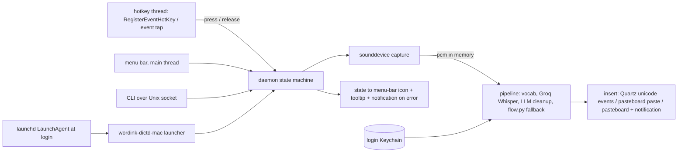

# macOS Dictation App - Plan

## Goal Capsule

- **Objective:** On a Mac (macOS 14 or newer, Apple Silicon or Intel, Python 3.11, uv), hold a global hotkey, speak, release, and Groq-transcribed, cleaned-up text is typed into the focused app. A menu-bar icon shows state, a launchd LaunchAgent keeps it running, and the Groq key lives in the login Keychain.
- **Means:** The same `wordink.desktop` package that ships on Linux and Windows (`sdks/python`). The pipeline stays as is. Only the platform edges change: mic capture, hotkey, text insertion, menu-bar indicator, IPC, autostart, secrets and install. The five seams from the Windows plan (`AudioSource`, `HotkeySource`, `TextInserter`, `Indicator`, `Transport`) already exist, so macOS only adds adapters.
- **Authority:** `ROADMAP.md` Phase 3 and program plan U13. `docs/plans/2026-10-28-0200-feat-windows-dictation-plan.md` (the template; this plan reuses its seams and its test approach). `docs/plans/2026-10-19-2102-test-cross-platform-verification-plan.md` (the macOS mini lane).
- **Execution profile:** Code units M1 to M8 land as small PRs, each tested on Linux against fakes. M8 (CI) rides with them. M9 is operator-run on a real Mac and produces evidence, not diffs. Nothing in this plan changes any Mac until the operator runs the installer.
- **Stop conditions:** a permission flow that cannot be completed without an Apple Developer account (record it, stop that unit), a target app that blocks synthetic input (secure input fields, record, fall back to clipboard), or a hotkey that clashes with a system shortcut (change the key, not the design).
- **Who ships:** the agent ships M1 to M8. The operator (or an agent on the Mac) runs M9.

---

## Product Contract

### Summary

A macOS build of the dictation daemon that matches the Linux and Windows ones in behavior: hold-to-talk and tap-to-toggle, vocabulary hint, LLM cleanup that fails open, insertion into whatever has focus, a visible state indicator, and an always-on service. Same Groq backend, same cleanup code. It installs with one shell script that supports a dry run, an uninstall, and a rollback.

### Problem Frame

macOS is the platform where every competitor already lives (Wispr Flow, Superwhisper, TypeWhisper, VoiceInk), so the app has to be at least as unobtrusive as them. What is new compared with Linux and Windows is the permission model. A Mac asks the user to grant Microphone, Accessibility (to post keystrokes) and sometimes Input Monitoring (to see keystrokes) to a specific executable, and it remembers the grant by the code identity of that executable. A script run by a Python interpreter inherits the interpreter's identity, so a Homebrew or uv Python upgrade can silently revoke a grant. The plan makes that visible (`doctor`) instead of trying to hide it.

### Requirements

- R1. **Global hotkey with hold semantics.** Default `Ctrl+Option+D` hold and `Ctrl+Option+S` toggle (configurable, same `[hotkey]` table). Press starts, release stops. The chord is swallowed so the focused app does not also see it.
- R2. **No clash.** Refuse chords that macOS reserves (`Cmd+Space`, `Cmd+Tab`, `Cmd+Q`, `Ctrl+Cmd+Q` and friends, plus bare keys without a modifier) and chords the user's Spotlight or input-source shortcuts use when they can be read. Report a clash found at registration, never silently fail.
- R3. **Mic capture.** 16 kHz mono s16 from the default input through `sounddevice` (CoreAudio), same tail grace and min/max duration as Linux and Windows, with an actionable error when Microphone access is denied or no input exists.
- R4. **Same pipeline.** Vocabulary, Groq Whisper, LLM cleanup, `flow.py` fallback, retries, kept audio on failure and the key or gateway credentials behave exactly as on Linux. No second implementation.
- R5. **Insertion.** Type with Quartz keyboard events carrying a Unicode string (`CGEventKeyboardSetUnicodeString`), in chunks. For terminals and long text, paste instead: set the pasteboard, send `Cmd+V`, restore the previous pasteboard. When secure event input is on (a password field has focus) or Accessibility is not granted, copy to the pasteboard and notify instead of failing silently.
- R6. **Deny list.** Never type into password managers (match on bundle identifier, for example `com.1password.1password`, `com.bitwarden.desktop`, `org.keepassxc.keepassxc`). Same `[insert] deny` key as the other platforms, keyed on bundle id on macOS.
- R7. **Menu bar.** A menu-bar icon whose symbol and tooltip show idle, recording, transcribing, error, with a menu: toggle recording, copy last transcript, open the config folder, open the log, quit. Errors also raise a notification.
- R8. **Autostart.** A LaunchAgent in `~/Library/LaunchAgents` that runs at login for the current user, restarts on failure, throttles restart loops, never runs two copies, and logs to a rotating file.
- R9. **Secrets.** The Groq key lives in the login Keychain (`wordink-dictd set-key` prompts without echo), with `GROQ_API_KEY` in the environment as an override. The key never appears in logs, the state file, notifications, the plist or `doctor` output.
- R10. **Install and rollback.** `install.sh` supports `--dry-run`, `--uninstall` and `--switch`. `--switch` turns off a competing dictation tool the user names (default: none) only when asked; without it nothing else is touched. Uninstall removes the LaunchAgent, the tool and the rollback script, never the stored key or vocabulary.
- R11. **Doctor.** `wordink-dictd doctor` works on macOS: macOS version and architecture, Python, input device, key present (not its value), Microphone, Accessibility and Input Monitoring status, secure input state, LaunchAgent state, the executable that holds the grants. Read-only.
- R12. **Same CLI.** `trigger`, `status`, `last`, `vocab`, `binds` work through the Unix socket transport so scripts, Shortcuts and Raycast can drive the daemon.

### Scope Boundaries

- Not in scope: a signed and notarized `.app` bundle or `.dmg` (needs an Apple Developer account, so it is an owner decision, see below), a Mac App Store build, a settings GUI beyond the menu, streaming partial results, local engines, Intel-specific tuning.
- The Linux and Windows code is not changed except to widen the OS name list and share helpers.
- No changes to any Mac until the operator runs the installer.

---

## Planning Contract

### Key Technical Decisions

- **KTD1. Reuse the seams; add `mac/` next to `win/`.** The platform layer learns a third OS name, `macos`. Paths follow Apple's layout: config in `~/Library/Application Support/wordink`, logs in `~/Library/Logs/wordink`, failed recordings in `~/Library/Caches/wordink/failed`, and the socket in a short path under `$TMPDIR` or `~/Library/Caches/wordink/run` (Unix socket paths are limited to 104 bytes on macOS, so the runtime dir is chosen and length-checked, with a fallback to `/tmp/wordink-<uid>`). Governs R4, R12.
- **KTD2. Hotkey: `RegisterEventHotKey` first, an event tap only when needed.** Carbon's `RegisterEventHotKey` reports both key pressed and key released for a chord and needs no Input Monitoring permission, which is exactly hold-to-talk with the lowest-friction permission story. It cannot express modifier-only chords (`Fn`, right `Option`). Those are an opt-in mode that uses a `CGEventTap` (listen-only for the modifier, so it cannot swallow typing) and needs Input Monitoring. If registration fails because another app owns the combination, report the clash. If the chord is in the opt-in mode and permission is missing, fall back to the toggle chord and say so in the menu tooltip and `doctor`. Both paths run on a dedicated thread with its own run loop, and hand events to asyncio with `call_soon_threadsafe`. Governs R1, R2.
- **KTD3. Insertion with Quartz events and a pasteboard path.** `CGEventPost` needs Accessibility permission. Unicode events per chunk work across layouts. Text over a threshold (default 200 characters) and terminal bundle ids use pasteboard paste with the previous text restored after a short delay (skipped when the pasteboard holds non-text types, so images and files are never destroyed). `IsSecureEventInputEnabled()` true means a secure field has focus: copy and notify, never type. The frontmost app's bundle id comes from `NSWorkspace`. The pasteboard write sets the `org.nspasteboard.ConcealedType` and `org.nspasteboard.TransientType` markers so clipboard managers skip it. The insertion policy is the same pure-Python decision function style as `win/insert.py`, over an injectable `InsertApi`, so the logic is tested on Linux. Governs R5, R6.
- **KTD4. Menu bar through `rumps`.** `rumps` wraps `NSStatusItem` with a small API and runs the Cocoa run loop on the main thread, which AppKit requires. The daemon's asyncio loop runs on a worker thread and talks to the menu through a thread-safe queue. `pystray` was considered (the Windows tray uses it) and rejected: its macOS backend is less maintained and its menu callbacks run off the main thread. Notifications go through `rumps.notification` (or `osascript` as a fallback). Governs R7.
- **KTD5. Unix socket transport, reused.** `UnixTransport` already exists for Linux and works unchanged on macOS once the socket path fits (KTD1). Governs R12.
- **KTD6. LaunchAgent with `launchctl bootstrap`.** A plist with `RunAtLoad`, `KeepAlive` on non-zero exit, `ThrottleInterval`, `ProcessType` `Interactive`, and `StandardErrorPath` in the log folder. Load with `launchctl bootstrap gui/$(id -u)`, unload with `bootout`. The plist runs a stable launcher path (`~/.local/bin/wordink-dictd-mac`, written by the installer), so the permission grant belongs to one path the user can find. Governs R8, R10.
- **KTD7. Keychain through `keyring`.** The `keyring` package has a macOS Keychain backend. The existing `KeyStore` and `Secret` wrapper in `win/secrets.py` move to a shared module and both OS packages use it; only the help text differs. Governs R9.
- **KTD8. Packaging stays optional-extra based.** `pip install wordink[macos]` adds `sounddevice`, `rumps`, `keyring` and `pyobjc-framework-Quartz`, `pyobjc-framework-Cocoa` with `sys_platform == "darwin"` markers, so Linux and Windows installs are unchanged. Governs R3, R5, R7, R9.
- **KTD9. Default keys: `Ctrl+Option+D` hold, `Ctrl+Option+S` toggle.** `Cmd+Space`, `Fn` and `Ctrl+Space` are taken by Spotlight, the emoji picker and input sources. The keys are an open question for the owner. Governs R1, R2.
- **KTD10. All native calls live behind two small modules.** `mac/quartz.py` (events, hotkey registration, secure input, accessibility trust) and `mac/appkit.py` (pasteboard, frontmost app, status item) are the only modules that import `Quartz` or `AppKit`. Imports are lazy, so every `mac/` module imports on Linux with the fake layer injected, and a CI check fails if any other module imports them. Governs the test approach.

### Open questions for the owner

- Is `Ctrl+Option+D` acceptable as the default hold key, or does Luke prefer a modifier-only key such as right `Option` (needs Input Monitoring)?
- Does Luke have, or want, an Apple Developer account for a signed, notarized `.app`? Without one, the app runs from a uv-installed Python and the user grants permissions to that interpreter. This plan assumes no account.

### Output Structure

```text
sdks/python/src/wordink/desktop/
  platform.py          # gains "macos" (paths, OS detection)
  secrets.py           # shared KeyStore/Secret (moved out of win/secrets.py)
  mac/
    __init__.py
    audio.py           # sounddevice source (CoreAudio)
    hotkey.py          # chord parser, reserved-key table, RegisterEventHotKey + opt-in event tap
    insert.py          # insertion policy over an InsertApi
    menubar.py         # rumps status item, menu, notifications
    secrets.py         # Keychain help text over the shared KeyStore
    quartz.py          # the only module that imports Quartz
    appkit.py          # the only module that imports AppKit
    doctor.py          # macOS doctor checks over injectable probes
    app.py             # entry point: wires adapters and runs the daemon
sdks/python/tests/desktop/
  test_mac_*.py        # run on Linux CI with fake native layers
examples/macos-dictation/
  install.sh
  io.wordink.dictd.plist.tmpl
  README.md
```

### High-Level Technical Design



### Risks

- **Permission grants tied to the interpreter.** A Python upgrade changes the code identity and macOS asks again, or silently denies. Mitigation: the launcher is a stable path, `doctor` prints which executable needs the grants and whether each is granted, and the README says where to look in System Settings.
- **Secure input.** A password field, or another app that left secure input on, makes synthetic typing fail. Mitigation: detect it, copy to the pasteboard and notify.
- **Hotkey clashes with system or other-app shortcuts.** Mitigation: R2 reserved table plus the registration error, and `doctor` lists the configured chords.
- **Main-thread rule.** AppKit must run on the main thread. Mitigation: KTD4, with the daemon on a worker thread and a test that the menu object is only touched through its queue.
- **Unix socket path length.** Mitigation: KTD1, with a test for the 104-byte limit.
- **Sleep and wake.** The event tap or the audio stream can die after wake. Mitigation: the hotkey thread re-registers on a wake notification and the audio source reopens its stream per recording (it already does).
- **No Mac to test on.** Everything is tested against fakes on Linux until M9. Mitigation: the `macos-15` CI job imports every module with the real native packages (declarations only), and M9 is the human check. Never claim "works on macOS" before M9.

---

## Implementation Units

### M1. macOS paths, config, chords and key store

- **Goal:** The macOS file layout, defaults and key storage, with no native calls.
- **Requirements:** R2, R9, KTD1, KTD7, KTD9
- **Dependencies:** none (builds on the Windows plan's W1 and W2 seams).
- **Files:** `desktop/platform.py`, `desktop/config.py`, `desktop/mac/hotkey.py` (parser and reserved table only), `desktop/secrets.py`, `desktop/mac/secrets.py`, `pyproject.toml` (`macos` extra), tests.
- **Approach:** `current_os` accepts `darwin` and returns `macos`; `app_paths("macos", env)` returns the Apple layout with the socket path length check; `load_config(os_name="macos")` uses it with `Ctrl+Option+D` and `Ctrl+Option+S` and validates chords; the chord parser understands `Ctrl`, `Option` (`Alt`), `Shift`, `Cmd`, letters, digits, `F1` to `F20` and rejects reserved or modifier-less chords; the key store moves to a shared module with `win/secrets.py` re-exporting it.
- **Test scenarios:** layout for a normal home, a missing `HOME`, a long `TMPDIR` that forces the fallback; defaults, overrides and invalid chords; `Alt` and `Option` are the same key; reserved chords rejected with a message naming the system shortcut; the key store with a fake backend (get, set, empty refused, missing returns None, errors never include the value); the env override wins; the Windows tests still pass unchanged.
- **Verification:** `uv run pytest` on Linux.

### M2. macOS microphone source

- **Status:** built (`mac/audio.py` over the capture now shared with Windows in `sdaudio.py`, tested against a fake `sounddevice`); the real-device smoke test is left for M9.
- **Goal:** `AudioSource` over `sounddevice` for CoreAudio.
- **Requirements:** R3
- **Dependencies:** M1.
- **Files:** `desktop/mac/audio.py`, tests.
- **Approach:** share the Windows `SoundDeviceSource` core, parameterized by the error text; map a PortAudio error with no input device and the CoreAudio permission-denied pattern (a stream that opens but delivers only zeros for the first second is reported as probable denied access) to messages that point at System Settings, Privacy and Security, Microphone.
- **Test scenarios:** with a fake `sounddevice`: capture and resample, no device, open error, an all-zero stream flagged once, abort mid-capture, tail grace.
- **Verification:** unit tests on Linux; a `mac_hardware` smoke test is skipped in CI and listed for M9.

### M3. Global hotkey

- **Status:** built for the hold and toggle chords (`mac/hotkey.py` `HotkeySource` over the `HotkeyApi` in `mac/quartz.py`, with a ctypes Carbon implementation that has never run on a Mac; tested against a fake). Wake is detected by the wall clock jumping ahead of the monotonic clock. The opt-in modifier-only mode (event tap and Input Monitoring check) is not built; it is deferred until the base hotkey is confirmed on a Mac at M9. The real event loop may instead be the menu bar's main-thread loop, decided in M6.
- **Goal:** Press and release events for the hold chord and press events for the toggle chord.
- **Requirements:** R1, R2, KTD2, KTD10
- **Dependencies:** M1.
- **Files:** `desktop/mac/hotkey.py`, `desktop/mac/quartz.py`, tests.
- **Approach:** a `HotkeySource` that registers both chords with `RegisterEventHotKey` on its own thread and run loop, maps pressed and released events to the callbacks, unregisters on stop, re-registers after wake, and reports a registration failure as a clash. The opt-in modifier-only mode uses a listen-only event tap, checks Input Monitoring first, and falls back to toggle-only with a flag the indicator and `doctor` read.
- **Test scenarios:** against a fake `quartz` layer: press and release order, key repeat ignored, a second chord, registration failure raises the clash error, unregister on stop, wake re-registers, modifier-only without permission falls back and sets the flag, callbacks cross threads through `call_soon_threadsafe`.
- **Verification:** unit tests on Linux; the real hotkey is an M9 check.

### M4. Text insertion

- **Status:** built (`mac/insert.py` policy over an `InsertApi`, tested against a fake; `NativeInsertApi` wires `quartz.py` events, secure input and Accessibility, and `appkit.py` pasteboard and frontmost app, none of which has run on a Mac). Paste is Cmd+V; the pasteboard is flagged concealed and transient; the real typing and paste check is M9.
- **Goal:** Put text into the focused app, safely.
- **Requirements:** R5, R6, KTD3, KTD10
- **Dependencies:** M1.
- **Files:** `desktop/mac/insert.py`, `desktop/mac/appkit.py`, tests.
- **Approach:** a pure policy over an `InsertApi` (frontmost bundle id, secure input flag, Accessibility trusted flag, post-unicode, set and restore pasteboard, send paste, notify). Release held modifiers first and wait for the chord keys to be up. Strategy: deny list skips, secure input or no Accessibility copies and notifies, terminals and long text paste, otherwise type in chunks of up to 20 UTF-16 units.
- **Test scenarios:** ASCII, emoji, newline, long text switches to paste, a terminal bundle id pastes, secure input falls back to the pasteboard with a notification, a deny-listed bundle id is skipped, non-text pasteboard prevents paste, restore only while the pasteboard still holds our text, a second dictation cancels the first restore, concealed and transient markers are set, no Accessibility notifies once.
- **Verification:** unit tests on Linux; typing into a scratch TextEdit window is an M9 check.

### M5. Menu bar and notifications

- **Status:** built (`mac/menubar.py`, `MenuBar` over `rumps`, tested against a fake; the daemon side only enqueues and a main-thread timer applies updates). The icon appearing on screen is the M9 check.
- **Goal:** A status item with state and a small menu.
- **Requirements:** R7, KTD4
- **Dependencies:** M1.
- **Files:** `desktop/mac/menubar.py`, tests.
- **Approach:** an `Indicator` that posts state changes to the main-thread queue, with a symbol per state, a tooltip carrying a short error detail, and menu actions that call the daemon through a thread-safe handle. Notification once per distinct failure.
- **Test scenarios:** with a fake `rumps`: state to symbol and tooltip mapping, menu actions call the right daemon methods, an error notifies once, quit shuts the daemon down, the UI object is never touched from the daemon thread.
- **Verification:** unit tests on Linux; the icon appearing on screen is an M9 check.

### M6. Daemon wiring, doctor and CLI

- **Status:** built (`mac/app.py`: daemon on a worker thread under the main-thread menu loop, startup failures raised before the menu opens; `mac/doctor.py` over injectable probes; macOS `run` and `doctor` in the CLI; the `wordink-dictd-mac` entry). Nothing has run on a Mac: the real adapters and probes are the M9 check.
- **Goal:** One process that runs the pipeline with the macOS adapters, plus `doctor` and the CLI.
- **Requirements:** R4, R11, R12
- **Dependencies:** M1 to M5.
- **Files:** `desktop/mac/app.py` (the `wordink-dictd-mac` entry), `desktop/mac/doctor.py`, `desktop/cli.py` (macOS `run`, `set-key`, `doctor`, `binds`), tests.
- **Approach:** build the adapters, wire hotkey press and release into `Daemon`, run the daemon on a worker thread under the main-thread menu loop, log to `~/Library/Logs/wordink/dictd.log` with rotation, refuse a second instance when the socket answers. `doctor` runs read-only probes (injectable) and never prints the key.
- **Test scenarios:** end to end on Linux with fakes (hotkey press, fake audio, mocked Groq, fake inserter, menu queue); second instance refused; stale socket replaced; `doctor` output never contains the key and lists each permission with its executable; the CLI commands work over the socket.
- **Verification:** unit and integration tests on Linux.

### M7. Installer and LaunchAgent

- **Goal:** One script to install, uninstall and roll back. Not run on any Mac as part of this plan.
- **Requirements:** R8, R10, KTD6
- **Dependencies:** M6.
- **Files:** `examples/macos-dictation/install.sh`, `examples/macos-dictation/io.wordink.dictd.plist.tmpl`, `examples/macos-dictation/README.md`, tests.
- **Approach:** `uv tool install --force "wordink[macos]"`, write the launcher at a stable path, render the plist, `launchctl bootstrap` and `bootout`, `--dry-run` prints every step, `--uninstall` keeps the key and vocabulary, a second run changes nothing. All commands go through functions the tests replace, as in the Omarchy installer.
- **Test scenarios:** shellcheck clean, `plutil -lint` on the rendered plist where available (macOS CI), dry run changes nothing, second run changes nothing, uninstall keeps the key and vocabulary, a missing `uv` fails with the install hint, the plist never contains a key.
- **Verification:** shellcheck on Linux, `plutil` on `macos-15`; nothing executed on a user's Mac.

### M8. CI and test seams

- **Goal:** Keep macOS code honest without a Mac on the desk.
- **Dependencies:** M1 onward (grows with each unit).
- **Files:** `.github/workflows/ci.yml` (a `python-sdk-macos` job on `macos-15`), `sdks/python/pyproject.toml` (pytest marker `mac_hardware`).
- **Approach:** the Linux job runs everything against fake native layers. The macOS job installs `.[macos]`, runs the same tests, imports every `mac/` module with the real `Quartz`, `AppKit` and `rumps` (declarations only: nothing is called at import), and lints the plist. A check fails if any module other than `quartz.py` and `appkit.py` imports a native framework. `mac_hardware` tests are skipped in CI.
- **Verification:** both jobs green on the PR that adds them.

### M9. Operator checks and acceptance on a real Mac (read-only, then a human test)

- **Goal:** Confirm assumptions before install and prove the result after.
- **Dependencies:** M1 to M8 merged. Not an agent task unless the operator gives machine access.
- **Read-only checks before install:** `sw_vers`, `uname -m`, `python3 --version`, `uv --version`; the default input device; whether `Ctrl+Option+D` or `Ctrl+Option+S` is used by Raycast, Alfred, BetterTouchTool, Karabiner or a system shortcut; whether a competing dictation tool is running; Groq key presence only, never its value.
- **Acceptance after the operator runs `install.sh`:**
  - Grant Microphone and Accessibility to the launcher when asked.
  - Hold the hotkey in TextEdit, a browser field, Terminal and an editor; cleaned text appears within a few seconds each time, and the chord does not leak into the app.
  - The menu-bar icon changes state, and the error notification appears when the network is off.
  - A password field gets the pasteboard-and-notification fallback, not a silent failure.
  - Log out and in; the LaunchAgent starts the app. Kill the process; it restarts.
  - `install.sh --uninstall` removes everything but the key and vocabulary.
- **Verification:** results recorded in the PR or the tracking ticket as a short table, with no keys or audio.

---

## Verification Contract

- Linux: `uv run pytest` in `sdks/python` covers M1 to M7 against fake native layers; shellcheck on the installer.
- macOS CI: `uv run pytest`, real-framework import checks, `plutil -lint`.
- Operator acceptance: M9.

## Definition of Done

- M1 to M8 merged with green CI on Linux and macOS runners; M9 results recorded.
- `ROADMAP.md` marks the macOS app shipped.
- WI-U13 (TLY-279) shows each merged PR.
