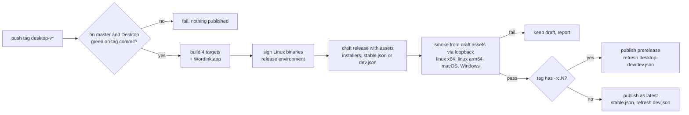
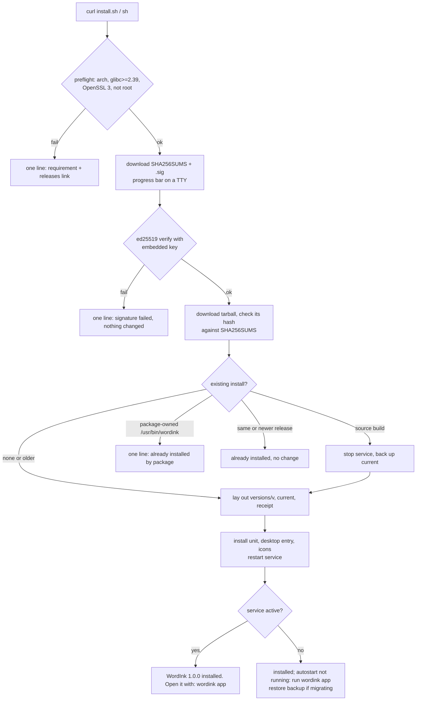
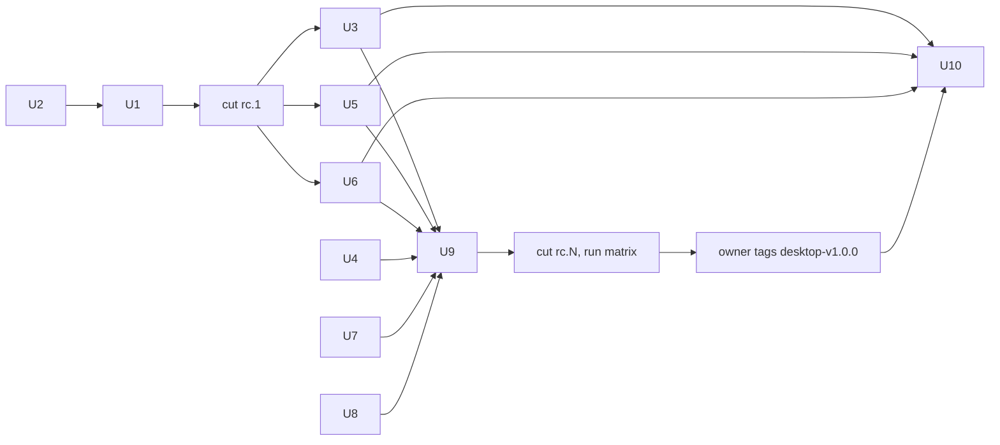

# WordInk desktop 1.0.0 release - Plan

## Goal Capsule

- **Objective:** Anyone on Linux, macOS (Apple silicon) or Windows can install the released WordInk desktop app with one pasted command that prints a few lines, finish a short first run, and dictate; Linux installs then keep themselves up to date from a signed release feed.
- **Means:** GitHub Releases is the only host (KTD1). Small per-OS bootstrap installers are published as release assets (KTD2, KTD4). The existing tag-driven release workflow gains a test gate, a staging feed and a post-publish install smoke (KTD3, KTD9).
- **Authority:** the Product Contract wins on behavior; KTDs win on mechanism within it; units override neither.
- **Stop conditions:**
  - Stop if the first `desktop-v1.0.0-rc.1` run shows the release workflow cannot publish signed Linux assets; fix the pipeline before any other unit ships.
  - Stop and ask the owner if a change would add a server, accounts, automatic telemetry, or a visual redesign (Key Decisions).
- **Execution profile:** one PR per unit, merged when the four-OS `Desktop` workflow is green and review has no open blocking finding. U1 lands and an rc is cut before U3-U6 depend on real assets.
- **Who finishes:** the agent implements and merges the units. The owner approves each `release` environment deployment, runs the manual matrix on their own machines, and cuts the final `desktop-v1.0.0` tag after an rc passes (R20).

---

## Product Contract

### Summary

Ship WordInk desktop 1.0.0. Add one-line installers for each OS and move existing installs to the release build. Cut the first-run tour down to the steps that matter, with one short demo. Fix every download link that still points at Hex. Gate the release on green tests and a real install of the published assets on all four targets. Telemetry stays off: usage is read from GitHub download counts, and users can copy a diagnostics summary by hand.

### Problem Frame

The desktop app is feature-complete for a first release, but nothing a user can follow installs it. The desktop README's download links, Homebrew tap and install command all install Hex, the upstream app. The only Linux installer ships inside the release tarball. macOS and Windows get bare zips with no app bundle, installer or uninstall. The release workflow has never run end to end, and it runs no tests. The updater serves only a stable feed, so the "Dev" channel in Settings points at nothing. A local build installed with `scripts/install-linux.sh` never updates, and the release installer refuses to replace it. First run plays a long scripted demo and a practice game before the user can dictate, and it cannot be skipped when the user is offline.

### Key Decisions

- **Version 1.0.0, cut only after tests pass on all four targets.** Governs R17, R20. (session-settled: user-directed — chosen over 0.1.0: the app is ready to ship as a stable release once tests pass)
- **Telemetry is opt-in only and nothing is sent automatically.** Governs R14, R15. (session-settled: user-directed — chosen over opt-out and default-on telemetry: privacy-first product)
- **No server, accounts or stats sync in 1.0.** Governs R1, R14. (session-settled: user-directed — chosen over a hosted account service with synced stats: no infrastructure to run)
- **Keep the existing WordInk desktop look.** Governs R21, R22. (session-settled: user-directed — chosen over a redesigned card-grid picker: the owner likes the current app)
- **macOS notarization and Windows Authenticode stay deferred; Linux ships signed.** Governs R6, R7, R12. (session-settled: user-directed — chosen over buying signing for 1.0: paid signing waits; Linux ed25519 signing already exists)

### Requirements

**Install**

- R1. Each OS has one documented command that downloads the latest stable release from GitHub Releases and installs it: `curl … | sh` on Linux and macOS, `irm … | iex` on Windows.
- R2. A successful install prints at most five lines (a progress bar while downloading counts as one) and ends by saying how to open the app.
- R3. A failed install prints one line naming what failed and what to do, and leaves any previous install working.
- R4. The Linux installer refuses to install a binary whose ed25519 signature does not verify against the public key embedded in the installer itself.
- R5. Before downloading, the Linux installer checks the CPU architecture, glibc version, OpenSSL 3, and that the user is not root. It stops with a named requirement when any check fails.
- R6. The macOS installer installs an app bundle named `WordInk.app` into `~/Applications` and turns on launch at login. It says once that the app is unsigned.
- R7. The Windows installer installs per-user without admin rights, adds a Start menu entry and launch at login, and says once that the app is unsigned.
- R8. Unsupported platforms (Intel Mac, Windows on ARM, other Linux CPUs) get a one-line message naming the supported platforms and the releases page.

**Upgrade, migrate and uninstall**

- R9. Running the Linux installer over a local source build replaces it with the release build and keeps settings, history, keys and downloaded models.
- R10. Re-running an installer over the same or a newer installed version changes nothing unless `--force` is given.
- R11. Each OS has an uninstall command that stops the app and removes it. With `--purge` it also removes settings, history and models, after one confirmation.
- R12. Linux installs update themselves from the stable feed and verify each update's signature. macOS and Windows show that an update exists and link to the release.
- R13. A staging channel exists. Choosing "Dev" in Settings follows release candidates, and switching back to stable warns that it may install an older version.

**Privacy and usage**

- R14. WordInk sends no analytics, crash reports or usage data automatically. The privacy pane keeps saying so.
- R15. A "Copy diagnostics" action copies a plain-text summary to the clipboard: app version, channel, OS, architecture, engine kind and recent error codes. It never includes audio, transcripts, file paths or keys.
- R16. The owner can see install counts per release, OS and architecture with one command, read from GitHub. One asset per OS and architecture counts as an install; downloads the updater makes are reported separately as updates.

**Release**

- R17. A release tag builds only from a commit whose `Desktop` workflow passed on all four targets.
- R18. A release stays a draft until a job has installed its own assets with the one-line installers on Linux x86_64, Linux aarch64, macOS arm64 and Windows x64, and started the app (`wordink --version`).
- R19. Release candidates never become the "latest" release; only a final tag does.
- R20. 1.0.0 is tagged only from a commit whose release candidate passed R17, R18 and the manual per-OS checklist.

**First run**

- R21. First run shows, in order: welcome, one short demo (under 20 seconds, skippable), permissions, engine choice (Groq key or local model download), shortcut, one test dictation, done. The practice game is not part of first run.
- R22. The permissions and engine steps offer "Finish later". Choosing it lands in the app with a visible "Set up dictation" state instead of a loop, and later launches open the app, not the tour.
- R23. Quitting during first run (without Finish later) resumes at the same step on next launch, and a model download never counts as finished until its checksum verifies.
- R24. No user-facing text in first run says "Hex".

**Documentation**

- R25. The root README and `apps/desktop/README.md` show the one-line install and uninstall commands for each OS, the unsigned-app notice for macOS and Windows, and the Linux requirements. No download link points at Hex.

### Acceptance Examples

- AE1. Covers R9. Given a source build at `~/.local/share/wordink/current` with a running user service, when the user runs the Linux one-liner, then the release build is installed, the service restarts on it, the old build is kept as a backup until the new one starts, and settings and history are unchanged.
- AE2. Covers R10. Given the updater already installed 1.0.1, when the user runs the installer for 1.0.0, then it prints "WordInk 1.0.1 is already installed" and changes nothing.
- AE3. Covers R5. Given Ubuntu 22.04 (glibc 2.35), when the user runs the Linux one-liner, then it prints one line saying WordInk needs glibc 2.39 or newer and lists example distributions, and downloads nothing.
- AE4. Covers R22. Given no network and no Groq key, when the user picks "Finish later" on the engine step, then the main window opens with "Set up dictation" shown, and the shortcut does nothing but open that setup.

### Scope Boundaries

- Not in 1.0: Homebrew tap, winget manifest, AUR, `.deb`/`.rpm`, Flatpak, AppImage, Nix publishing. The templates in `apps/desktop/packaging/` stay, unpublished.
- Not in 1.0: macOS notarization, Windows Authenticode, and self-installing updates on macOS and Windows (Key Decisions).
- Not in 1.0: Windows on ARM, Intel Macs, macOS before 15.
- Considered and not built:
  - Automatic rollback when a new version crashes on start. The installer keeps the previous version, and the runbook documents a manual revert. Revisit if a bad release reaches users.
  - Building Linux releases on an older base for glibc below 2.39 (KTD6). Revisit if users on Ubuntu 22.04 or Debian 12 ask.
  - Rollback protection for a fresh Linux install (refusing an older, validly signed build served as "latest"). The in-app updater already has `sequence` and `revoked_versions`; the bootstrap does not consult them. Revisit if release assets are ever tampered with.

### Deferred to Follow-Up Work

- Homebrew cask and winget manifest, once the app is signed.
- Paid signing (owner actions listed under Operational Notes).
- A "Replay tour" entry that plays the full demo and practice game from the Help menu.

### Open Questions

Deferred to the owner; the plan proceeds with the stated default.

- **Is a manual "Copy diagnostics" an acceptable meaning of opt-in telemetry for 1.0?** With no server there is nowhere to send an opt-in ping. Default: yes, plus download counts (KTD5). A different answer needs a destination the owner already runs.
- **Should macOS builds use a free self-signed code-signing identity kept as a `release` secret?** Ad-hoc signed apps may lose microphone and accessibility grants on every reinstall, and on macOS every update is a reinstall. Default for 1.0: ad-hoc signing, with the re-grant documented. The owner would create the identity and store it as a secret.

---

## Planning Contract

### Key Technical Decisions

- KTD1. **GitHub Releases on `duketopceo/WordInk` is the only download host.** Installers fetch `releases/latest/download/<asset>`, and the updater keeps its existing `stable.json` URL. No other workflow may create GitHub Releases, so "latest" always means the latest desktop release (R19). Governs R1, R14.
- KTD2. **A signed checksum list is the trust root for every release file.** The protected signing job signs `SHA256SUMS` (which lists every asset, tarballs and zips included) as well as the bare Linux binaries. The tarballs are therefore assembled before signing, in a job with no secrets. The Linux bootstrap `install.sh` embeds the ed25519 public key, verifies `SHA256SUMS.sig`, and checks every file it downloads against that list before running anything from the tarball. macOS and Windows installers check hashes against `SHA256SUMS` only, because those systems lack a stock ed25519 verifier; this matches the settled unsigned status. Governs R4.
- KTD3. **Staging is release-candidate tags, not branches.** A `desktop-vX.Y.Z-rc.N` tag is built with `HEX_BUILD_CHANNEL=dev`, publishes a prerelease, and refreshes `dev.json` on a rolling `desktop-dev` prerelease, so Dev installs follow candidates without a switch prompt. The updater's Dev channel reads `releases/download/desktop-dev/dev.json`. A final tag `desktop-vX.Y.Z` rebuilds the same commit with `HEX_BUILD_CHANNEL=stable` and refreshes both `stable.json` and `dev.json`, so Dev never lags stable. There are no `dev` or `production` branches. Governs R13, R19.
- KTD4. **macOS and Windows ship unsigned, installed by script.** macOS gets an ad-hoc-signed `WordInk.app` (executable `wordink`, bundle id `io.github.duketopceo.wordink`). It is built in CI from `scripts/build-app.sh`, zipped, and installed to `~/Applications` by `install-macos.sh`. Windows gets the existing zip, installed by `install.ps1` to `%LOCALAPPDATA%\Programs\WordInk` with `Unblock-File`, a Start menu shortcut and a `Run` key. Script installs avoid browser quarantine and mark-of-the-web; the scripts say plainly that the app is unsigned. Inno Setup stays unbuilt. (session-settled: user-directed — chosen over paid notarization and Authenticode for 1.0: paid signing is deferred) Governs R6, R7.
- KTD5. **Telemetry is a user-initiated diagnostics copy plus GitHub download counts.** Without a server, an opt-in network ping has nowhere to go, so 1.0 sends nothing. "Copy diagnostics" (R15) is the opt-in act. `apps/desktop/scripts/download-stats.sh` reads `download_count` per asset through the GitHub API (R16). The privacy copy, its pinned test and the "no telemetry" lines in `AGENTS.md` and `ROADMAP.md` stay true unchanged. Governs R14, R15, R16.
- KTD6. **Linux builds stay on Ubuntu 24.04 (glibc 2.39) with an early preflight.** The bootstrap names the requirement before downloading (R5). Building on an older base is a follow-up if users ask. Governs R5.
- KTD7. **The Cargo version becomes 1.0.0 and the tag stamps the release version.** `HEX_VERSION` from the tag stays authoritative. The package name `hex`, the protocol id `app: "hex"` and the updater User-Agent are internal and stay. `scripts/set-crate-version.sh` accepts final and `-rc.N` versions. Governs R17, R20.
- KTD8. **First run is shortened by removing story pages, not by new screens.** The flow in `src/desktop/onboarding.rs` keeps Welcome, Setup (permissions), Engine, Hotkey, TryIt and Done. The story pages for the scripted demo (Parked → Done) and the practice game leave the first-run story; their code stays for a later "Replay tour". Governs R21, R22, R23.
- KTD9. **The release workflow gates itself.** A first job requires the tag commit to be on `master` and the `Desktop` workflow to have succeeded on it; when no run exists (path-filtered docs commits) it dispatches `Desktop` on that commit and waits, and a cancelled run counts as a failure (R17). A final tag also requires a published release candidate on the same commit (R20). The release is created as a draft. A no-secrets job downloads the draft's assets with the job token and hands them on as workflow artifacts; read-only `smoke` jobs install them from a loopback server through the installers' base-URL override (R18). `publish` alone un-drafts. Release notes come from `apps/desktop/CHANGELOG.md`. Governs R17, R18, R19, R20.
- KTD10. **Source-to-release migration is automatic and reversible.** `install-release.sh` recognises a real `current` directory carrying the `source-build` marker. It stops the user service, moves the directory to `current.source-bak`, installs, restarts, and deletes the backup only after the service reports active. On any failure it restores the backup. An unreadable or unknown state fails closed. Governs R9, R3.

### High-Level Technical Design

Release flow: a tag runs one gated pipeline; candidates feed the Dev channel, finals feed stable.

Linux bootstrap install path (KTD2, KTD10):

### Assumptions

These defaults were chosen without the owner's answer, because this plan was written unattended.

- macOS and Windows installs verify file hashes but have no independent trust root until those builds are signed (KTD2).
- Telemetry ships as "Copy diagnostics" plus download counts, with no toggle (KTD5).
- The glibc 2.39 floor is accepted with an early preflight (KTD6).
- Source-to-release migration runs automatically with a backup (KTD10).
- The downgrade guard refuses unless `--force` (R10).
- macOS ships as an ad-hoc-signed `WordInk.app` installed to `~/Applications`; users may need to re-grant microphone and accessibility after each update (Open Questions).

### Risks & Dependencies

| Risk | Mitigation |
|---|---|
| The release workflow has never run end to end; its only run failed in 0 seconds. | U1 cuts `desktop-v1.0.0-rc.1` before the installers depend on real assets. |
| `release.yml` (Changesets) could create a GitHub Release and take over "latest". | U1 confirms it only tags; KTD1 forbids other Release creators. |
| macOS microphone and accessibility permissions may not attach to an ad-hoc-signed bundle. | The manual matrix (U9) checks the grants and the re-prompts after an update. |
| The Linux binary depends on `[patch.crates-io]` pinning a third-party `transcribe.cpp` git revision. | Kept for 1.0 and recorded in `docs/releasing.md`; vendoring is a follow-up. |
| Some Hyprland and sway sessions never reach `graphical-session.target`, so the service never autostarts. | The post-install health check reports it and prints `wordink app` (R2, U3). |
| Every release run needs the owner to approve the `release` environment. | Accepted; it is the signing gate. |

### Sequencing

---

## Implementation Units

### U1. Prove and gate the release workflow

- **Goal:** A tag reliably builds, signs, drafts and publishes, but only from a tested commit, with notes from a changelog.
- **Requirements:** R17, R19; KTD1, KTD7, KTD9.
- **Dependencies:** U2.
- **Files:**
  - `.github/workflows/desktop-release.yml`
  - `.github/workflows/release.yml` (confirm it creates no GitHub Release)
  - `apps/desktop/CHANGELOG.md` (new)
  - `docs/releasing.md`
- **Approach:**
  1. Find and fix the cause of the 0-second failure, using `actionlint` and a `workflow_dispatch` dry run that skips publishing.
  2. Add the gate job of KTD9: tag commit on `master`; `Desktop` success on it, dispatching and waiting when no run exists; for a final tag, a published `-rc.N` on the same commit.
  3. Read the release notes from the matching `CHANGELOG.md` section instead of the fixed heredoc.
  4. Keep `-rc.N` tags as prereleases that are never marked latest, built with `HEX_BUILD_CHANNEL=dev` (KTD3).
  5. Assemble the tarballs before the `sign-linux` job, and have it sign `SHA256SUMS` as well as the bare binaries (KTD2).
  6. Document the runbook in `docs/releasing.md`: the rc-then-final flow, approving the `release` environment, pulling a bad release (back to draft), and a manual Linux revert (`current` → previous `versions/<v>`).
- **Patterns to follow:** the existing jobs and the `release` environment in `.github/workflows/desktop-release.yml`; `docs/releasing.md`.
- **Test scenarios:**
  - A tag on a commit whose `Desktop` run failed stops at the gate job and publishes nothing.
  - A tag on a commit not reachable from `master` stops at the gate.
  - A tag on a docs-only commit with no `Desktop` run dispatches one and proceeds only if it succeeds; a cancelled run fails the gate.
  - A final tag on a commit with no published rc stops at the gate.
  - `SHA256SUMS.sig` verifies against `apps/desktop/packaging/linux/wordink-signing.pub` and lists every published asset.
  - A tag on a green commit with an `-rc.1` suffix produces a prerelease, and `releases/latest/download/stable.json` still resolves to no release or the previous final.
  - The release body equals the `CHANGELOG.md` section for that version; a missing section fails the run before signing.
- **Verification:** `desktop-v1.0.0-rc.1` produces every asset listed in `docs/releasing.md` with a verifiable Linux signature.

### U2. Version 1.0.0 and remove Hex release leftovers

- **Goal:** The repo builds and describes WordInk 1.0.0, and no script can publish to Hex's accounts.
- **Requirements:** R24, R25 (partial); KTD7.
- **Dependencies:** none.
- **Files:**
  - `apps/desktop/Cargo.toml`, `apps/desktop/Cargo.lock`
  - `apps/desktop/scripts/set-crate-version.sh`
  - delete: `apps/desktop/scripts/publish-app-mirror.sh`, `apps/desktop/scripts/release-dev-notes.sh`, `apps/desktop/scripts/release-aur.sh`, `apps/desktop/scripts/release-homebrew.sh`, `apps/desktop/scripts/release-app.sh`, `apps/desktop/packaging/legacy-downloads/`, `apps/desktop/packaging/macos/legacy-appcast.xml`
  - fix: `apps/desktop/scripts/build-windows-installer.ps1` output name; `apps/desktop/scripts/check-onboarding.sh` binary name
  - `apps/desktop/docs/releasing.md` (replace with a pointer to `docs/releasing.md`), `apps/desktop/AGENTS.md` (drop the dev/production branch policy)
  - onboarding strings under `apps/desktop/src/rune_ui/onboarding_kit/` and the i18n tables
- **Approach:**
  1. Set the Cargo version to 1.0.0, keeping the package name `hex`.
  2. Make `set-crate-version.sh` accept `X.Y.Z` and `X.Y.Z-rc.N`.
  3. Delete the scripts and packaging that target `anoma.ly` or `anomalyco`. Keep the `[patch.crates-io]` pin (Risks).
  4. Replace the "Hex" strings shown to users with "WordInk".
- **Test scenarios:**
  - `wordink --version` from a local build prints a 1.0.0-based version.
  - The onboarding golden scenes contain no "Hex" text.
  - `set-crate-version.sh 1.0.0-rc.1` succeeds, and `set-crate-version.sh 1.0` is refused.
- **Verification:** `rg -i 'anoma\.ly|anomalyco/hex|kitlangton'` over `apps/desktop` finds only the `transcribe.cpp` pin, attribution text and test fixtures.

### U3. Linux one-line installer, migration and uninstall

- **Goal:** `curl -fsSL https://github.com/duketopceo/WordInk/releases/latest/download/install.sh | sh` installs or upgrades the signed release in a few lines, migrates source builds, and uninstalls.
- **Requirements:** R1-R5, R8-R11; KTD2, KTD6, KTD10.
- **Dependencies:** U1, and an rc with real assets.
- **Files:**
  - `apps/desktop/packaging/linux/install.sh` (new bootstrap)
  - `apps/desktop/packaging/linux/install-release.sh`
  - `apps/desktop/packaging/linux/make-tarball.sh`
  - `.github/workflows/desktop-release.yml` (publish `install.sh` as an asset)
  - `apps/desktop/scripts/test-install-linux-release.sh` (retarget to the bootstrap and loopback fixtures)
- **Approach:**
  1. The bootstrap is POSIX `sh`. It runs the preflight (R5), picks the arch asset, and downloads with `curl --progress-bar` only when stderr is a TTY. It cleans its temp dir on exit.
  2. Downloads come from `WORDINK_INSTALL_BASE`, defaulting to `releases/latest/download`; it accepts https, or http only to loopback for the test harness and smoke jobs.
  3. It verifies `SHA256SUMS` and every file per KTD2, and only then runs the tarball's `install-release.sh`.
  4. It passes `uninstall` and `--purge` through: `curl … | sh -s -- uninstall`.
  5. `install-release.sh` gains the migration of KTD10 and the downgrade guard of R10. Before installing, it detects a package-owned `/usr/bin/wordink`.
  6. After restarting, it checks `systemctl --user is-active wordink`, replacing the `|| true` that hid failures.
  7. Install output is at most five lines (R2).
  8. Validate the `XDG_DATA_HOME` and `WORDINK_BIN_DIR` overrides. When `~/.local/bin` is not on `PATH`, print one hint line.
- **Execution note:** this is mostly packaging; prove it with the loopback-fixture harness and real installs on x64 and aarch64 hosts rather than unit tests.
- **Patterns to follow:** `apps/desktop/packaging/linux/install-release.sh` (verification and layout); `apps/desktop/scripts/test-install-linux-release.sh` (fixture service).
- **Test scenarios:**
  - Covers AE3. With glibc 2.35 faked, the bootstrap exits non-zero with the glibc line and downloads nothing.
  - A `SHA256SUMS` whose `.sig` does not verify against the embedded key fails with "signature failed" and leaves the previous install intact.
  - A tarball whose hash differs from `SHA256SUMS` (for example a swapped `install-release.sh`) fails before anything from it runs.
  - `WORDINK_INSTALL_BASE` set to a non-loopback http URL is refused.
  - Covers AE1. Over a source build with the `source-build` marker, the install migrates, the service is active on the new binary, `current.source-bak` is removed, and the settings file is byte-identical.
  - Migration where the new service fails to start restores the source build and its service.
  - Covers AE2. With a newer version installed, the installer prints "already installed" and exits 0 without changes; `--force` reinstalls.
  - With `/usr/bin/wordink` owned by a package, the installer stops with the package name.
  - `uninstall` removes the binary, unit, desktop entry, icons and symlink and keeps the data dir; `uninstall --purge` with confirmation also removes `~/.local/share/wordink` and the keyring entries.
  - Without a user systemd bus, the install succeeds and prints the `wordink app` hint.
  - On a non-TTY run the output has no progress bar and is at most five lines.
- **Verification:** the shell harness passes; a real install from rc assets works on Linux x86_64 and aarch64, including one migrated source build.

### U4. Staging channel feed

- **Goal:** "Dev" in Settings follows release candidates through a real feed.
- **Requirements:** R13; KTD3.
- **Dependencies:** U1.
- **Files:**
  - `apps/desktop/src/updater.rs` (`manifest_url_for` for the Dev channel)
  - `apps/desktop/packaging/linux/write-manifest.sh` (`channel` argument)
  - `.github/workflows/desktop-release.yml` (rc tags write `dev.json` and replace it on the rolling `desktop-dev` prerelease)
  - the switch-channel confirmation copy in the Settings update rows
  - tests beside `apps/desktop/src/updater.rs` and the fixtures in `apps/desktop/tests/fixtures/release-protocol/`
- **Approach:**
  1. Candidate builds are stamped `dev` and final builds `stable` (KTD3), so each install follows its home feed without prompts.
  2. Any channel switch whose target is older than the running build shows a confirmation that says it will install an older version.
  3. Final tags write `dev.json` too (KTD3).
- **Patterns to follow:** the existing stable manifest path and protocol fixtures.
- **Test scenarios:**
  - With the Dev channel selected, the updater requests the `desktop-dev/dev.json` URL.
  - With the stable channel selected, the URL is unchanged from today.
  - A `dev.json` naming a candidate newer than the running build is offered.
  - A Dev-to-stable switch where stable is older shows the downgrade wording before anything installs.
  - After a final release, `dev.json` names the final, so a stable user who picks Dev is not moved to an older candidate.
  - A Dev-stamped install updates to the next candidate without a switch prompt.
  - `write-manifest.sh dev` writes `"channel":"dev"`, and the publish step refuses a Linux target without its signature, as for stable.
- **Verification:** an rc-installed Linux build with Dev selected updates to the next rc.

### U5. macOS app bundle and one-line installer

- **Goal:** `curl -fsSL …/install-macos.sh | sh` installs an unsigned `WordInk.app` that keeps its permissions and starts at login.
- **Requirements:** R1-R3, R6, R8, R10, R11; KTD4.
- **Dependencies:** U1.
- **Files:**
  - `apps/desktop/scripts/build-app.sh` (bundle name `WordInk.app`, executable `wordink`, ad-hoc signature; the unsigned path must not need the missing `.github/release/hex.entitlements`)
  - `.github/workflows/desktop-release.yml` (zip the bundle as `wordink-<v>-macos-arm64.zip`)
  - `apps/desktop/packaging/macos/install-macos.sh` (new)
  - `apps/desktop/scripts/smoke-macos-app.sh`
- **Approach:**
  1. Make the unsigned bundle path of `build-app.sh` self-contained: entitlements for ad-hoc signing in the repo, the microphone driver and helper steps confirmed on the macOS runner, and the release job calling it with the tag version instead of zipping the bare executable.
  2. The installer checks for arm64 and macOS 15 or newer, downloads from `WORDINK_INSTALL_BASE` (as in U3), verifies the zip against `SHA256SUMS`, and replaces `~/Applications/WordInk.app` only when the release is newer than the installed one (or with `--force`).
  3. It enables launch at login through the app's existing login-item support, opens the app once, and supports `uninstall` and `--purge`.
- **Test scenarios:**
  - On an Intel or macOS 14 runner, the installer prints the supported-platform line.
  - A fresh install leaves `~/Applications/WordInk.app` whose `wordink --version` equals the release.
  - A re-run with the same version changes nothing.
  - `uninstall --purge` removes the app, its support folder and the login item.
  - When macOS holds launch at login for approval, the installer's last line says to approve it in System Settings.
- **Verification:** on a real Mac, the app records and pastes after granting microphone and accessibility, the grants survive a relaunch, and the checklist records whether they survive an rc-to-rc reinstall (Open Questions).

### U6. Windows one-line installer

- **Goal:** `irm https://github.com/duketopceo/WordInk/releases/latest/download/install.ps1 | iex` installs per-user without admin and starts at login.
- **Requirements:** R1-R3, R7, R8, R10, R11; KTD4.
- **Dependencies:** U1.
- **Files:**
  - `apps/desktop/packaging/windows/install.ps1` (new)
  - `.github/workflows/desktop-release.yml` (publish it)
  - `apps/desktop/scripts/test-windows-installer.ps1` (retarget)
- **Approach:**
  1. Check for x64 and refuse ARM64 with the R8 line.
  2. Download the zip from `WORDINK_INSTALL_BASE` (as in U3) and verify it against `SHA256SUMS`.
  3. Stop a running `wordink.exe`, extract to `%LOCALAPPDATA%\Programs\WordInk`, and `Unblock-File` the executable.
  4. Add the Start menu shortcut and the HKCU `Run` value, then start the app.
  5. `uninstall` removes these; `-Purge` also removes `%APPDATA%\wordink` after confirmation.
- **Patterns to follow:** the per-user layout and Run-key handling in `apps/desktop/packaging/windows/wordink.iss`.
- **Test scenarios:**
  - On a clean runner the install creates the shortcut and Run value, and `wordink.exe --version` matches.
  - A re-run with the app running replaces it without a locked-file error.
  - On ARM64 the installer prints the supported-platform line.
  - `uninstall` removes the shortcut and Run value and keeps `%APPDATA%\wordink`.
  - PSScriptAnalyzer reports no errors.
- **Verification:** a real Windows PC installs, starts at login and dictates.

### U7. Shorter first run

- **Goal:** A new user reaches a working dictation in the fewest steps, and can finish later.
- **Requirements:** R21-R24; KTD8.
- **Dependencies:** U2.
- **Files:**
  - `apps/desktop/src/desktop/onboarding.rs`
  - `apps/desktop/src/rune_ui/onboarding.rs`
  - `apps/desktop/src/rune_ui/onboarding_kit/live.rs`, `apps/desktop/src/rune_ui/onboarding_kit/stories.rs`
  - the onboarding tests and `apps/desktop/tests/golden/` onboarding scenes
- **Approach:**
  1. Build the first-run flow with engine setup always included. A ready engine skips only the Engine step; Hotkey always shows.
  2. Keep one short demo page (the side-by-side "with and without" story) with a Skip control, and drop the practice-game pages from the sequence.
  3. Add a Finish later input on Setup and Engine. It marks the tour deferred, not resumable, and lands on the main window.
  4. "Set up dictation" is a row at the top of General naming the first missing piece (microphone, accessibility or engine). Pressing it, or the dictation shortcut, reopens the tour at that step. It clears once Setup and Engine are complete.
  5. Persist the current step so a quit without Finish later resumes there.
  6. Keep the existing look (Key Decisions).
- **Patterns to follow:** the `Step`/`TOUR` state machine and `Input::Skip` handling in `apps/desktop/src/desktop/onboarding.rs`.
- **Test scenarios:**
  - A fresh profile walks Welcome → demo → Setup → Engine → Hotkey → TryIt → Done with no practice-game pages, and Skip on the demo moves to Setup.
  - A profile with a ready engine skips Engine and still shows Hotkey.
  - Covers AE4. Finish later on Engine with no key and no network opens the main window with "Set up dictation".
  - A relaunch after quitting on Hotkey opens Hotkey.
  - A relaunch after Finish later opens the main window with "Set up dictation", not the tour.
  - With microphone access denied, "Set up dictation" names the microphone and reopens Setup.
  - A model download interrupted mid-file is not reported ready and resumes or restarts with checksum verification.
  - TryIt distinguishes "no speech heard" from an engine error.
  - The onboarding goldens are regenerated and contain no "Hex".
- **Verification:** `scripts/check-onboarding.sh` passes on Linux, and the manual matrix walks first run on each OS.

### U8. Copy diagnostics and download counts

- **Goal:** Users can share a safe diagnostics summary by hand, and the owner can read download counts.
- **Requirements:** R14-R16; KTD5.
- **Dependencies:** none.
- **Files:**
  - a diagnostics module under `apps/desktop/src/` and a `wordink diagnostics` CLI command in `apps/desktop/src/control/cli.rs`
  - the Privacy pane in `apps/desktop/src/rune_ui/privacy.rs` (a Copy diagnostics row)
  - `apps/desktop/scripts/download-stats.sh` (new)
  - tests beside each
- **Approach:**
  1. Diagnostics is a pure function from app state to text: version, channel, OS, architecture, engine kind (local, Groq or other cloud), install method, and the last error codes.
  2. The Privacy row expands to show the text read-only with a Copy button, confirms "Copied", and on a clipboard failure shows the error with the text still selectable. With no recent errors it says "Recent errors: none".
  3. The "None. WordInk sends no analytics" copy and its pinned test stay.
  4. `download-stats.sh` reads `download_count` with `gh api`. It counts installs from the tarball (Linux) and zip (macOS, Windows) per release, OS and architecture, reports bare Linux binary downloads separately as updates, and skips signatures, checksums and manifests (R16).
- **Test scenarios:**
  - The diagnostics text for a fixture state contains the version and engine kind.
  - It contains no transcript text, home path or key, even when those exist in the fixture.
  - The Privacy pane shows the Copy diagnostics row, and the existing no-analytics assertion still passes.
  - `download-stats.sh` against a recorded API fixture prints installs per OS and architecture, a separate Linux updates line, and skips signature and manifest assets.
- **Verification:** `wordink diagnostics` prints the summary on Linux, and the button copies the same text.

### U9. Post-publish install smoke and manual matrix

- **Goal:** No release leaves draft until its own installers work on every target, and the owner has one checklist for real machines.
- **Requirements:** R18, R20; KTD9.
- **Dependencies:** U3, U5, U6 (and U4, U7, U8 in the checklist).
- **Files:**
  - `.github/workflows/desktop-release.yml` (`smoke` matrix between draft and publish)
  - `docs/release-checklist.md` (new)
- **Approach:**
  1. Per KTD9, each smoke runner serves the draft's assets from a loopback server and runs that OS's installer with `WORDINK_INSTALL_BASE` pointed at it, then `wordink --version`, uninstall and re-install. Smoke jobs have read-only permissions and no secrets.
  2. GitHub runners have no user systemd session, so service autostart, the service-active check and source-build migration are covered by the U3 harness and the manual checklist, not by smoke.
  3. The checklist lists, per OS: install, first run, microphone, shortcut, paste into an editor and a terminal, cloud and local engines, update (Linux), uninstall. It uses generic machine roles (Linux laptop, Linux desktop, Mac, Windows PC).
- **Test scenarios:**
  - A draft whose bare Linux binary is missing its `.sig`, or whose `SHA256SUMS.sig` does not verify, fails the smoke job and stays a draft.
  - A healthy draft passes on all four runners and is published.
- **Verification:** rc.N runs green through smoke, and the checklist is completed for it.

### U10. README and download documentation

- **Goal:** A visitor sees how to install, update and uninstall WordInk on their OS, with honest unsigned notices.
- **Requirements:** R25.
- **Dependencies:** U3, U5, U6, and the published `desktop-v1.0.0` release; the install section merges only after that release is live, so its links never 404.
- **Files:**
  - `README.md`
  - `apps/desktop/README.md`
  - delete or rewrite the Hex-era pages: `apps/desktop/docs/downloads.md`, `apps/desktop/docs/linux.md`, `apps/desktop/docs/windows.md`, `apps/desktop/docs/windows-signing.md`, `apps/desktop/docs/nix.md`
- **Approach:**
  1. Add an Install section with the three one-liners.
  2. List the Linux requirements (x86_64 or aarch64, glibc 2.39+, OpenSSL 3, systemd user session for autostart) and the uninstall commands.
  3. Explain what "unsigned" means on macOS and Windows and that only Linux updates itself.
- **Test expectation:** none -- documentation only; checked by the link check and the `rg` audit in the Verification Contract.
- **Verification:** every install link in the READMEs resolves to a `duketopceo/WordInk` release asset or page.

---

## Verification Contract

| Gate | Command or check | Applies to |
|---|---|---|
| Lint and unit tests | `cd apps/desktop && cargo clippy --locked --bin wordink --tests -- -D warnings && cargo test --locked` | U2, U4, U7, U8 |
| Four-OS CI | the `Desktop` workflow green on Linux x86_64, Linux aarch64, macOS arm64 and Windows x64 | every unit |
| Shell installers | `shellcheck` on `apps/desktop/packaging/linux/install.sh`, `install-release.sh` and `apps/desktop/packaging/macos/install-macos.sh`; `apps/desktop/scripts/test-install-linux-release.sh` | U3, U5 |
| PowerShell installer | PSScriptAnalyzer and `apps/desktop/scripts/test-windows-installer.ps1` | U6 |
| Onboarding | `apps/desktop/scripts/check-onboarding.sh` | U7 |
| Release dry run | a `desktop-v1.0.0-rc.N` tag publishes a prerelease that passed smoke | U1, U4, U9 |
| Hex audit | `rg -i 'anoma\.ly|anomalyco/hex|kitlangton' apps/desktop README.md` finds only allowed hits | U2, U10 |
| Manual matrix | `docs/release-checklist.md` completed on real machines for the rc being promoted | R20 |

## Definition of Done

- R1-R25 hold, each unit's test scenarios exist and pass, and every unit's PR is merged.
- An rc passed the gate, the smoke job and the manual matrix, and `desktop-v1.0.0` was tagged from that commit by the owner.
- The owner's own machines run the release build installed by the one-liners, with settings kept.
- No dead code from abandoned approaches, no leftover Hex release scripts, and no scratch files remain in the diff.

---

## Operational Notes

Owner-only actions:

1. Approve the `release` environment deployment for each rc and the final tag.
2. Make the four `Desktop` jobs required status checks on `master`. This is a branch-protection change that agents may not make.
3. Turn off "Allow force pushes" on `master`, left on from the history rewrite.
4. Add a tag ruleset so only the owner can create `desktop-v*` tags, and limit the `release` environment to those tags.
5. Set the repository description and homepage to the desktop app and its install section.
6. Run the manual checklist on each machine and tag `desktop-v1.0.0`.
7. Later, to sign macOS and Windows builds:
   - Join the Apple Developer Program and add the Developer ID certificate, team id and notary credentials as `release` secrets.
   - Buy a Windows code-signing certificate (or use Azure Trusted Signing) and add it as a `release` secret.
   - Then lift the download-only update gate on those OSes.
8. Move the owner's existing local-build installs to the release build by running the Linux one-liner; it migrates them (KTD10).
