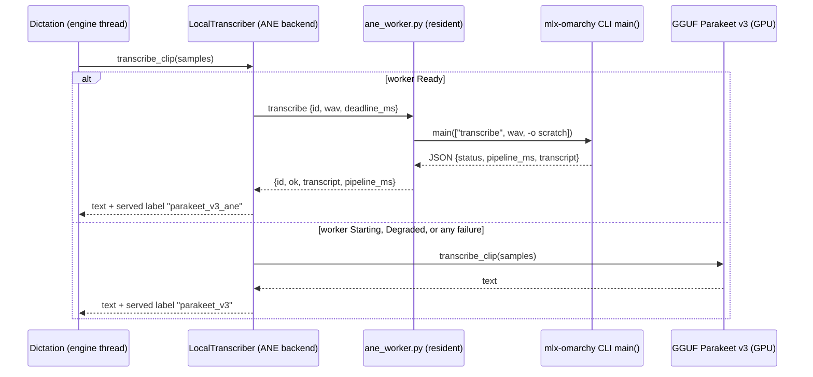
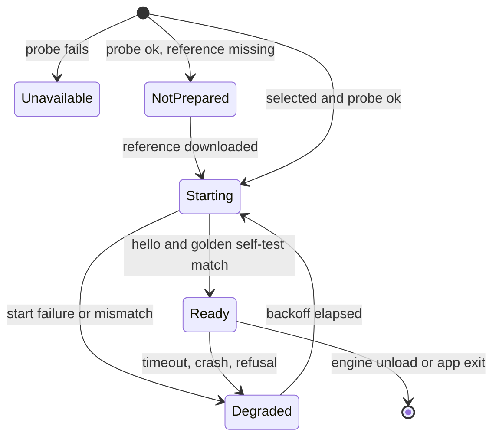

# Apple Neural Engine Parakeet Engine - Plan

## Goal Capsule

- **Objective:** On Apple Silicon Linux, a local dictation finishes faster than the GPU Parakeet path and than Groq cloud at no cost, without the GPU doing the heavy work, and nobody on any other machine sees or pays for the feature.
- **Means:** A resident, WordInk-supervised worker process that drives the installed `mlx-omarchy-parakeet` runtime, surfaced as one more local model with the GPU Parakeet v3 as its silent fallback (KTD1, KTD2).
- **Authority:** Product Contract wins on behavior; a KTD wins on mechanism within it; units override neither.
- **Execution profile:** `code`, Rust in `apps/desktop` plus one embedded Python shim. Units land as separate PRs against `master` (protected, squash-only). Test-first for U1 and U2 (recorded-fixture contracts); smoke-first for U3 and U4.
- **Stop conditions:** Stop and return to the owner if the U3 spike shows the worker cannot stay warm across different audio files, or if warm round-trip latency is not below the GPU path's on the same clip.
- **Finishing:** The implementer opens the PRs; the owner reviews and decides promotion out of Labs (Open Questions).

## Product Contract

### Summary

WordInk's desktop app gains an engine, "Parakeet v3 (Neural Engine)", for Linux on Apple Silicon. It appears in the local model picker only where the Apple Neural Engine driver and the `mlx-omarchy` runtime are present and healthy, and it is off behind a Labs toggle until promoted. It keeps one warm worker, so a dictation never pays a cold start. Any failure routes that dictation to the existing GPU Parakeet v3 without a dialog. Usage stats show it as its own engine row.

### Problem Frame

The local Parakeet v3 path runs on the GPU through Vulkan (transcribe.cpp). On an M1 Max a 9.5 s clip takes about 0.85 s, and the GPU stays busy while the user's compositor and apps want it. The Neural Engine on the same chip is idle. The installed `mlx-omarchy-parakeet` runtime already transcribes on it: a 10 s clip in 0.52 s warm (about 19x real time) and a 127 s meeting in 2.7 s (about 47x), with transcripts matching the runtime's pinned golden reference.

The runtime ships only as a CLI. Measured here, one cold invocation of the CLI on its 10.4 s pinned clip reports 1.44 s of pipeline time (1.15 s of it the encoder's device and bundle load) and about 2.0-2.3 s wall including interpreter start. Repeated runs inside one process drop to 0.58 s (mel 6 ms, encoder 441 ms, decode 72 ms). A process per dictation would therefore be slower than the GPU path. The value exists only if the session stays resident.

### Requirements

#### Engine and fallback

- R1. A model "Parakeet v3 (Neural Engine)" transcribes complete dictation clips on the Neural Engine through the installed `mlx-omarchy-parakeet` runtime.
- R2. The model is listed only on Linux aarch64 with its Labs toggle on and a probe that finds the Neural Engine device node usable and the runtime resolvable; it is selectable only once the runtime's reference model is also prepared. Until then the card says what is missing. Nowhere else does it appear.
- R3. When the saved selection is this model and it cannot run, WordInk runs Parakeet v3 on the GPU instead, with no dialog, banner, or lost dictation. The saved selection is kept.
- R4. A dictation never waits for a Neural Engine cold start: while the worker is not ready, that dictation runs on the GPU model and the worker warms in the background.
- R5. A failed, refused, or timed-out Neural Engine transcription is retried once on the GPU model within the same dictation, and the worker enters a bounded backoff before the next start attempt.

#### Warm session

- R6. One worker process stays resident per app instance after first successful start, serves requests one at a time, and exits when the app exits or the engine unloads (including Labs, Unload model when idle).
- R7. Warm round-trip latency (WAV handed over to transcript returned) for a dictation of about 10 s is below the GPU model's on the same clip, measured on the target hardware.

#### Surface and stats

- R8. The model picker card keeps the current desktop look: same card layout, name, speed, license, and coverage fields, with the card's detail text saying why it is not yet selectable or still warming.
- R9. `wordink usage` and the Usage pane show the engine as its own row with p50, p95, and real-time factor, attributed to the engine that actually served each dictation, including fallbacks.
- R10. Dictation text, history, and paste behavior are unchanged; the engine returns the same raw-text contract as other local engines.

#### Safety and constraints

- R11. Audio reaches the worker only through owner-only temporary files in a private directory, deleted on every path, and never leaves the machine.
- R12. The feature is a Labs toggle, off by default, listed only on Linux aarch64 (matches the Labs convention for user-visible additions).
- R13. Tests make no live model, network, or paid calls; they use recorded fixtures and a protocol test double.
- R14. The repository carries no personal or machine-specific strings: no hostnames, home paths, personal names, emails, or tracker ids.
- R15. The external runtime and driver are optional, never bundled or linked, and their licenses and the model's attribution are recorded in the notices files.

### Key Decisions

- **Dictation only in v1.** Meetings, captures, and the local API keep using the GPU model: the runtime returns no word timestamps and no streaming. Governs R1, R10.
- **Ship behind Labs, off by default.** Promotion after a soak is the owner's call. Governs R12.
- **GPU fallback is lazy, not pre-warmed.** Keeping the GPU model resident would defeat "GPU free"; the fallback path pays a model load, and so does the first dictation after each app launch or idle unload while the worker starts. The worker starts at app launch when the engine is selected, so that window usually passes before the first dictation. Governs R3, R4, R5.
- **Dictation only in v1 is a confirmed assumption awaiting owner sign-off** (Open Questions); U4's caller enumeration builds on it.

### Scope Boundaries

Out of scope for this plan and not planned later:

- Streaming or live partials on the Neural Engine path (considered and not built: dictation clips transcribe in about half a second; a stream would need runtime support that does not exist).
- Vocabulary biasing on this engine (the runtime has no biasing input; the GPU model keeps it).
- An in-app Prepare action (considered and not built: the card names the runtime's own `download` command, leaving it out harms nobody unnoticed, and adding it later touches no stored data; revisit if users stall at the not-prepared card).
- Bundling or auto-installing `mlx-omarchy` or the `omarchy-ane` driver (both are the user's system's business; considered and not built because licensing and kernel-module installation are out of WordInk's remit).
- Any change to the Python SDK dictation daemon, the gateway, or the web packages.

Deferred to Follow-Up Work:

- Word timestamps for meetings and captures on the Neural Engine, if the runtime later exposes them.
- Promotion out of Labs and auto-preferring this engine for a saved Parakeet v3 selection.
- Contributing a first-class `serve` mode upstream (Open Questions) and swapping the shim for it.

### Success Criteria

- On the target hardware, warm p50 for dictations of 5-15 s is under the GPU model's, read from `wordink usage` rows after a day of use, and under the Groq row's p50 from the same stats on the same machine.
- Zero dictations lost to engine failure in the fault-injection tests (U3, U5).
- On a machine without the Neural Engine, no new row, card, or log line appears, and startup time is unchanged.

### Outstanding Questions

Deferred to implementation:

- The exact `status` vocabulary the CLI prints for non-pinned audio (U2 records it from fixtures).
- The `--json` schema of the runtime's `mlx-omarchy-info` (U1 records it from a captured sample).
- Worker resident memory and the per-request deadline constants (U3 measures, then sets).

## Planning Contract

### Key Technical Decisions

- KTD1. **Long-lived worker over per-call subprocess or in-process library.** Per-call is measured at about 2 s, slower than the GPU path. The runtime is not a library: the CLI is a script inside the runtime's own package directory with no stable import surface, a Python 3.14 interpreter, and MLX native modules, so linking it into a Rust binary is not viable. Residency inside one process is real (`--repeat` shows it), so WordInk runs that process itself. Alternatives rejected: the runtime's own ANE-worker daemon plus a CLI per call (saves only the encoder load, still pays interpreter and decoder start, and couples to seal and bundle arguments that are internal); a pure Rust reimplementation (the model, mel, TDT decode and sealed ANE bundles are the runtime's work).
- KTD2. **The shim drives the CLI's `main`, not its internals.** The embedded `ane_worker.py` is run by the runtime's own interpreter, loads the installed CLI script once, and for each request calls `main(["transcribe", <wav>, "-o", <scratch>, "--deadline-ms", N])` with stdout captured, then parses the JSON the CLI prints (`status`, `total_pipeline_ms`, `transcript`). Three runtime facts shape this. `N` is one fixed value chosen at worker start, because the runtime's shared ANE session is keyed on its deadline and a different value retires the warm session; clip-length-scaled timeouts belong to the Rust supervisor only. After the KTD4 self-test passes with a full cache verify, the worker's environment sets `MLX_OMARCHY_PK_TRUST_CACHE=1`, because every `main()` call otherwise re-hashes the multi-gigabyte reference cache (`--repeat` pays that once). `main()` raises refusals as exceptions and exits only for argument errors, so the shim loads the extensionless script with `SourceFileLoader`, catches `Exception` and `SystemExit` per request, replies `ok:false`, and then exits after any exception so the supervisor starts a clean worker. That couples WordInk to the CLI's documented command line and output, not to private functions. The U3 spike must confirm that process-level warmth survives repeated `main()` calls with different audio; if it does not, the stop condition fires.
- KTD3. **Protocol: JSON lines over stdin and a private fd, EOF is the lease.** The shim duplicates the original stdout to a private descriptor for protocol replies and points fd 1 at stderr, so anything the runtime prints cannot corrupt a reply. Requests: `hello`, `transcribe {id, wav, deadline_ms}`, `shutdown`. Replies carry `id`, `ok`, and either `transcript` and `pipeline_ms` or `code` and `message`. stdin EOF means exit, matching the lease pattern the desktop's embedded service already uses.
- KTD4. **Self-test with the runtime's own pinned fixture.** On first start the worker runs `transcribe` with no audio argument, which runs the runtime's golden contract on its own cached, licensed clip and returns `status: match`. That proves the runtime, driver, and device work together, doubles as the warm-up, and means WordInk bundles no audio.
- KTD5. **Probe is cheap and never loads a model.** It checks platform, device node access, runtime resolution (explicit override, then `PATH`, then the runtime's usual per-user install location), the runtime's own `mlx-omarchy-info --json` Neural Engine fields, and the presence of the runtime's prepared reference directory (the `NotPrepared` signal; U1 records the exact marker from the runtime's layout). It runs off the UI thread, caches its verdict for a short TTL, and records a reason string for the card. The slow golden check belongs to worker start, not the probe.
- KTD6. **New model id, one seam, one owner of fallback.** `parakeet_v3_ane` is a catalog entry with a new `ModelRuntime` variant. The Linux `LocalTranscriber` stays the engine's single model type and gains an internal backend (GGUF or worker); `LocalTranscriber::load` dispatches on the selection and returns at once in the `Starting` state, so the engine thread, `ModelSwap`, and `WarmLocal` are unchanged. The worker-backed `LocalTranscriber` owns the supervisor, starts the worker, and owns a lazily built GGUF Parakeet v3 session that serves any dictation while the worker is not `Ready` or has failed; it drops that session on idle unload. This follows the Parakeet Ultra precedent: `available()` gates listing and `custom_models::runnable` supplies the fallback selection.
- KTD7. **Usage attribution by the engine that served.** Local dictations currently record the saved selection's id. This plan returns the served engine's label with the transcription, so a fallback dictation is counted under the GPU model and the Neural Engine row stays honest.
- KTD8. **Interpreter resolution is explicit.** An environment override first, else the interpreter named by the runtime's launcher script, spawned directly: no shell, no `PATH` lookup of `python`. A bad path fails at spawn and lands in the GPU fallback.
- KTD9. **Licensing posture.** The runtime is MIT; the driver and userspace are `GPL-2.0-only OR MIT`; the model weights are CC-BY-4.0 inheriting NVIDIA's Parakeet v3. WordInk executes the runtime as a separate process and opens no driver interface itself, so no copyleft attaches. Weights are fetched only by the user's own run of the runtime's `download` command and are not redistributed.

### High-Level Technical Design

Component and request flow:

Worker state machine owned by the Rust side:

Backoff doubles from a few seconds up to a cap of minutes, and resets after a success. Dictations in `Starting` and `Degraded` use the GPU model.

### Assumptions

- The runtime's CLI prints one JSON object to stdout on success and exits non-zero or prints `error:` to stderr on refusal; U2 verifies both from recorded samples before relying on them.
- The owner's installed runtime stays at its current major behavior; the self-test (KTD4) is the guard against drift, not a version allowlist.
- 16 kHz mono PCM16 WAV is accepted natively by the CLI (its help states 16 kHz mono is native).

### Risks and Dependencies

- **Private-API drift.** The CLI's output shape may change. Mitigation: KTD4's self-test fails closed into the GPU fallback; the protocol and CLI parsing are isolated in the shim so one file changes.
- **GPU is not fully idle.** The runtime's mel frontend and TDT decode run on the GPU through MLX (about 80 ms of a 576 ms warm run); only the encoder, the bulk, is on the Neural Engine. The plan claims less GPU load, not none, and the docs say so.
- **Warm residency across `main()` calls is inferred from `--repeat`, not proven.** U3 is a measured spike with a stop condition.
- **Resident memory.** The worker holds MLX and model state; U3 measures it and the unload-when-idle path must release it.
- **Runtime scratch left by a killed worker.** The CLI makes its own scratch directories under its cache root; a process-group kill can leave them. U3 checks and, if they persist, sweeps those created during the killed request.
- **Disk traffic per call.** The CLI writes intermediate arrays to its output directory; the shim points it at a private scratch directory and deletes it after each request. U3 measures the cost.
- **Dependencies.** `mlx-omarchy` (MIT) and the Neural Engine driver are external and optional; the desktop builds and passes CI on all platforms without them.

### System-Wide Impact

- Linux `LocalTranscriber` callers that need word times or streams (meetings, captures, local API, `/streams`) must keep receiving the GPU model; U4 enumerates them.
- The picker, Settings, Labs, `wordink usage`, and docs gain one engine; macOS and Windows code paths are untouched.
- Golden screenshots change only if the new card renders in a golden fixture; the card is hidden by default in fixtures, and any new golden is regenerated per the desktop guide.

## Implementation Units

| U-ID | Title | Files touched | Depends on |
|---|---|---|---|
| U1 | Runtime probe and discovery | `src/transcription/ane/probe.rs`, fixtures | none |
| U2 | Worker shim and protocol | `resources/ane/ane_worker.py`, `src/transcription/ane/protocol.rs` | U1 |
| U3 | Worker supervisor and warm-session spike | `src/transcription/ane/worker.rs` | U1, U2 |
| U4 | Model id, Labs toggle, and backend seam | `models.rs`, `labs.rs`, `local_transcriber.rs` | U3 |
| U5 | Fallback and failure routing | `local_transcriber.rs`, `custom_models.rs` | U4 |
| U6 | Picker card and usage attribution | `rune_ui/picker.rs`, `history.rs`, `linux/dictation.rs` | U4, U5 |
| U7 | Docs, notices, and dogfood measurement | `docs/linux.md`, notices files | U6 |

### U1. Runtime probe and discovery

- **Goal:** Decide cheaply and safely whether the Neural Engine engine can exist on this machine, and say why not.
- **Requirements:** R2, R14, R15, R13.
- **Dependencies:** none.
- **Files:**
  - Create `apps/desktop/src/transcription/ane.rs` and `apps/desktop/src/transcription/ane/probe.rs`
  - Create `apps/desktop/tests/fixtures/ane/info-ready.json`, `info-no-ane.json`
  - Test: unit tests inside `probe.rs`
- **Approach:**
  - Probe order: target platform, device node access (metadata and permission check, never a long-held open), runtime discovery (override, `PATH`, per-user install location), then the runtime's `mlx-omarchy-info --json` Neural Engine fields.
  - Result is an enum with a human reason (`Unavailable(reason)`, `NotPrepared`, `Available`), cached with a short TTL, run off the UI thread.
  - Interpreter resolution per KTD8 lives here.
- **Patterns to follow:** `src/transcription/gpu_health.rs` for cached device verdicts; `src/hardware.rs` for platform gating.
- **Test scenarios:**
  - Fixture `info-ready.json` with the prepared reference directory present yields `Available`; the same fixture without it yields `NotPrepared`; `info-no-ane.json` yields `Unavailable` with a reason naming the missing Neural Engine.
  - Device node absent, present but not writable, and present and writable each map to distinct reasons.
  - Runtime not found yields `Unavailable` without spawning anything.
  - Non-Linux or non-aarch64 target short-circuits with no filesystem access.
  - Cached verdict is reused within the TTL and recomputed after it.
- **Verification:** On a machine without the runtime the probe returns `Unavailable` and spawns no process; fixtures contain no personal paths or hostnames.

### U2. Worker shim and protocol

- **Goal:** A small embedded Python program that holds the runtime warm and serves the KTD3 protocol, with a Rust-side codec.
- **Requirements:** R1, R6, R11, R13, R15.
- **Dependencies:** U1.
- **Files:**
  - Create `apps/desktop/resources/ane/ane_worker.py` (MIT header, embedded with `include_str!`)
  - Create `apps/desktop/src/transcription/ane/protocol.rs`
  - Create `apps/desktop/tests/fixtures/ane/cli-match.json`, `cli-refusal.txt`, `stub_cli.py` (models both raised exceptions and return codes, as the real `main()` does)
  - Test: `apps/desktop/tests/ane_worker_protocol.rs`
- **Approach:**
  - The shim takes `--cli-script PATH` (default: the installed runtime's CLI), loads it once with `importlib`, redirects fd 1 to stderr and keeps the original stdout as the protocol channel.
  - `hello` returns protocol and runtime versions; first `transcribe`-less start runs the KTD4 self-test and replies only after `status: match`.
  - Each `transcribe` runs `main([...])` per KTD2, captures stdout, parses the JSON, removes the scratch directory in a `finally`, and replies; a raised exception, `SystemExit`, non-zero return, a status other than `match`, or unparsable output becomes `ok:false` with a code, and an exception also ends the worker after the reply.
  - Rust `protocol.rs` encodes and decodes the lines and validates `id` echo and size caps.
- **Technical design:** Request `{"id":7,"op":"transcribe","wav":"<path>","deadline_ms":8000}`; reply `{"id":7,"ok":true,"transcript":"...","pipeline_ms":576}` or `{"id":7,"ok":false,"code":"refused","message":"..."}`.
- **Test scenarios:**
  - Against `stub_cli.py` returning the recorded `cli-match.json`, a `transcribe` round trip returns the recorded transcript and `pipeline_ms`.
  - Stub printing extra text before the JSON (a runtime banner) does not corrupt the reply channel.
  - Stub raising a refusal exception yields `ok:false, code:refused` and then the shim exits; stub returning non-zero with a non-`match` status yields `ok:false` and the shim keeps serving.
  - Self-test mismatch (stub returns `status` other than `match`) makes `hello` fail.
  - stdin EOF makes the shim exit promptly and remove its scratch directory.
  - Scratch directory is removed after success and after failure.
  - Oversized or malformed request lines are rejected without crashing the shim.
  - Test skips with a visible note when no Python 3 is on the test machine.
- **Verification:** The shim's tests pass using only the stub; no runtime, model, or network is touched.

### U3. Worker supervisor and warm-session spike

- **Goal:** Rust-side lifecycle: spawn, handshake, health, deadlines, backoff, shutdown. Prove the session really stays warm.
- **Requirements:** R4, R5, R6, R7, R11.
- **Dependencies:** U1, U2.
- **Files:**
  - Create `apps/desktop/src/transcription/ane/worker.rs`
  - Test: `apps/desktop/tests/ane_worker_supervisor.rs` (uses the stub shim and a hanging variant)
- **Approach:**
  - Spawn with the runtime's interpreter in its own process group, stdin piped (lease), a private runtime directory mode 0700 for WAVs and scratch, stale files swept at start.
  - State machine per the design; the engine thread asks `try_transcribe(samples)`, which returns the text or a typed "not ready / failed" result, never blocking on a cold start (R4).
  - The supervisor's per-request timeout is an initial constant plus a fraction of the clip length (the CLI's own `--deadline-ms` stays fixed, KTD2); on expiry the process group is killed, the state goes to `Degraded`, and backoff grows (R5). U3's measurement step sets the constants.
  - Shutdown closes stdin, waits briefly, then kills the group; app exit and engine unload both call it.
  - **Spike (measured, on the target hardware, not in CI):** after a golden self-test, send five distinct recorded clips of 3, 8, 15, 40 and 127 s and record wall-clock round trip (not only `pipeline_ms`), per-call verify cost, resident memory, scratch disk time, and whether the worker respawned between clips of different length. Record results in the PR description. If warm round-trip for the 8 s clip is not below the GPU model's on the same clip, or if the second distinct clip is cold or respawns the worker, stop (Goal Capsule stop condition).
- **Execution note:** Build the supervisor against the stub first; run the spike last and gate U4 on its result.
- **Test scenarios:**
  - Start, hello, and self-test success moves `Starting` to `Ready`.
  - Request while `Starting` returns "not ready" immediately.
  - Hanging worker: request exceeds its deadline, group is killed, state is `Degraded`, no orphan process remains.
  - Worker crash mid-request (stub exits) yields a failed result and `Degraded`.
  - Backoff doubles per consecutive failure up to its cap and resets after one success.
  - Shutdown leaves no child and no files in the private directory.
  - Stale WAVs from a previous crashed run are removed at start.
  - Two requests in a row are served in order with matching ids.
- **Verification:** Supervisor tests pass offline; the spike numbers are recorded and meet R7, or work stops.

### U4. Model id, Labs toggle, and backend seam

- **Goal:** Make the engine selectable through the existing model machinery with the GPU model untouched.
- **Requirements:** R1, R2, R10, R12.
- **Dependencies:** U3.
- **Files:**
  - Modify `apps/desktop/src/transcription/models.rs` (id `parakeet_v3_ane`, new `ModelRuntime` variant, catalog entry, `available()`)
  - Modify `apps/desktop/src/labs.rs` (feature, flag bit, storage key, copy, platform listing)
  - Modify `apps/desktop/src/transcription/local_transcriber.rs` (internal backend, `load` dispatch)
  - Modify `apps/desktop/src/app_settings.rs` only if the new Labs key needs registering
  - Test: tests beside each in-file `#[cfg(test)]` module
- **Approach:**
  - Catalog entry reuses Parakeet v3 facts (license CC-BY-4.0, languages, no hint, no detection), `streams: false`, `timestamps` stated as none, speed label filled from U3's numbers.
  - The model is listed when the Labs toggle is on and the probe says `Available` or `NotPrepared`, and `available()` (selectable) is true only for `Available`; `is_labs_gated` includes the new id so the fallback selection logic applies (KTD6).
  - The worker backend exposes the same methods the engine uses (`transcribe_clip`, `prewarm`, `device_label`, `warm_ms`, `matches_selection`); `with_stream` returns `None`; word-time methods return a typed "unsupported" so callers route to the GPU model.
  - Enumerate and cover every Linux caller that needs word times or streams: meeting transcripts, capture, local API and service, `/streams`.
- **Patterns to follow:** Parakeet Ultra's Labs bit, `available()` arm, and `runnable` handling.
- **Test scenarios:**
  - With Labs off or probe `Unavailable`, the model is absent from picker choices; with `NotPrepared` it is listed but `available()` is false.
  - Wire name `parakeet_v3_ane` round-trips through settings; an older build's decode failure keeps the default without rewriting the file (existing behavior stays true).
  - `LocalTranscriber::load` for the new selection builds the worker backend; for every other selection it builds the GGUF backend exactly as before.
  - A caller requesting word times with the worker backend active receives the GPU model path (one test per enumerated caller).
  - macOS and Windows builds compile with the new variant and list nothing new.
- **Verification:** Existing model, labs, and settings tests pass unchanged; no behavior change with the toggle off.

### U5. Fallback and failure routing

- **Goal:** Make R3, R4, and R5 true end to end.
- **Requirements:** R3, R4, R5, R10.
- **Dependencies:** U4.
- **Files:**
  - Modify `apps/desktop/src/transcription/local_transcriber.rs`
  - Modify `apps/desktop/src/transcription/custom_models.rs` (`runnable`, `fallback`) for the saved-selection case
  - Test: in-file tests plus `apps/desktop/src/transcription/engine.rs` tests with the fake worker
- **Approach:**
  - Inside the worker-backed `LocalTranscriber` (KTD6), a dictation uses the worker only when `Ready`; otherwise it uses the lazily built GGUF session while the worker warms in the background (R4). `ModelSwap` is untouched.
  - A failed request is retried once on the GGUF session inside the same job, and the job's deadline accounts for both attempts.
  - The GGUF fallback loads lazily on first need and unloads under the existing idle policy; when the GGUF model is not installed, the dictation reports the engine's existing "no local model installed" error rather than a new one.
- **Test scenarios:**
  - Worker `Starting`: dictation runs on the GPU backend, text returned, worker becomes `Ready` afterwards and the next dictation uses it.
  - Worker timeout mid-dictation: the same dictation returns GPU text, no error surfaced, state is `Degraded`.
  - Worker `Degraded` within backoff: dictations run on the GPU without spawning attempts.
  - Saved selection is the new id while the Labs toggle is off: `runnable` yields the GPU selection and the saved value is unchanged.
  - Fallback model not installed: the existing no-model error appears once, not a new message.
  - Engine drop while a worker request is in flight cancels it and leaves no child.
- **Verification:** Fault-injection tests prove no dictation is lost in any failure mode listed.

### U6. Picker card and usage attribution

- **Goal:** Show the engine where users look and count it truthfully.
- **Requirements:** R8, R9, R3.
- **Dependencies:** U4, U5.
- **Files:**
  - Modify `apps/desktop/src/rune_ui/picker.rs` and `apps/desktop/src/rune_ui/model_details.rs` (card detail text for the unavailable and warming states)
  - Modify `apps/desktop/src/linux/dictation.rs` and `apps/desktop/src/transcription/engine.rs` (served-engine label in `Transcribed`)
  - Modify `apps/desktop/src/history/usage.rs` only if row labels need a friendly name
  - Test: `apps/desktop/src/history/usage.rs` tests, picker tests, golden tests per the desktop guide
- **Approach:**
  - The card uses the existing component; no new widgets, colors, or layout (R8).
  - The not-prepared card detail names the runtime's own `download` command; WordInk never downloads the model.
  - `UsageRecord::local` receives the served engine id, so a fallback dictation lands on `parakeet_v3` (KTD7). `inference_ms` is the served attempt's own time: the worker round trip for the engine, and only the GPU attempt for a fallback dictation (a timed-out worker wait is not charged to the GPU row), returned with the served label from the transcriber.
- **Patterns to follow:** Parakeet Ultra's credit and details handling in the picker; `usage.rs` fixtures built from `tests/fixtures/history.json` style records.
- **Test scenarios:**
  - Card absent when Labs is off or the probe is `Unavailable`; present with the Parakeet v3 facts otherwise.
  - Card is listed but not selectable for `NotPrepared`, with detail text naming the `download` command; text differs for warming and degraded.
  - Usage summary from synthetic history with mixed `parakeet_v3_ane` and `parakeet_v3` records yields two rows, each with p50, p95, and real-time factor computed from its own records.
  - A dictation served by fallback is recorded under the GPU id even though the saved selection is the new id.
  - `wordink usage --json` output includes the new engine row with the existing field set.
  - A fallback dictation after a worker timeout records only the GPU attempt's time.
  - Golden images regenerate only for the new card state, reviewed per the desktop guide.
- **Verification:** The picker looks like its neighbors in the golden diff; usage rows read correctly in a recorded-history run.

### U7. Docs, notices, and dogfood measurement

- **Goal:** Make the feature discoverable, attributable, and measured against the success criteria.
- **Requirements:** R14, R15, Success Criteria.
- **Dependencies:** U6.
- **Files:**
  - Modify `apps/desktop/docs/linux.md`, `apps/desktop/docs/features/labs.md`, `apps/desktop/docs/features/dictation.md`
  - Modify `apps/desktop/THIRD_PARTY_NOTICES.md` and `THIRD_PARTY_NOTICES.md`
  - Modify `apps/desktop/ROADMAP.md` if it tracks Linux engine work
- **Approach:**
  - Document requirements (kernel driver, runtime, running its `download` command), what the fallback does, and that the GPU still does mel and decode.
  - Notices record the runtime (MIT), the driver (`GPL-2.0-only OR MIT`, not bundled), and the model attribution (CC-BY-4.0).
  - Run the repo's private-string check against the tree before the PR.
- **Test expectation:** none -- documentation; the scrub check is the gate.
- **Verification:** The scrub check passes and the docs name no host, user, or path.

## Verification Contract

- `cd apps/desktop && cargo fmt --all --check`
- `cd apps/desktop && cargo clippy --locked --bin wordink --tests -- -D warnings`
- `cd apps/desktop && cargo test --locked --bin wordink` and `cargo test --locked --test '*'`
- Golden tests on Linux for any picker change (`HEX_UPDATE_GOLDENS=1 cargo test --locked --bin wordink rune_ui`), every changed image reviewed.
- `scripts/scrub-check.sh` with a private-strings expressions file before each PR.
- U3 spike results recorded in the PR; R7 is measured on the target hardware, not asserted from CI.
- No test touches a real model, driver, network, or paid service; the shim and supervisor tests run against stubs and recorded fixtures.

## Definition of Done

- All R1-R15 hold; U1-U7 merged as separate PRs with passing CI.
- With the toggle off or on non-target machines, behavior and startup time are unchanged.
- Abandoned spike code and experimental flags are removed from the diff.
- Docs and notices updated; scrub check clean.
- The owner has the recorded spike numbers and the first day's `wordink usage` rows to decide on promotion.

## Open Questions

Needs the owner's decision (none block U1-U3):

- Should WordInk, after a soak, auto-prefer this engine whenever a Parakeet v3 selection runs on a healthy Neural Engine host, or stay an explicit pick?
- Should the shim be replaced by an upstream `serve` subcommand? The runtime's maintainers would need to accept it; this plan does not depend on that.
- Confirm dictation-only for v1 (meetings would need word timestamps the runtime does not return).

## Sources and Research

- Runtime CLI surface and warm behavior: `mlx-omarchy-parakeet transcribe --help`, the CLI's module docstring, and the runtime's resident ANE worker client (process-private worker, optional daemon).
- Measured 2026-11-04 on an M1 Max: cold 1.44 s pipeline (encoder 1.15 s), warm 0.58 s for the 10.4 s pinned clip; `--repeat` run 2 and 3 identical.
- Existing seams: `apps/desktop/src/transcription/local_transcriber.rs`, `src/transcription/models.rs`, `src/transcription/engine.rs`, `src/labs.rs` (Parakeet Ultra precedent), `src/history/usage.rs`, `src/linux/dictation.rs`.
- Licenses read from installed metadata: runtime MIT; driver and userspace `GPL-2.0-only OR MIT`; Parakeet v3 weights CC-BY-4.0.
