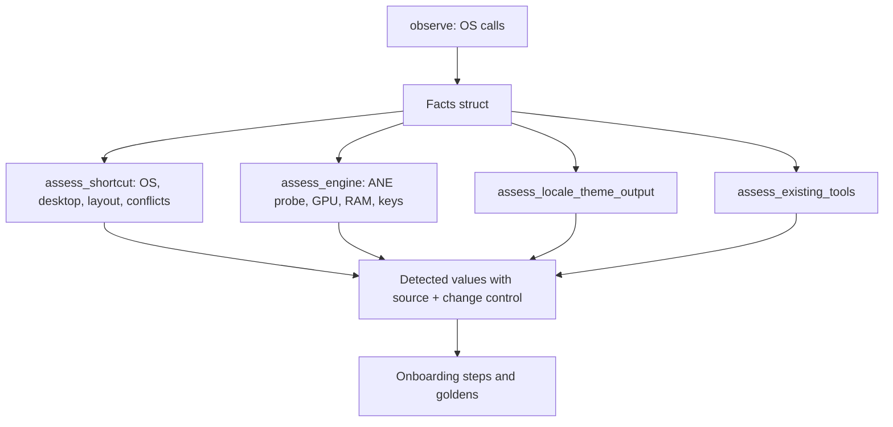
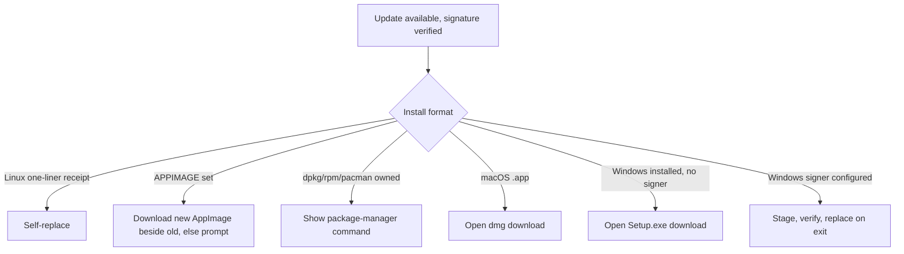

# WordInk Open Work, Onboarding Auto-Detect and Easy Desktop Release - Plan

## Goal Capsule

- **Objective:** A new user on Windows, macOS or Linux downloads WordInk from one link, opens it with clear first-launch steps, and finishes a first run whose every choice (shortcut, engine, model, microphone, language, look) already matches their own machine, with a correct logo everywhere and a working update path. The open issue backlog moves to merged or explicitly owner-gated work.
- **Means:** One PR per implementation unit from `master`, quick wins first: issue triage, an onboarding hardcoded-name sweep, a pure-fact detector layer behind the onboarding (KTD1), the release group (icons, installers, updater, 1.0.1 prep), then #114 with #115, then #112 with #113 prep.
- **Authority:** Product Contract wins on behavior; a KTD wins on mechanism within it; units override neither. The owner merges, tags and publishes; agents never merge, tag, publish to npm or cut a release.
- **Execution profile:** `code`. Rust in `apps/desktop`, CI workflows, docs. Test-first for the detector layer (U3) and updater format routing (U7); smoke-first for packaging (U5, U6, U8) through the release workflow's dry-run mode.
- **Stop conditions:** Stop a unit and report when it would need a paid model call, a paid signing certificate, real Windows or Mac hardware, or a merge/tag/publish. Stop U9 if macOS event-tap changes cannot be proved on the `macos-26` CI runner.
- **Finishing:** The implementer opens the PRs with green CI; the owner reviews, merges in the stated order, cuts `desktop-v1.0.1`, approves #160's workflows and decides #164.

---

## Product Contract

### Summary

The first run stops assuming the developer's own machine. Each onboarding step reads the user's OS, keyboard, microphone, accelerator, locale and theme, shows what it found, and offers a way to change it. Releases ship installers that look right and open cleanly on each OS, and the in-app updater does the correct thing for each install format. The remaining open issues each get a PR, a checklist, a harness or a written spike, sized to what can be proved without paid services or real Mac/Windows hardware.

### Problem Frame

Merged #162 and #163 made the microphone and GPU lines real, but the rest of the first run still carries fixed values: a Mac keycap drawing on every OS, a "MacBook Pro Microphone" demo device, Groq and Parakeet v3 named as the only choices, an "English" pill, and no Apple Neural Engine path even where the ANE engine exists. The 1.0.0 release has no installer assets, so the README download links 404. The Windows icon generator writes a file name nobody reads, the dmg ships without its art, the updater points installed Windows copies at a zip, and AppImage users get no update path. Eleven issues have sat open since 1.0.

### Requirements

**Triage**

- R1. #157 is closed with a comment linking merged #159; #118's body no longer claims v3.2.0.
- R2. #160 gets one review comment naming the targets it still drops (`hex::capture`, `hex_config`); #160 and #164 are listed for the owner, untouched otherwise.

**Onboarding auto-detect**

- R3. No onboarding step, string, locale entry or golden depicts a fixed device, vendor, model or person name as if it were the user's; demo fixtures use neutral names.
- R4. Modifier and key names follow the running OS: Option and Command on macOS, Alt and Ctrl elsewhere, with the keycap drawing matching the platform.
- R5. The default shortcut is chosen from the OS, desktop and active keyboard layout, and is checked against shortcuts the system or another dictation tool already holds.
- R6. The accelerator line distinguishes Apple Neural Engine (Apple silicon Linux with the ANE runtime), Metal, Vulkan, CUDA and CPU-only.
- R7. The recommended engine follows the detected hardware: the ANE Parakeet engine when available, local Parakeet on a usable GPU, cloud otherwise; the cloud choice names the provider the user can actually configure.
- R8. Language comes from the system locale, appearance from the system theme, and the feedback-sound device from the system default output.
- R9. Existing installs of other dictation tools (voxtype, the Python `wordink-dictd`) are detected and named with an offer to import or a warning about their hotkey.
- R10. Every detected value is shown with a control to change it.

**Easy desktop release (all OS)**

- R11. Download: README and the docs site download links resolve to versionless assets on `releases/latest` once 1.0.1 is published.
- R12. Open: unsigned first-launch steps (SmartScreen "More info" then "Run anyway"; macOS Privacy & Security "Open Anyway") are in both READMEs and on the docs download page; the macOS dmg shows a WordInk background, an Applications alias and a volume icon; the Windows installer stays per-user with a Start Menu entry and an uninstall entry.
- R13. Setup: a first launch on every OS goes straight into the auto-detect onboarding.
- R14. Logo: every icon size each OS needs is generated from one source and is WordInk-branded, and CI fails when a size is missing.
- R15. Update: each install format gets the right update action (KTD6), with a manual per-OS update checklist.
- R16. `desktop-v1.0.1` is ready to cut: versions agree in every manifest, CHANGELOG and release notes are drafted, and a dry-run of the release workflow produces and smoke-tests every artifact.

**Issue units**

- R17. #114: the Cancel shortcut and Esc-twice cancel a recording on Windows and macOS as they do on Linux.
- R18. #115: every user-facing string in the newer panes and onboarding has an entry in every shipped language, and the completeness test covers those files.
- R20. #112: a precise manual Mac/Windows checklist exists, plus a CI smoke for what can be automated.
- R22. #113: signing and notarization steps exist in the release workflow, run only when their secrets exist, and are documented.
- R23. #116, #117, #118, #154, #155, #156 are commented as deferred.

### Scope Boundaries

- Real-device verification on Mac and Windows, buying certificates, and Windows in-app self-update (needs Authenticode per the #113 acceptance criteria) are owner work.
- No change to `legacy_dictation_default_for`, saved-settings formats, or the update manifest schema.
- No re-adding `wordink dictation cancel`: upstream removed it by design (`docs/voxtype-parity.md`).
- Considered and not built: a runtime telemetry check of detector accuracy (no telemetry leaves the device, `AGENTS.md`).

### Deferred to Follow-Up Work

- #117, #154, #155, #156: deferred; each gets a one-line comment saying so.
- #116 (benchmark harness) and #118 (scheduled upstream check): deferred; `scripts/hex-sync.sh --dry-run` already covers manual upstream checks.
- Renaming the Cargo package from `hex` and the `HEX_*` env vars: tangential, breaks upstream sync.

---

## Planning Contract

### Key Technical Decisions

- KTD1. **Detectors are plain observed-fact structs plus pure assess functions.** Mirrors `apps/desktop/src/hardware/gpu.rs` (`Observed` plus `assess`) and `mic_line::pick` from #162/#163; tests construct facts by hand instead of trait mocks. One new `onboarding_detect` module gathers OS, desktop, layout, locale, theme, output device, accelerator, dictation-tool and hotkey-conflict facts; only its `observe()` touches the OS.
- KTD2. **ANE availability reuses `transcription/ane/probe.rs`.** The onboarding never re-implements `/dev/accel` checks; ANE ranks above GPU Parakeet only when the probe says healthy and the Labs engine is available on that build.
- KTD3. **Default shortcut keeps `HotkeyBinding::dictation_default_for` as the base.** Layout detection only swaps the key when Space is not a usable physical key name on the active layout, and conflict detection moves to the next candidate rather than inventing new defaults.
- KTD4. **Translations are machine-drafted and marked unreviewed.** The repo already ships pt, fr and zh-Hant tables headed "Not yet reviewed by a native speaker"; new entries follow that convention with a per-entry review marker comment.
- KTD5. **One icon source, one generator.** `app/AppIcon.icon/Assets/Image.png` plus a new SVG master generate the Windows `.ico` (16, 20, 24, 32, 40, 48, 64, 128, 256), Linux hicolor PNGs and scalable SVG, and the macOS icns via `actool`; a CI script checks the generated set against a manifest.
- KTD6. **Update action by install format.** One-liner Linux install: signed self-update (unchanged). AppImage (`APPIMAGE` env set): verified download of the new AppImage beside the old, else a "download new version" prompt. deb/rpm/pacman: package-manager notice (unchanged). macOS `.app`: open the dmg download. Windows installed: open the `WordInk-Setup-windows-x64.exe` download, not the zip; staged self-update stays gated on a configured Authenticode signer (#113 owner comment).
- KTD7. **Dry-run is the release proof.** `desktop-release.yml` `workflow_dispatch` with `dry_run=true` builds, packages and installer-checks every OS without signing or a release; U8 runs it on its branch and links the artifact.
- KTD8. **Signing steps are additive and secret-gated.** Each step checks its secret exists and skips with a notice otherwise, so unsigned dry-runs and forks stay green.

### High-Level Technical Design

Detector flow (KTD1, KTD2):

Update routing by install format (KTD6):

### Sequencing and merge order

Units ship as four PRs, merged in this order:

1. Onboarding auto-detect: U2, U3, U4.
2. Release readiness: U5, U6, U7, U8, proved by one release dry-run.
3. Cancel parity and translations: U9, U10 (rebases on PR 1 for the i18n tables and goldens).
4. Hardware checklist and signing prep: U12, U14.

U1 is tracker-only. U8's CHANGELOG entry lists everything in PRs 1 and 2.

### Assumptions

- Headless run: scope was not confirmed interactively. The owner's message is the scope.
- The ANE engine from the 2026-11-04 plan is merged and its probe is reusable.
- Machine translation is acceptable because the repo already ships unreviewed tables (KTD4).
- macOS behavior is proved by `macos-26` CI compile and unit tests only.

---

## Implementation Units

| U-ID | Title | Key files | Depends on |
|---|---|---|---|
| U1 | Triage #157, #118, #160, #164 | GitHub only | none |
| U2 | Onboarding hardcoded-name sweep | `apps/desktop/src/rune_ui/onboarding_kit/*` | none |
| U3 | Onboarding detector layer | `apps/desktop/src/onboarding_detect.rs` | U2 |
| U4 | Detected values in onboarding UI | `apps/desktop/src/rune_ui/onboarding_kit/*`, goldens | U3 |
| U5 | Icon set and CI check | `apps/desktop/scripts/icons/*` | none |
| U6 | Installers and first launch | `apps/desktop/packaging/*`, READMEs, `apps/docs/desktop.html` | U5 |
| U7 | Updater per install format | `apps/desktop/src/updater/*` | none |
| U8 | desktop-v1.0.1 prep and dry-run | CHANGELOG, `docs/releasing.md` | U5-U7 |
| U9 | Cancel parity (#114) | `apps/desktop/src/windows/*`, `apps/desktop/src/macos_rune.rs` | none |
| U10 | Translations (#115) | `apps/desktop/src/desktop/i18n*` | U4 |
| U12 | Hardware checklist (#112) | `docs/hardware-verification.md` | none |
| U14 | Signing prep (#113) | `.github/workflows/desktop-release.yml`, `docs/signing.md` | none |

### U1. Triage #157, #118, #160, #164

- **Goal:** Close what is done and hand the owner-gated PRs back.
- **Requirements:** R1, R2.
- **Files:** none.
- **Approach:** Comment on #157 linking #159 and close it. Update #118 to the v3.3.0 commit. Post one comment on #160 naming `apps/desktop/src/capture_host.rs` (`hex::capture`) and `personal_commands/script.rs` (`hex_config`) as targets its filter now drops.
- **Test expectation:** none -- issue tracker only.
- **Verification:** #157 closed; #160 has the comment.

### U2. Onboarding hardcoded-name sweep

- **Goal:** Remove fixed device, vendor, model and person names from onboarding output.
- **Requirements:** R3, R4.
- **Dependencies:** none.
- **Files:** `apps/desktop/src/rune_ui/onboarding_kit/{mic_line,keyboard,pill,stories,engine_setup}.rs`, `apps/desktop/src/rune_ui/scenes.rs`, `apps/desktop/src/rune_ui/onboarding.rs`, i18n tables, `apps/desktop/tests/golden/rune-onboarding-*`, new test `apps/desktop/src/rune_ui/tests/onboarding_names.rs`.
- **Approach:**
  1. Replace `DEMO_NAME` and scene fixtures with a neutral "Built-in Microphone".
  2. Draw the keycap row per OS (fn, Option, Command on macOS; Ctrl, Win, Alt elsewhere) using `rune_ui/platform.rs` naming.
  3. Make the key-check copy provider-neutral where the provider is a choice.
- **Test scenarios:**
  - A denylist test fails if any onboarding source or golden-scene string contains MacBook, AirPods, NVIDIA, a person name or a hard model name outside a fixture module.
  - Keycap row on a Windows `DefaultOs` shows Ctrl and Alt, no Option or Command glyph.
  - Keycap row on macOS shows Option and Command.
- **Verification:** goldens regenerated and reviewed; `cargo test --bin wordink` passes on all four CI legs.

### U3. Onboarding detector layer

- **Goal:** One module that observes the machine and returns each detected value with its source.
- **Requirements:** R5, R6, R7, R8, R9.
- **Dependencies:** U2.
- **Files:** `apps/desktop/src/onboarding_detect.rs` (new) and `apps/desktop/src/onboarding_detect/tests.rs`; reads `hardware.rs`, `hardware/gpu.rs`, `transcription/ane/probe.rs`, `keyboard_input_sources/*`, `desktop/i18n.rs`, `voxtype_import.rs`, `linux/gnome_shortcuts.rs`.
- **Approach:** Per KTD1, KTD2, KTD3. Add output-device listing next to the input listing in `audio`. Accelerator classification extends `hardware::recommend` with an ANE rung. Hotkey-conflict facts come only from sources the app can read without privileges: GNOME custom and system keybindings (`linux/gnome_shortcuts.rs`), the voxtype config and the `wordink-dictd` config; other desktops report "not checked" rather than "no conflict".
- **Execution note:** test-first with hand-built facts.
- **Test scenarios:**
  - Apple silicon Linux with a healthy ANE probe recommends the ANE Parakeet engine; with the probe failing it recommends GPU Parakeet.
  - x86 with only a software Vulkan adapter recommends cloud and labels the accelerator CPU-only.
  - macOS facts yield Option+Space; GNOME facts yield Ctrl+Alt+Space; a facts set where Ctrl+Alt+Space is already bound moves to the next candidate.
  - A Polish locale yields Polish; an unsupported locale falls back to English with the source shown as "fallback".
  - A voxtype config present yields an "existing tool" entry with its hotkey.
  - No output device yields "sounds off" rather than a panic.
- **Verification:** all scenarios pass on four CI legs; `observe()` is the only OS-touching function.

### U4. Detected values in onboarding UI

- **Goal:** Each step shows the detected value, why, and a change control.
- **Requirements:** R7, R10, R13.
- **Dependencies:** U3.
- **Files:** `apps/desktop/src/rune_ui/onboarding_kit/{engine_setup,live,first_run}.rs`, `apps/desktop/src/rune_ui/scenes.rs`, `apps/desktop/src/rune_ui/tests/onboarding_check.rs`, goldens, `apps/desktop/docs/features/` onboarding map.
- **Approach:** Add scenes for ANE, CPU-only, conflict and existing-tool cases. Each change control routes to the existing settings control for that value.
- **Test scenarios:**
  - Scene "ane-recommended" renders the ANE line and a Change control.
  - Scene "hotkey-conflict" names the conflicting tool and the chosen alternative.
  - Linux first launch without the completion marker opens onboarding (R13).
- **Verification:** goldens regenerated on Linux; feature map updated.

### U5. Icon set and CI check

- **Goal:** Every OS icon size generated from one WordInk source, checked in CI.
- **Requirements:** R14.
- **Dependencies:** none.
- **Files:** `apps/desktop/scripts/icons/generate.sh` and `apps/desktop/scripts/icons/manifest.txt` (new), `apps/desktop/scripts/windows-icon.ps1`, `apps/desktop/resources/windows/wordink.ico`, `apps/desktop/packaging/linux/icons/hicolor/*`, `.github/workflows/desktop.yml`.
- **Approach:** Per KTD5. Fix `windows-icon.ps1` writing `hex.ico`. Add the scalable SVG to nfpm and the AppImage. Upload a contact sheet of every size as a CI artifact.
- **Test scenarios:**
  - The check fails when one hicolor size is deleted and passes on the full set.
  - The `.ico` parse lists all nine sizes.
- **Verification:** CI artifact contact sheet shows no blurry or Hex-branded size.

### U6. Installers and first launch

- **Goal:** Installers that open cleanly and look right on each OS.
- **Requirements:** R11, R12, R13.
- **Dependencies:** U5.
- **Files:** `apps/desktop/packaging/macos/make-dmg.sh`, `apps/desktop/packaging/macos/dmg/*`, `apps/desktop/packaging/windows/wordink.iss`, `apps/desktop/scripts/test-windows-installer.ps1`, `README.md`, `apps/desktop/README.md`, `apps/docs/desktop.html`.
- **Approach:** Replace the Hex dmg art with WordInk art and wire background, volume icon and Applications alias. Assert per-user install, Start Menu and uninstall entries in the installer test. Put unsigned first-launch steps on the docs download page.
- **Execution note:** smoke-first through the dry-run.
- **Test scenarios:**
  - Installer test asserts install under `%LOCALAPPDATA%\Programs\WordInk`, a Start Menu shortcut and an HKCU uninstall key.
  - Dmg check mounts the image and finds `WordInk.app`, `Applications` and `.VolumeIcon.icns`.
- **Verification:** dry-run `check-installers` passes on all four legs.

### U7. Updater per install format

- **Goal:** The update action matches KTD6 for each format.
- **Requirements:** R15.
- **Dependencies:** none.
- **Files:** `apps/desktop/src/updater/{linux,windows,macos,protocol}.rs` and their tests, `docs/release-checklist.md` update section.
- **Approach:** Detect AppImage via `APPIMAGE`; verify the downloaded AppImage against the ed25519-signed `SHA256SUMS` before swapping. Point Windows `DOWNLOAD_TARGET` at the Setup exe. Replace leftover Hex wording. Add a per-OS manual update checklist.
- **Execution note:** test-first on the routing function.
- **Test scenarios:**
  - `APPIMAGE` set routes to the AppImage path; a bad signature leaves the old file untouched and returns an actionable error.
  - A dpkg-owned path routes to the package-manager notice.
  - Windows with the placeholder signer routes to the Setup exe URL.
  - A dev-channel manifest is ignored by a stable build.
- **Verification:** updater tests pass on four legs.

### U8. desktop-v1.0.1 prep and dry-run

- **Goal:** A release the owner can cut by pushing one tag.
- **Requirements:** R11, R16.
- **Dependencies:** U5, U6, U7.
- **Files:** `apps/desktop/Cargo.toml`, `apps/desktop/CHANGELOG.md`, `docs/releasing.md`, `docs/release-checklist.md`, `docs/release-notes/desktop-v1.0.1.md` (new).
- **Approach:** Bump with `set-crate-version.sh`. Draft notes. Run the dry-run per KTD7 on the branch and link the run.
- **Test expectation:** none -- version and docs; proof is the dry-run.
- **Verification:** dry-run green with all installers; versions agree.

### U9. Cancel parity (#114)

- **Goal:** Cancel works on Windows and macOS.
- **Requirements:** R17.
- **Dependencies:** none.
- **Files:** `apps/desktop/src/windows/{app,input}.rs`, `apps/desktop/src/macos_rune.rs`, `apps/desktop/src/suppression*`, `apps/desktop/src/control/settings.rs`, `docs/voxtype-parity.md`.
- **Approach:** Mirror `linux/input.rs` first-Escape state as a shared pure state machine; wire the Windows hook and macOS event tap to it.
- **Test scenarios:**
  - Escape then Escape within the window cancels; Escape then other key does not.
  - The bound Cancel shortcut while recording cancels and plays the cancel sound; while idle does nothing.
- **Verification:** tests pass on Windows and macOS legs; settings copy no longer says "don't act on it yet".

### U10. Translations (#115)

- **Goal:** Full language coverage for the newer panes and onboarding.
- **Requirements:** R18.
- **Dependencies:** U4.
- **Files:** `apps/desktop/src/desktop/i18n.rs` and `i18n/*.rs`.
- **Approach:** Add the missing files to the `SOURCES` list in the completeness test, then fill entries per KTD4.
- **Test scenarios:**
  - `every_translated_string_has_every_language` covers `engine_setup.rs`, `privacy.rs`, `recovery.rs`, `usage.rs`, `cloud_engine.rs`, `replacements.rs` and passes.
- **Verification:** test green; goldens unchanged unless a scene renders a non-English locale.

### U12. Hardware checklist (#112)

- **Goal:** A precise manual Mac/Windows checklist plus CI smoke.
- **Requirements:** R20.
- **Files:** `docs/hardware-verification.md` (new), `.github/workflows/desktop.yml`.
- **Approach:** Expand the #112 list into numbered steps with expected results, reusing `docs/release-checklist.md`. CI smoke runs `wordink --version` and the headless self-checks on the Windows and macOS legs.
- **Test expectation:** none -- docs and a smoke step.
- **Verification:** smoke green on both legs.

### U14. Signing prep (#113)

- **Goal:** Signing steps ready to switch on with secrets.
- **Requirements:** R22.
- **Files:** `.github/workflows/desktop-release.yml`, `apps/desktop/scripts/macos-signing.sh`, `apps/desktop/scripts/notarize-app.sh`, `docs/signing.md` (new).
- **Approach:** Per KTD8. Windows signtool step and macOS codesign plus notarytool steps, each skipped with a notice when its secret is absent.
- **Test expectation:** none -- workflow wiring; proof is an unsigned dry-run still passing and workflow-lint green.
- **Verification:** dry-run shows the skip notices.

---

## Verification Contract

| Gate | Command | Applies to |
|---|---|---|
| Format and lint | `cargo fmt --all --check`; `cargo clippy --locked --bin wordink --tests -- -D warnings` (in `apps/desktop`) | U2-U10 |
| Desktop tests | `cargo test --locked --bin wordink`; `cargo test --locked --test '*'` | U2-U10 |
| Goldens | `HEX_UPDATE_GOLDENS=1 cargo test --locked --bin wordink rune_ui` on Linux, every changed image reviewed | U2, U4, U10 |
| Release dry-run | `desktop-release.yml` dispatch with `dry_run=true` | PR 2 (one run) |
| Scrub | no hostnames, home paths, personal names | all |

## Definition of Done

- Each of the four PRs is open from `master` with green CI and an issue reference ("Closes #N" only when fully done).
- No merge, tag, npm publish or release by an agent.
- Owner hand-off lists hardware checks, certificates, #160 workflow approval and the #164 decision.
- No abandoned-attempt code left in any diff.
